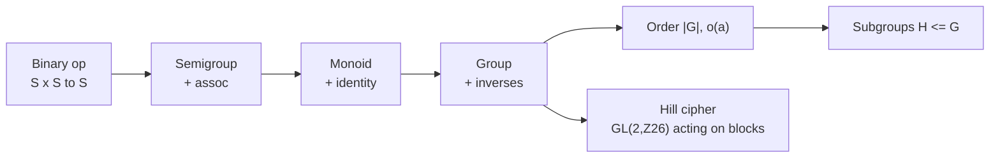

# Cheat Sheet — Lectures 01–02 (groups: axioms → order → subgroups)

Full notes: [[lecture-01/notes.md]], [[lecture-02/notes.md]].
Proof templates for lecture 1 alone: [[lecture-01/proofs-cheat-sheet.md]].

---

## 0. The 60-second map

Lecture 1 = the definition and its immediate theorems. Lecture 2 = measure elements
(order) and look inside (subgroups), plus the CS payoff (Hill cipher). Rings and fields
are next and repeat this exact pattern with two operations.

---

## 1. Definitions to reproduce verbatim

| Term | Statement |
|---|---|
| Binary operation | $*:S\times S\to S,\ (x,y)\mapsto x*y$ — the codomain $S$ **is** closure |
| Group | $(G,*)$ with (G1) $\forall a,b,c:\ a(bc)=(ab)c$; (G2) $\exists e\,\forall a:\ ae=a=ea$; (G3) $\forall a\,\exists b:\ ab=e=ba$ |
| Abelian | group + $\forall a,b:\ ab=ba$ |
| Semigroup | closed + associative |
| Monoid | semigroup + identity |
| $\lvert G\rvert$ | number of elements; finite vs infinite group |
| $o(a)$ | least $n\ge1$ with $a^n=e$; infinite order if none |
| Subgroup | $H\neq\varnothing\subseteq G$ with $(H,*)$ a group, written $H\le G$ |
| Relation | $R\subseteq A\times B$; on $A$: $R\subseteq A\times A$ |
| Equivalence relation | reflexive + symmetric + transitive |
| Equivalence class | $[x]=\{y\in A: y\,R\,x\}$ |
| Congruence | $a\equiv b\pmod n\iff n\mid(a-b)$ |
| Well defined (on classes) | $[a]=[a'],\,[b]=[b']\Rightarrow[a*b]=[a'*b']$ |

**Quantifier traps.** (G2) is $\exists e\,\forall a$ (one $e$ for all); (G3) is
$\forall a\,\exists b$ ($b$ may depend on $a$). Swapping (G2) makes it vacuous.

---

## 2. "$(G,*)$ is a group" — six headings, in this order

| # | Heading | The sentence that earns the mark |
|---|---|---|
| 1 | Well defined | "Let $[a]=[a']$, $[b]=[b']$; then $a=a'+nt$, $b=b'+ns$, so the outputs differ by a multiple of $n$." |
| 2 | Closed | "Let $a,b\in G$; then $a*b=\dots\in G$ because …" (e.g. $a,c\neq0\Rightarrow ac\neq0$) |
| 3 | Associative | "$(a*b)*c=\dots=a*(b*c)$, using associativity in $\mathbb{R}$/$\mathbb{Z}$." |
| 4 | Identity | "Solve $a*c=a$: $c=\dots$. This lies in $G$, and $a*e=e*a=a$." |
| 5 | Inverse | "Solve $a*c=e$: $c=\dots$. It lies in $G$, and $a*c=c*a=e$." |
| 6 | Commutative | only if "abelian": "$a*b=\dots=b*a$." |

Then: "Therefore $(G,*)$ is a[n abelian] group. $\blacksquare$"

**Never** write "obvious"; **never** claim associativity from a Cayley table.

**"Not a group" = name the axiom + one witness:**
closure $\mathbb{N}$: $3-5\notin\mathbb{N}$ · associative $\mathbb{Z}$: $(1-2)-3\neq1-(2-3)$ ·
identity $(2\mathbb{Z},\cdot)$: $1\notin2\mathbb{Z}$ · inverse $\mathbb{Q}$: $0b=0\neq1$ ·
$M_2(\mathbb{R})$: $\begin{bmatrix}1&2\\0&0\end{bmatrix}$, $\det0$ · commutative
$GL(2,\mathbb{R})$: $\begin{bmatrix}1&2\\0&3\end{bmatrix}\begin{bmatrix}2&1\\3&0\end{bmatrix}\neq\begin{bmatrix}2&1\\3&0\end{bmatrix}\begin{bmatrix}1&2\\0&3\end{bmatrix}$.

---

## 3. Proof bank (everything examinable from L1–L2)

### 3.1 Identity unique
$e,e_1$ identities $\Rightarrow e_1=e_1e=e$. $\blacksquare$

### 3.2 Inverse unique
$b,c$ both invert $a$: $b=be=b(ac)=(ba)c=ec=c$. $\blacksquare$

### 3.3 $(a^{-1})^{-1}=a$
$aa^{-1}=e=a^{-1}a$ says $a$ inverts $a^{-1}$; uniqueness ⇒ equal.
*(Lecture method: $a^{-1}(a^{-1})^{-1}=e$, left-multiply by $a$, regroup.)*

### 3.4 $(ab)^{-1}=b^{-1}a^{-1}$
$(ab)(b^{-1}a^{-1})=a(bb^{-1})a^{-1}=aa^{-1}=e$ and likewise on the left ⇒ uniqueness.
**Order reverses.**

### 3.5 Cancellation
$ac=bc\Rightarrow(ac)c^{-1}=(bc)c^{-1}\Rightarrow a(cc^{-1})=b(cc^{-1})\Rightarrow a=b$.
Left version: multiply by $c^{-1}$ on the left. (Needs an inverse — fails in
$(\mathbb{Z}_6,\cdot)$: $2\cdot3=2\cdot0$.)

### 3.6 Congruence mod $n$ is an equivalence relation
reflexive $\frac{a-a}{n}=0$ · symmetric $\frac{b-a}{n}=-t$ · transitive
$\frac{a-c}{n}=\frac{a-b}{n}+\frac{b-c}{n}=r+s$. $\blacksquare$

### 3.7 $\mathbb{Z}_n$ has exactly $n$ classes
$a=nq+r,\ 0\le r<n\Rightarrow[a]=[r]$; if $0\le r<s<n$ then $0<s-r<n$, so $n\nmid(s-r)$,
so $[r]\neq[s]$. $\blacksquare$

### 3.8 $(\mathbb{Z}_5,+)$ is an abelian group
well defined ($a=a'+5t,\ b=b'+5s\Rightarrow$ sum differs by $5(t+s)$) → closed →
$[a]+([b]+[c])=[a+(b+c)]=[(a+b)+c]$ → identity $[0]$ → inverse $[-a]$ →
$[a]+[b]=[b+a]$. $\blacksquare$

### 3.9 Finite group ⇒ every element has finite order
$a,a^2,\dots,a^{|G|+1}\in G$; pigeonhole $a^k=a^l$, $k>l$; multiply by $a^{-l}$:
$a^{k-l}=e$. Hence $o(a)\le|G|$. $\blacksquare$ *(Converse false: $\begin{bmatrix}0&-1\\-1&0\end{bmatrix}$ has order 2 in infinite $GL(2,\mathbb{R})$; $\begin{bmatrix}1&1\\0&1\end{bmatrix}$ has infinite order.)*

### 3.10 $o(a)=n$, $a^m=e\Rightarrow n\mid m$
$m=nq+r$, $0\le r<n$; then $a^r=a^{m-nq}=a^m(a^n)^{-q}=e$. Minimality ⇒ $r=0$ ⇒ $n\mid m$.
$\blacksquare$

### 3.11 $o(a^t)=n/\gcd(t,n)$
$d=\gcd(t,n)$, $t=du$, $n=dv$, $\gcd(u,v)=1$; $k=o(a^t)$.
(i) $(a^t)^k=e\Rightarrow a^{tk}=e\Rightarrow n\mid tk\Rightarrow dv\mid duk\Rightarrow v\mid uk\Rightarrow v\mid k$.
(ii) $(a^t)^v=a^{duv}=a^{nv}=(a^n)^u=e\Rightarrow k\mid v$.
So $k=v=n/d$. $\blacksquare$

### 3.12 One-step subgroup test
$H\le G\iff H\neq\varnothing$ and $\forall a,b\in H:\ ab^{-1}\in H$.

(⇒) $b\in H\Rightarrow b^{-1}\in H$; closure ⇒ $ab^{-1}\in H$.

(⇐) $x\in H$ ⇒ $e=xx^{-1}\in H$; then $x^{-1}=ex^{-1}\in H$; then
$xy=x(y^{-1})^{-1}\in H$; associativity inherited ⇒ $H$ is a group. $\blacksquare$

**Additive form:** $a-b\in H$. **Order of constructions is forced** — $e$ before
$x^{-1}$, $x^{-1}$ before $xy$.

### 3.13 Finite subgroup test
$H$ finite, nonempty, closed under $ab$ ⇒ $H\le G$.
$b\in H$ ⇒ $b,b^2,\dots\in H$ finite ⇒ $b^i=b^j$ ⇒ $e=b^{j-i}\in H$ and
$b^{-1}=b^{j-i-1}\in H$; closure ⇒ $ab^{-1}\in H$; apply 3.12. $\blacksquare$
**Finiteness is essential:** $\mathbb{N}\subseteq\mathbb{Z}$ is closed under $+$ and not a
subgroup.

---

## 4. Counterexample bank

| Claim to kill | Witness |
|---|---|
| $(\mathbb{N},-)$ closed | $3-5=-2\notin\mathbb{N}$ |
| $(\mathbb{Z},-)$ associative | $(1-2)-3=-4\neq2$ |
| $(\mathbb{Z},\cdot)$ group | $2b=1$ has no $b\in\mathbb{Z}$ |
| $(2\mathbb{Z},\cdot)$ has identity | $1\notin2\mathbb{Z}$ |
| $(\mathbb{Q},\cdot)$ group | $0\cdot b=0\neq1$ |
| $(M(2,\mathbb{R}),\times)$ group | $\det\begin{bmatrix}1&2\\0&0\end{bmatrix}=0$ |
| $GL(2,\mathbb{R})$ abelian | $\begin{bmatrix}1&2\\0&3\end{bmatrix},\begin{bmatrix}2&1\\3&0\end{bmatrix}$ |
| $SL(2,\mathbb{R})$ abelian | $\begin{bmatrix}1&1\\0&1\end{bmatrix},\begin{bmatrix}1&0\\1&1\end{bmatrix}$ |
| every element of an infinite group has infinite order | $\begin{bmatrix}0&-1\\-1&0\end{bmatrix}^2=I_2$ |
| closed ⇒ subgroup | $\mathbb{N}\le(\mathbb{Z},+)$ fails |
| $[x]=[y]$ never happens for distinct reps | $[1]=[6]$ in $\mathbb{Z}_5$ |
| key invertible because $\det\neq0$ | $K=\operatorname{diag}(1,13)$, $\gcd(13,26)=13$ |

---

## 5. Cayley tables: what to read, and the two standard examples

**Read off:** closed = every cell in $G$; identity = row/column copying the header;
inverse of $a$ = column where row $a$ hits $e$; abelian = symmetric about the diagonal.
**Associativity cannot be read off — prove it.**

**$(\mathbb{Z}_5,+)$** identity $[0]$; inverses $[0],[4],[3],[2],[1]$;
orders $1,5,5,5,5$ for $[0],[1],[2],[3],[4]$.

**$(\mathbb{Z}_6,+)$** identity $[0]$; inverses $[0],[5],[4],[3],[2],[1]$;
orders $1,6,3,2,3,6$.

**$(\mathbb{Z}_5^*,\times)=\{[1],[2],[3],[4]\}$** identity $[1]$;
inverses $[1],[3],[2],[4]$; orders $1,4,4,2$.

Cross-check any of these with $o(a^t)=n/\gcd(t,n)$ using a generator ($[1]$ in
$\mathbb{Z}_6$; $[2]$ in $\mathbb{Z}_5^*$).

---

## 6. Hill cipher — all of it on one card

$$
C=KP\bmod 26,\qquad P=K^{-1}C\bmod 26,\qquad
K^{-1}=(\det K)^{-1}\operatorname{adj}(K)\bmod 26,
$$
$$
\det\begin{bmatrix}a&b\\c&d\end{bmatrix}=ad-bc,\qquad
\operatorname{adj}\begin{bmatrix}a&b\\c&d\end{bmatrix}=\begin{bmatrix}d&-b\\-c&a\end{bmatrix}.
$$

**Key usable $\iff\gcd(\det K,26)=1$.** $A=0,\dots,Z=25$; block size = size of $K$;
$26=2\cdot13$ so $\det K$ must be odd and not divisible by 13.

**Lecture example, all numbers:** $K=\begin{bmatrix}2&3\\3&6\end{bmatrix}$, $\det=3$,
$\gcd(3,26)=1$, $3^{-1}=9$ (since $9\cdot3=27=26+1$),
$\operatorname{adj}K=\begin{bmatrix}6&-3\\-3&2\end{bmatrix}$,
$K^{-1}=9\operatorname{adj}K=\begin{bmatrix}54&-27\\-27&18\end{bmatrix}\equiv\begin{bmatrix}2&25\\25&18\end{bmatrix}$.

| block | $KP$ | mod 26 | letters |
|---|---|---|---|
| $g,o=6,14$ | $(54,102)$ | $(2,24)$ | `cy` |
| $l,d=11,3$ | $(31,51)$ | $(5,25)$ | `fz` |

Round trip: $K^{-1}(2,24)=(604,482)\equiv(6,14)=$`go`;
$K^{-1}(5,25)=(635,575)\equiv(11,3)=$`ld`.

**Extended Euclid for $\det^{-1}$:** $26=8\cdot3+2$, $3=1\cdot2+1$, so
$1=3-(26-8\cdot3)=9\cdot3-26\Rightarrow3^{-1}=9$.

**Failure mode:** $\det K=13$ ⇒ $13x$ is $0$ or $13$ mod 26 ⇒ no inverse ⇒ second digit of
every block destroyed. "Invertible over $\mathbb{R}$" $\neq$ "invertible mod 26".

---

## 7. Notation dictionary (translate every theorem)

| multiplicative | additive |
|---|---|
| $ab$, $a^{-1}$, $e$, $a^n$ | $a+b$, $-a$, $0$, $na$ |
| $(ab)^{-1}=b^{-1}a^{-1}$ | $-(a+b)=(-b)+(-a)$ |
| $(a^{-1})^{-1}=a$ | $-(-a)=a$ |
| $ac=bc\Rightarrow a=b$ | $a+c=b+c\Rightarrow a=b$ |
| $o(a)$: least $n$ with $a^n=e$ | least $n$ with $na=0$ |
| $ab^{-1}\in H$ | $a-b\in H$ |

---

## 8. Traps that cost marks

1. "$\mathbb{Z}$ is a group" — without an operation the sentence is meaningless.
2. Proving associativity before closure.
3. Guessing $e$ instead of solving $a*c=a$.
4. Verifying $a*e=a$ only (need $e*a=a$; they differ in non-abelian $G$).
5. Writing $(ab)^{-1}=a^{-1}b^{-1}$.
6. Confusing well defined with closed for $\mathbb{Z}_n$.
7. Concluding "$X^{-1}=Y$" from $XY=e$ alone — cite uniqueness.
8. Confusing $|G|$ with $o(a)$ ($\mathbb{Z}_6$: $|G|=6$ but $o([2])=3$).
9. Using $o(a^t)=n/\gcd(t,n)$ with $n=|G|$ instead of $n=o(a)$.
10. Using the finite subgroup test on an infinite $H$.
11. Forgetting $H\neq\varnothing$ (the empty set passes the equation vacuously).
12. Claiming $o(a)=n$ from $a^n=e$ without proving no smaller exponent works.
13. Reducing Hill-cipher entries only at the start, or forgetting to reduce the adjugate's
    negatives ($-3\equiv23$).

---

## 9. If the question says … write …

| Question | Answer skeleton |
|---|---|
| "Is $(G,*)$ a group? Justify." | six headings; close with the conclusion sentence |
| "Prove the identity is unique." | $e_1=e_1e=e$ |
| "Prove $(ab)^{-1}=b^{-1}a^{-1}$." | both products $=e$ + uniqueness |
| "Show $H\le G$." | nonempty → general $a,b$ → $ab^{-1}\in H$ → cite one-step test |
| "Find $o(a)$." | list $a,a^2,\dots$ until $e$; state that no earlier one is $e$ |
| "Find $o(a^{12})$ in a group where $o(a)=18$." | $18/\gcd(12,18)=18/6=3$ |
| "Show $\mathbb{Z}_n$ has $n$ classes." | division algorithm + distinctness |
| "Is this Hill key usable?" | compute $\det$, then $\gcd(\det,26)=1$? |
| "Decrypt …" | $K^{-1}$, then $P=K^{-1}C\bmod26$, then round-trip check |
