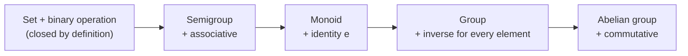
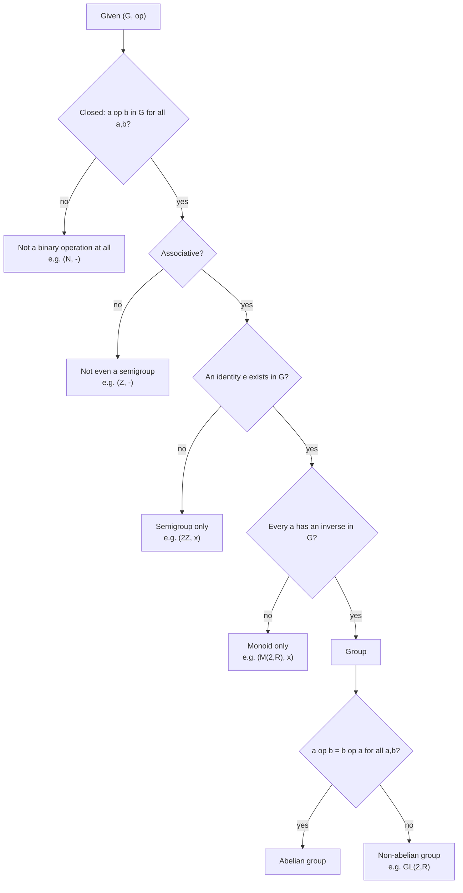

# Lecture 01 — What is a Group? Binary Operations, the Group Axioms, and the First Theorems

> Companion files: [`proofs-cheat-sheet.md`](proofs-cheat-sheet.md) — every proof in this
> lecture reduced to a fill-in-the-blank template for exam use; and
> [`../cheatsheet-lec01-02.md`](../cheatsheet-lec01-02.md) — the combined cheat-sheet for
> Lectures 1–2.

## TL;DR
- A **binary operation** on $S$ is a *function* $* : S\times S \to S$. Writing
  "$\to S$" (and not "$\to$ something bigger") *is* the statement that $S$ is **closed**.
  Closure is a property of the operation, not an extra axiom you may skip.
- A **group** is a pair $(G,*)$ — **set and operation together** — satisfying exactly
  three axioms: **(G1)** associativity, **(G2)** existence of an identity $e$,
  **(G3)** existence of an inverse for every element. Add commutativity and you get an
  **abelian** group. That is *all* a group is: no addition, no numbers, no order.
- The structure ladder is the spine of the whole course:
  **set + closed op → semigroup (+ associative) → monoid (+ identity) → group (+ inverses)
  → abelian group (+ commutative)**.
- The two theorems to know cold: identity and inverse are **unique** (proved by
  "suppose there are two, show they are equal"), and
  $(a^{-1})^{-1}=a$, $(ab)^{-1}=b^{-1}a^{-1}$, plus the **cancellation law**
  $ac=bc \Rightarrow a=b$.
- **$(M(2,\mathbb{R}),\times)$ is not a group** but $(GL(2,\mathbb{R}),\times)$ is
  (kill the singular matrices); $(GL(2,\mathbb{R}),\times)$ is **not** commutative.
  Same set, different operation, different answer — always name both.
- Congruence mod $n$ is an **equivalence relation** (3 short verifications), its classes
  are exactly $[0],\dots,[n-1]$, and $(\mathbb{Z}_5,+)$ is an abelian group — but only
  after you prove the operation $[a]+[b]=[a+b]$ is **well defined**, which is a
  separate obligation from closure and the step students skip most often.

## Where this fits
This is the first lecture of the course, so there is no prerequisite beyond high-school
arithmetic and basic set notation. Everything after it is built on the one definition
given here: Lecture 2 (order of a group/element, subgroups, cyclic groups) takes
$(G,*)$ as given and starts asking *smaller* structures inside it, and the later ring
and field material simply repeats this exact pattern — a set, two operations, a list of
axioms, then a pile of uniqueness and cancellation theorems. Mastering the
**verification ritual** here (well-defined → closed → associative → identity → inverse →
commutative) makes parts 2 and 3 of the course nearly free.

## Learning objectives
After this lecture you should be able to:
- Decide whether a given map $S\times S\to S$ is a binary operation, and give a
  counterexample when a set is not closed under a candidate operation.
- State the group axioms (G1)–(G3) **with their quantifiers in the right order**, and
  place any structure on the ladder semigroup → monoid → group → abelian group.
- Run the full six-step verification on a concrete pair $(G,*)$ — including *finding*
  (not guessing) the identity and the inverse of a general element.
- Prove that the identity and inverses are unique, and prove
  $(a^{-1})^{-1}=a$, $(ab)^{-1}=b^{-1}a^{-1}$, and both cancellation laws, citing the
  axiom used at **every** line.
- Name the exact failing axiom, with a concrete counterexample, when something is *not*
  a group (e.g. $(M(2,\mathbb{R}),\times)$, $(\mathbb{N},-)$, $(\mathbb{Z},\cdot)$).
- Prove congruence mod $n$ is reflexive, symmetric and transitive, and construct
  $\mathbb{Z}_n=\{[0],\dots,[n-1]\}$ from the equivalence classes.
- Prove $(\mathbb{Z}_5,+)$ is an abelian group from scratch, including well-definedness,
  and read identity, inverses and commutativity off its Cayley table.

---

## Full detailed explanation

### 0. The course map (so you know what is being graded)

The course is **Math 333 (2 lecture + 2 section hours)**, 150 marks total:
37 course work + 8 oral + 105 final. Part 1 (groups) course work breaks down as:

| Component | Where | Marks |
|---|---|---|
| Quiz | Lecture 4 | 10 |
| Assignments | throughout | 7 |
| Midterm | Lecture 6 | 20 |

The three content parts are **groups → rings → fields**. This lecture is the whole of
"what a group is"; nothing is assumed.

> **Why this matters for how you study:** the 37 marks in part 1 are almost entirely
> *write a complete proof* marks. A quiz answer that says "it is associative because
> matrix multiplication is associative" earns the mark; one that says "it is obviously a
> group" earns nothing. Every proof below is written the way it must appear on paper.

---

### 1. Two motivating examples — and the abstraction they force

**Intuition.** Mathematicians did not invent the group axioms out of nothing. They
noticed that two completely different-looking systems obey *the same five rules*, and
then threw away everything that was not needed to state those rules. The leftovers are
the definition of a group.

**Example 1 (clock arithmetic).** Take $S=\{0,1,2,3,4,5,6\}$ and add "mod 7": compute
the ordinary sum, then subtract 7 until you land back in $S$. The full table
(redrawn from slide 3):

| $+$ | 0 | 1 | 2 | 3 | 4 | 5 | 6 |
|---|---|---|---|---|---|---|---|
| **0** | 0 | 1 | 2 | 3 | 4 | 5 | 6 |
| **1** | 1 | 2 | 3 | 4 | 5 | 6 | 0 |
| **2** | 2 | 3 | 4 | 5 | 6 | 0 | 1 |
| **3** | 3 | 4 | 5 | 6 | 0 | 1 | 2 |
| **4** | 4 | 5 | 6 | 0 | 1 | 2 | 3 |
| **5** | 5 | 6 | 0 | 1 | 2 | 3 | 4 |
| **6** | 6 | 0 | 1 | 2 | 3 | 4 | 5 |

**Example 2.** $(\mathbb{Z},+)$ with ordinary addition.

The comparison the lecturer builds (slide 3) is the entire point of the lecture:

| Property | $S=\{0,\dots,6\}$, $+\bmod 7$ | $(\mathbb{Z},+)$ |
|---|---|---|
| Elements | $\{0,1,\dots,6\}$ | $\{\dots,-2,-1,0,1,2,\dots\}$ |
| Operation | $+\bmod 7$ | $+$ |
| Closed? | Yes | Yes |
| Associative? | Yes | Yes |
| Identity | $0$ | $0$ |
| Inverses | every element has one | every element has one |

Two sets of wildly different size, one finite and one infinite, behave identically with
respect to these five properties. **That is the abstraction**: keep the five properties,
forget the numbers. (In Lecture 2 language: both are groups, and both are *cyclic* —
$S=\langle 1\rangle$, $\mathbb{Z}=\langle 1\rangle$ — but that is not needed yet.)

> **Watch the wording.** The table's first column is *not* "the same set with a different
> operation"; it is a different set. The lesson is the opposite one: **different sets can
> share the same axioms**, which is why we prove theorems about $(G,*)$ once instead of
> about each example.

---

### 2. Binary operations and closure

**Formal definition.** Let $S$ be a nonempty set. A **binary operation** $*$ on $S$ is a
function

$$
* : S\times S \to S, \qquad (x,y) \mapsto x*y .
$$

**Read the codomain.** The arrow points *into* $S$. So for all $x,y\in S$ we must have
$x*y \in S$. Because the image is contained in $S$, we say $S$ is **closed** under $*$.

**Why closure is not a separate axiom.** A function $S\times S\to S$ cannot output
anything outside $S$ — that is what "$\to S$" means. Closure is therefore *automatic*
once you have genuinely defined a binary operation, and every later "is it closed?"
check is really a check that your formula does not escape the set.

**Examples (slide 4).**

1. $\mathbb{Z}$ is closed under $+$, $-$ and $\times$: for all $x,y\in\mathbb{Z}$,
   $x+y,\ x-y,\ x\cdot y\in\mathbb{Z}$. (Product of two integers is an integer — this
   is the closure of $\mathbb{Z}$ under multiplication, used silently in every
   arithmetic argument in the course.)
2. $\mathbb{N}$ is closed under $+$ but **not** under $-$: $3,5\in\mathbb{N}$ yet
   $3-5=-2\notin\mathbb{N}$. So subtraction is **not** a binary operation on
   $\mathbb{N}$. This single counterexample kills $(\mathbb{N},-)$ at step 0.

**Common pitfalls.**
- Confusing "closed" with "well defined". *Closed* = the output lands in the set.
  *Well defined* = different names for the same input give the same output. The second
  only becomes an issue when elements are **equivalence classes** (see §11) — there,
  $[a]$ has infinitely many names ($a$, $a+n$, $a-n$, …) and you must prove the formula
  does not depend on which name you picked.
- Testing closure on a few examples. Closure is a $\forall$ statement — it needs a
  general argument ($a,c\neq 0 \Rightarrow ac\neq 0$), not two lucky computations.

---

### 3. Definition of a group, and the structure ladder

**Formal definition (slide 4).** A **group** is an ordered pair $(G,*)$ where $G$ is a
nonempty set and $*$ is a binary operation on $G$ such that:

$$
\begin{aligned}
\text{(G1)} &\quad \forall a,b,c\in G:\ a*(b*c) = (a*b)*c && \text{(associative law)}\\
\text{(G2)} &\quad \exists e\in G\ \forall a\in G:\ a*e = a = e*a && \text{(identity)}\\
\text{(G3)} &\quad \forall a\in G\ \exists b\in G:\ a*b = e = b*a && \text{(inverse)}
\end{aligned}
$$

**Definition.** If $(G,*)$ is a group and $a*b=b*a$ for all $a,b\in G$, then $(G,*)$ is
called an **abelian group** (commutative group).

**Quantifier order is the content of (G2) and (G3).** In (G2) the *same* $e$ must work
for every $a$: $\exists e\,\forall a$. Swapping them to $\forall a\,\exists e$ would make
the axiom vacuous (every set would satisfy it by choosing $e=a$). In (G3) the inverse $b$
is allowed to depend on $a$: $\forall a\,\exists b(a)$.

**The structure ladder (slide 4, with the missing rung restored — see Corrections).**

- A **semigroup** is a nonempty set with a binary operation that is *(i)* closed and
  *(ii)* associative.
- A **monoid** is a semigroup **with an identity element**.
- A **group** is a monoid **in which every element has an inverse**.
- An **abelian group** is a group whose operation is **commutative**.

*Read the ladder as "each rung adds exactly one requirement"; a group that fails
commutativity is still a group, just not abelian.*

**The decision procedure you should be able to run in your sleep.**

*This is the flowchart to reproduce in an exam when asked "is $(G,*)$ a group? Justify."*

**Notation rule for the rest of the course.** In a multiplicative group write $ab$,
$a^{-1}$, $e$, $a^n$. In an additive group write $a+b$, $-a$, $0$, $na$. They are the
same theorem in two costumes; when a theorem is stated multiplicatively and you need it
for $(\mathbb{Z},+)$, translate $ab\to a+b$, $a^{-1}\to -a$, $e\to 0$.

**Common pitfalls.**
- "@" (say) "$\mathbb{Z}$ is a group." Meaningless without an operation: $(\mathbb{Z},+)$
  is a group, $(\mathbb{Z},\cdot)$ is only a monoid, $(\mathbb{Z},-)$ is not even a
  semigroup.
- Proving associativity first when closure fails. Fix closure first — otherwise the
  expression $a*b$ is not defined and associativity is not even meaningful.
- Forgetting that $e$ must be *in* $G$ and $b$ must be *in* $G$. In $(2\mathbb{Z},\cdot)$
  the "identity" $1$ exists in $\mathbb{Z}$ but not in $2\mathbb{Z}$ — so that monoid
  has **no** identity.

---

### 4. The five standard examples, worked in full

The lecturer lists them; below each is verified axiom by axiom, because the exam asks for
exactly that.

#### 4.1 $(\mathbb{Z},+)$ is an abelian group (slide 5)

- **Closed.** For $a,b\in\mathbb{Z}$, $a+b\in\mathbb{Z}$. ✔ (closure of $\mathbb{Z}$ under $+$, §2)
- **(G1) Associative.** For $a,b,c\in\mathbb{Z}$,
  $(a+b)+c = a+(b+c)$, the associativity of integer addition. ✔
- **(G2) Identity.** $e=0$ works: $a+0=0+a=a$ for all $a\in\mathbb{Z}$. ✔ (and $0\in\mathbb{Z}$)
- **(G3) Inverses.** Given $a\in\mathbb{Z}$, take $b=-a\in\mathbb{Z}$:
  $a+(-a)=(-a)+a=0$. ✔
- **Commutative.** $a+b=b+a$ for all $a,b\in\mathbb{Z}$. ✔

Hence $(\mathbb{Z},+)$ is an abelian group. The same five lines, with "integer" replaced
by "rational/complex", prove $(\mathbb{Q},+)$, $(\mathbb{R},+)$, $(\mathbb{C},+)$ are
abelian groups (the slide says so without proof; the proofs are identical).

#### 4.2 $(\mathbb{Q}\setminus\{0\},\cdot)$ is an abelian group (slide 5)

- **Closed.** If $a,b\neq 0$ then $ab\neq 0$ — a product of nonzero rationals is nonzero
  (no zero divisors in $\mathbb{Q}$). So $ab\in\mathbb{Q}\setminus\{0\}$. ✔
- **(G1)** $(a\cdot b)\cdot c=a\cdot(b\cdot c)$ for rationals. ✔
- **(G2)** $e=1\in\mathbb{Q}\setminus\{0\}$ and $a\cdot 1=1\cdot a=a$. ✔
- **(G3)** Given $a\neq 0$, take $b=1/a$; this is a nonzero rational, and
  $a\cdot\frac1a=\frac1a\cdot a=1$. ✔ (this is exactly why $0$ was removed)
- **Commutative.** $ab=ba$. ✔

**Why $0$ had to be removed.** In $(\mathbb{Q},\cdot)$ the element $0$ has no inverse:
$0\cdot b=0\neq 1$ for every $b$. So $(\mathbb{Q},\cdot)$ is only a monoid, and
$(\mathbb{Q}\setminus\{0\},\cdot)$ is a group. This "delete the bad elements" move is
the prototype for passing from $M(2,\mathbb{R})$ to $GL(2,\mathbb{R})$ below.

#### 4.3 $(M(2,\mathbb{R}),+)$ is an abelian group; $(M(2,\mathbb{R}),\times)$ is not (slide 5)

Let

$$
M(2,\mathbb{R}) = \left\{\begin{bmatrix} a & b\\ c & d\end{bmatrix} : a,b,c,d\in\mathbb{R}\right\}.
$$

**With $+$:**

- **Closed.** The sum is entrywise,
  $\begin{bmatrix}a&b\\c&d\end{bmatrix}+\begin{bmatrix}e&f\\g&h\end{bmatrix}=\begin{bmatrix}a+e&b+f\\c+g&d+h\end{bmatrix}$,
  and all four entries are real. ✔
- **(G1)** Entrywise: $(a+e)+i = a+(e+i)$ and similarly for the other three entries, by
  associativity of real addition. ✔
- **(G2)** $e=\begin{bmatrix}0&0\\0&0\end{bmatrix}$ (the zero matrix). ✔
- **(G3)** $-\begin{bmatrix}a&b\\c&d\end{bmatrix}=\begin{bmatrix}-a&-b\\-c&-d\end{bmatrix}$. ✔
- **Commutative.** Entrywise addition of reals commutes. ✔

**With $\times$ it fails at (G3).** Matrix multiplication is closed and associative, and
$I_2$ is an identity, so $(M(2,\mathbb{R}),\times)$ **is a monoid** — but not a group:
$\begin{bmatrix}1&2\\0&0\end{bmatrix}$ has $\det=0$ and hence no inverse (a matrix is
invertible iff its determinant is nonzero). So (G3) fails, and that is the *only* axiom
that fails. Naming the precise failing axiom plus one witness is the full answer.

#### 4.4 $GL(2,\mathbb{R})$ — the general linear group (slides 5–6)

$$
GL(2,\mathbb{R}) = \left\{\begin{bmatrix}a&b\\c&d\end{bmatrix} : a,b,c,d\in\mathbb{R},\ |A|\neq 0\right\}.
$$

- **Closed.** This is the step the slide asserts with "$\in GL(2,\mathbb{R})$" and no
  reason. The reason is the product formula for determinants:
  $\det(AB)=\det(A)\det(B)$. If $\det A\neq0$ and $\det B\neq0$ then
  $\det(AB)\neq0$, so $AB\in GL(2,\mathbb{R})$. ✔
- **(G1)** Matrix multiplication is associative — for $2\times 2$ this is a direct
  entrywise computation; the general fact is proved once in linear algebra. ✔
- **(G2)** $I_2=\begin{bmatrix}1&0\\0&1\end{bmatrix}$, and $\det I_2=1\neq0$, so
  $I_2\in GL(2,\mathbb{R})$; and $AI_2=I_2A=A$ for every $A$. ✔
- **(G3)** For $A=\begin{bmatrix}a&b\\c&d\end{bmatrix}$ with $\Delta=ad-bc\neq0$, set

$$
A^{-1}=\frac{1}{\Delta}\begin{bmatrix} d & -b\\ -c & a\end{bmatrix}.
$$

  This is in $GL(2,\mathbb{R})$ because $\det(A^{-1})=\frac{1}{\Delta}\neq 0$. The
  verification the slide only states:

$$
AA^{-1}=\frac{1}{\Delta}\begin{bmatrix} ad-bc & -ab+ba\\ cd-dc & -cb+da\end{bmatrix}
=\frac{1}{\Delta}\begin{bmatrix}\Delta&0\\0&\Delta\end{bmatrix}
=\begin{bmatrix}1&0\\0&1\end{bmatrix}=I_2,
$$

  and $A^{-1}A=I_2$ by the same computation with the factors swapped. ✔
- **Not commutative.** Take $A=\begin{bmatrix}1&2\\0&3\end{bmatrix}$,
  $B=\begin{bmatrix}2&1\\3&0\end{bmatrix}$ (slide 6). Then

$$
AB=\begin{bmatrix}1\cdot2+2\cdot3 & 1\cdot1+2\cdot0\\ 0\cdot2+3\cdot3 & 0\cdot1+3\cdot0\end{bmatrix}
=\begin{bmatrix}8&1\\9&0\end{bmatrix},
\qquad
BA=\begin{bmatrix}2\cdot1+1\cdot0 & 2\cdot2+1\cdot3\\ 3\cdot1+0\cdot0 & 3\cdot2+0\cdot3\end{bmatrix}
=\begin{bmatrix}2&7\\3&6\end{bmatrix}.
$$

  Since $AB\neq BA$, $GL(2,\mathbb{R})$ is **non-abelian**. (One pair of witnesses is
  enough — commutativity is a $\forall$ statement, so a single failure disproves it.)

#### 4.5 $SL(2,\mathbb{R})$ — the special linear group (slide 6)

$$
SL(2,\mathbb{R}) = \left\{\begin{bmatrix}a&b\\c&d\end{bmatrix} : a,b,c,d\in\mathbb{R},\ |A|= 1\right\}.
$$

The slide says "verify". Here is the verification.

- **Closed.** $\det(AB)=\det A\det B=1\cdot1=1$, so $AB\in SL(2,\mathbb{R})$. ✔
- **(G1)** inherited from matrix multiplication. ✔
- **(G2)** $\det I_2=1$, so $I_2\in SL(2,\mathbb{R})$. ✔
- **(G3)** $\det(A^{-1})=1/\det A=1$, so $A^{-1}\in SL(2,\mathbb{R})$. ✔
- **Not commutative.** $A=\begin{bmatrix}1&1\\0&1\end{bmatrix}$ and
  $B=\begin{bmatrix}1&0\\1&1\end{bmatrix}$ both have determinant $1$, but

$$
AB=\begin{bmatrix}2&1\\1&1\end{bmatrix},\qquad BA=\begin{bmatrix}1&1\\1&2\end{bmatrix},
$$

  so $AB\neq BA$. Non-abelian. ✔

> **Careful:** $SL$ is "determinant **equal to** $1$", not "determinant nonzero". That is
> the whole difference from $GL$; writing $|A|\neq0$ here would silently turn $SL$ into
> $GL$.

#### 4.6 The non-examples worth memorising

| Pair | Fails | Witness |
|---|---|---|
| $(\mathbb{N},-)$ | closure | $3-5=-2\notin\mathbb{N}$ |
| $(\mathbb{Z},-)$ | associativity | $(1-2)-3=-4\neq 2=1-(2-3)$ |
| $(\mathbb{Z},\cdot)$ | inverses | $2$ has no $b\in\mathbb{Z}$ with $2b=1$ |
| $(2\mathbb{Z},\cdot)$ | identity | $1\notin 2\mathbb{Z}$ |
| $(\mathbb{Q},\cdot)$ | inverses | $0\cdot b=0\neq1$ |
| $(M(2,\mathbb{R}),\times)$ | inverses | $\begin{bmatrix}1&2\\0&0\end{bmatrix}$, $\det=0$ |
| $(GL(2,\mathbb{R}),\times)$ | commutativity | $\begin{bmatrix}1&2\\0&3\end{bmatrix}$, $\begin{bmatrix}2&1\\3&0\end{bmatrix}$ |

Note the last row is **not** a failure of being a group — commutativity is not a group
axiom.

---

### 5. Theorem: uniqueness of identity and inverse (slide 6)

> **Theorem.** Let $(G,*)$ be a group.
> **(i)** The identity element is unique.
> **(ii)** For every $a\in G$ there is exactly one inverse.

**Proof strategy (the one to reuse all course):** "Suppose there are two. Show they are
equal." Uniqueness is always proved by proving any two candidates coincide.

**(i)** Suppose $e$ and $e_1$ are both identities, i.e. both satisfy (G2). Then

$$
e_1 = e_1 * e = e .
$$

*Justification of each equality:* the first holds because $e$ is an identity, so
$x*e=x$ for all $x$, applied to $x=e_1$. The second holds because $e_1$ is an identity, so
$e_1*y=y$ for all $y$, applied to $y=e$. Hence $e_1=e$: there is only one identity. $\blacksquare$

**(ii)** Let $a\in G$. By (G3) there is at least one $b\in G$ with
$a*b=e=b*a$. Suppose $c\in G$ is another inverse of $a$, i.e. also
$a*c=e=c*a$. We show $b=c$:

$$
\begin{aligned}
b &= b*e && \text{($e$ is an identity)}\\
  &= b*(a*c) && \text{substitute } e=a*c \text{ (valid because } a*c=e\text{)}\\
  &= (b*a)*c && \text{(G1) associativity}\\
  &= e*c && \text{because } b*a=e \text{ ($b$ is an inverse of } a\text{)}\\
  &= c. && \text{($e$ is an identity)}
\end{aligned}
$$

Hence $b=c$ and the inverse is unique; it is denoted $a^{-1}$. $\blacksquare$

**Why the proof is written vertically.** Every line is one *axiom application*; a marker
can check associativity/identity/inverse use at a glance. Losing the middle lines
($b*(a*c)=(b*a)*c$) is the most common way to lose marks here — that step is exactly where
associativity is spent.

**Consequence used constantly later:** because the inverse is unique, *any* $b$ with
$a*b=e=b*a$ **is** $a^{-1}$. That converts every "$(x)^{-1}=y$" proof into "check
$x*y=e=y*x$", which is far easier than manipulating the symbol $(x)^{-1}$.

---

### 6. Theorem: inverse properties and the cancellation law (slides 7–8)

> **Theorem.** Let $(G,*)$ be a group.
> **(1)** $(a^{-1})^{-1}=a$ for all $a\in G$.
> **(2)** $(a*b)^{-1}=b^{-1}*a^{-1}$ for all $a,b\in G$.
> **(3) (Cancellation)** For all $a,b,c\in G$, if $a*c=b*c$ or $c*a=c*b$, then $a=b$.

#### (1) $(a^{-1})^{-1}=a$ — lecture method

Let $a\in G$. By (G3) applied to the element $a^{-1}$,

$$
a^{-1}*(a^{-1})^{-1}=e .
$$

Multiply both sides on the **left** by $a$ (equality is preserved by applying a function
to both sides — here "multiply by $a$"):

$$
a*\bigl(a^{-1}*(a^{-1})^{-1}\bigr)=a*e .
$$

Now use associativity on the left side and (G2) on the right side:

$$
(a*a^{-1})*(a^{-1})^{-1}=a .
$$

Since $a*a^{-1}=e$ and $e*x=x$:

$$
e*(a^{-1})^{-1}=a \;\Longrightarrow\; (a^{-1})^{-1}=a. \qquad \blacksquare
$$

**Alternative (one line, using §5).** The element $a$ satisfies
$a^{-1}*a=e=a*a^{-1}$, so $a$ is *an* inverse of $a^{-1}$. The element
$(a^{-1})^{-1}$ is also an inverse of $a^{-1}$ by definition. By uniqueness of inverses
(§5(ii)) they are equal: $(a^{-1})^{-1}=a$. $\blacksquare$

Label these **Method A (manipulation)** and **Method B (uniqueness)**. Both are
acceptable; Method A is what the lecture writes, Method B is shorter and less error-prone.

#### (2) $(a*b)^{-1}=b^{-1}*a^{-1}$ — Method A (lecture's first proof)

Start from the defining property of the inverse of $a*b$:

$$
(a*b)*(a*b)^{-1}=e .
$$

Multiply on the left by $a^{-1}$:

$$
a^{-1}*\bigl((a*b)*(a*b)^{-1}\bigr)=a^{-1}*e=a^{-1}.
$$

Use associativity twice on the left side — this is the step the slide compresses:

$$
\bigl(a^{-1}*(a*b)\bigr)*(a*b)^{-1}=\bigl((a^{-1}*a)*b\bigr)*(a*b)^{-1}
=\bigl(e*b\bigr)*(a*b)^{-1}=b*(a*b)^{-1}.
$$

So $b*(a*b)^{-1}=a^{-1}$. Now multiply on the left by $b^{-1}$:

$$
b^{-1}*\bigl(b*(a*b)^{-1}\bigr)=b^{-1}*a^{-1}
\;\Longrightarrow\;
\bigl(b^{-1}*b\bigr)*(a*b)^{-1}=b^{-1}*a^{-1}
\;\Longrightarrow\;
e*(a*b)^{-1}=b^{-1}*a^{-1},
$$

hence $(a*b)^{-1}=b^{-1}*a^{-1}$. $\blacksquare$

#### (2) again — Method B (the lecture's "OR" proof, with the missing reason added)

Compute both products:

$$
a*b*(b^{-1}*a^{-1})=a*(b*b^{-1})*a^{-1}=(a*e)*a^{-1}=a*a^{-1}=e,
$$

$$
(b^{-1}*a^{-1})*(a*b)=b^{-1}*(a^{-1}*a)*b=(b^{-1}*e)*b=b^{-1}*b=e .
$$

So $b^{-1}a^{-1}$ satisfies the two equations that define the inverse of $a*b$. **By
uniqueness (§5(ii))**, the inverse is unique, hence $(a*b)^{-1}=b^{-1}a^{-1}$.
$\blacksquare$

> The slide writes the two computations and then concludes directly. The conclusion is
> only valid *because* inverses are unique; cite §5(ii) explicitly or the proof has a
> gap.

**Memory hook:** taking an inverse **reverses the order** — "socks and shoes": you put
socks on then shoes, so to undo you take shoes off then socks. Writing
$(ab)^{-1}=a^{-1}b^{-1}$ is wrong in every non-abelian group (test it with the
$GL(2,\mathbb{R})$ matrices of §4.4).

#### (3) Cancellation law

Suppose $a*c=b*c$. Multiply on the right by $c^{-1}$:

$$
(a*c)*c^{-1}=(b*c)*c^{-1}
\;\Longrightarrow\;
a*(c*c^{-1})=b*(c*c^{-1})
\;\Longrightarrow\;
a*e=b*e
\;\Longrightarrow\;
a=b .
$$

The slide then says "similarly" for the other side; written out, if $c*a=c*b$, multiply
on the **left** by $c^{-1}$:

$$
c^{-1}*(c*a)=c^{-1}*(c*b)
\;\Longrightarrow\;
(c^{-1}*c)*a=(c^{-1}*c)*b
\;\Longrightarrow\;
e*a=e*b
\;\Longrightarrow\;
a=b. \qquad \blacksquare
$$

**Additive translation** (do this once, then reuse): in $(\mathbb{Z},+)$ the statement
$(a^{-1})^{-1}=a$ becomes $-(-a)=a$; $(a+b)^{-1}=b^{-1}a^{-1}$ becomes
$-(a+b)=(-b)+(-a)$; cancellation becomes $a+c=b+c\Rightarrow a=b$.

**Common pitfalls.**
- Cancelling **without** an inverse. Cancellation is not a group axiom — it is a theorem
  *derived from* inverses. In a monoid like $(\mathbb{Z}_6,\cdot)$ you cannot cancel:
  $2\cdot 3\equiv 2\cdot 0 \pmod 6$ but $3\not\equiv0$. So never "cancel" in a ring or
  monoid without checking the element is invertible.
- Applying associativity in the wrong pattern, e.g. writing
  $a^{-1}*(a*b)=(a^{-1}*a)*(a*b)$. Parenthesise deliberately.

---

### 7. Worked example: an unusual group on $\mathbb{R}\setminus\{0\}\times\mathbb{R}$ (slides 8–9)

> **Question.** Let $G=\{(a,b) \mid a,b\in\mathbb{R},\ a\neq0\}=\mathbb{R}\setminus\{0\}\times\mathbb{R}$,
> with $(a,b)*(c,d)=(ac,\ b+d)$. Show that $(G,*)$ is an abelian group.

This is the lecture's model answer for "how to write a full verification", so learn its
shape: **well defined → closed → associative → identity (derived, not guessed) →
inverse (derived) → commutative**.

**1. Well defined.** Suppose $(a,b)=(a',b')$ and $(c,d)=(c',d')$ as ordered pairs. Then
$a=a'$, $b=b'$, $c=c'$, $d=d'$. Hence $ac=a'c'$ (products of equal reals) and
$b+d=b'+d'$, so

$$
(a,b)*(c,d)=(ac,\ b+d)=(a'c',\ b'+d')=\bigl(a',b'\bigr)*\bigl(c',d'\bigr).
$$

So the formula gives the same answer for every name of the input. $\checkmark$

**2. Closed.** Let $(a,b),(c,d)\in G$, so $a\neq0$ and $c\neq0$. Then $ac\neq0$ (a
product of nonzero reals is nonzero), and $b+d\in\mathbb{R}$. Hence
$(a,b)*(c,d)=(ac,b+d)\in G$. $\checkmark$

**3. Associative.** For $(a,b),(c,d),(l,m)\in G$:

$$
\bigl((a,b)*(c,d)\bigr)*(l,m)=(ac,\ b+d)*(l,m)=\bigl((ac)l,\ (b+d)+m\bigr),
$$

$$
(a,b)*\bigl((c,d)*(l,m)\bigr)=(a,b)*(cl,\ d+m)=\bigl(a(cl),\ b+(d+m)\bigr).
$$

The two results are equal because multiplication and addition of real numbers are
associative: $(ac)l=a(cl)$ and $(b+d)+m=b+(d+m)$. $\checkmark$

**4. Identity — search for it.** We need $(c,d)\in G$ with
$(a,b)*(c,d)=(a,b)$ for all $(a,b)$. Expanding,

$$
(ac,\ b+d)=(a,b)\ \Longrightarrow\ ac=a \ \text{and}\ b+d=b .
$$

Since $a\neq0$ we may divide by $a$: $c=1$. The second equation gives $d=0$. So the only
candidate is $(1,0)$, and indeed $(1,0)\in G$ (since $1\neq0$) and
$(a,b)*(1,0)=(a,\ b+0)=(a,b)=(1,0)*(a,b)$. Hence $e=(1,0)$. $\checkmark$

**5. Inverse — search for it.** We need $(c,d)\in G$ with $(a,b)*(c,d)=(1,0)$:

$$
ac=1 \ \text{and}\ b+d=0 \ \Longrightarrow\ c=\tfrac1a \ (\text{legal since } a\neq0), \quad d=-b .
$$

So $e^{-1}$ candidate is $\bigl(\tfrac1a,-b\bigr)$, which lies in $G$ because
$\tfrac1a\neq0$. Check both sides:

$$
(a,b)*\Bigl(\tfrac1a,-b\Bigr)=\Bigl(a\cdot\tfrac1a,\ b+(-b)\Bigr)=(1,0),
\qquad
\Bigl(\tfrac1a,-b\Bigr)*(a,b)=\Bigl(\tfrac1a\cdot a,\ -b+b\Bigr)=(1,0). \ \checkmark
$$

**6. Commutative.**

$$
(a,b)*(c,d)=(ac,\ b+d)=(ca,\ d+b)=(c,d)*(a,b),
$$

using commutativity of real multiplication and addition. $\checkmark$

Therefore $(G,*)$ is an abelian group. $\blacksquare$

**Structure behind the example (worth seeing once).** The map
$(a,b)\mapsto (a,b)$ identifies $G$ with the direct product
$(\mathbb{R}\setminus\{0\},\cdot)\times(\mathbb{R},+)$: the first coordinate multiplies,
the second adds, and the axioms hold **coordinatewise**. If you spot this, the whole
verification becomes "it is a product of two abelian groups", but on an exam you still
write the six steps.

**Why $a\neq0$ is essential.** If $a=0$ were allowed, $(0,b)$ could have no inverse:
$(0,b)*(c,d)=(0,\ b+d)=(1,0)$ is impossible. Exactly the same reason $0$ is deleted in
$(\mathbb{Q}\setminus\{0\},\cdot)$.

---

### 8. Relations and equivalence classes (slide 9)

**Formal definitions.**

- A **relation** $R$ from $A$ to $B$ is a subset $R\subseteq A\times B$. A **binary
  relation on $A$** is a subset $R\subseteq A\times A$; we write $x\,R\,y$ for
  $(x,y)\in R$.
- $R$ is **reflexive** if $\forall x\in A:\ x\,R\,x$.
- $R$ is **symmetric** if $\forall x,y\in A:\ x\,R\,y \Rightarrow y\,R\,x$.
- $R$ is **transitive** if $\forall x,y,z\in A:\ x\,R\,y \wedge y\,R\,z \Rightarrow x\,R\,z$.
- $R$ is an **equivalence relation** on $A$ if it is reflexive, symmetric **and**
  transitive.
- For $x\in A$, the **equivalence class** of $x$ is
  $[x]=\{y\in A \mid y\,R\,x\}$.

**Why "relation = subset of $A\times B$".** A relation is nothing but a list of which
pairs are related; the list *is* the subset. This is the same trick as predicates ↔
subsets: a property of pairs is the same data as a set of pairs.

**Three facts about classes (slide 10).**

1. $A=\bigcup_{x\in A}[x]$ — every element belongs to its own class, because
   $x\,R\,x$ (reflexivity), so $x\in[x]$.
2. For all $x,y\in A$: either $[x]=[y]$ or $[x]\cap[y]=\varnothing$ — classes are
   *either identical or disjoint*, never partially overlapping.
3. If $[x]=[y]$ then $x\,R\,y$. (In fact $[x]=[y]\iff x\,R\,y$, and $x\in[x]$.)

**Why (2) is true (the slide asserts it).** Suppose $[x]\cap[y]\neq\varnothing$, and pick
$z$ in the intersection: $z\,R\,x$ and $z\,R\,y$. By symmetry $x\,R\,z$, and by
transitivity with $z\,R\,y$ we get $x\,R\,y$. Now take any $w\in[x]$, so $w\,R\,x$.
Since $x\,R\,y$, transitivity gives $w\,R\,y$, i.e. $w\in[y]$; hence $[x]\subseteq[y]$,
and symmetrically $[y]\subseteq[x]$. So $[x]=[y]$. $\blacksquare$

**Meaning.** An equivalence relation **cuts $A$ into disjoint nonempty blocks** — a
*partition*. That is why we can then treat each block as a single new object: the blocks
are the elements of $\mathbb{Z}_n$. This "collapse a set into its blocks" step is the
construction behind quotient structures in rings and fields later.

**Common pitfalls.**
- Checking only reflexivity and symmetry. All three are required.
- Confusing $\subseteq$ with $\in$, and $[x]$ with $x$.
- Reading $[x]=\{y:y\,R\,x\}$ backwards. The convention here is "$y$ related **to** $x$",
  but since $R$ will be symmetric it makes no difference for equivalence relations —
  it *would* matter for a general relation.

---

### 9. Congruence modulo $n$ is an equivalence relation (slides 10–11)

**Formal definition.** For $n\in\mathbb{Z}^+$ and $a,b\in\mathbb{Z}$,

$$
a\equiv b \pmod n
\iff n\mid(a-b)
\iff \frac{a-b}{n}\in\mathbb{Z}.
$$

**Examples (slide 10).**
1. $3\equiv 8 \pmod 5$ because $\dfrac{3-8}{5}=-1\in\mathbb{Z}$.
2. $11\equiv 2 \pmod 3$ because $\dfrac{11-2}{3}=3\in\mathbb{Z}$.
3. $15\not\equiv 1 \pmod 4$ because $\dfrac{15-1}{4}=\dfrac{14}{4}\notin\mathbb{Z}$.

> Note the definition is *subtraction* and *divisibility*, not "same remainder" — they are
> equivalent, but the definition used for proofs is $n\mid(a-b)$.

> **Theorem.** For every $n\in\mathbb{Z}^+$, the relation
> $R=\{(a,b)\in\mathbb{Z}\times\mathbb{Z} : a\equiv b \pmod n\}$ is an equivalence
> relation on $\mathbb{Z}$.

**Proof.** Three separate obligations, one per defining property.

**(1) Reflexive.** Let $a\in\mathbb{Z}$. Then $\dfrac{a-a}{n}=\dfrac0n=0\in\mathbb{Z}$, so
$a\equiv a \pmod n$, i.e. $(a,a)\in R$. $\checkmark$

**(2) Symmetric.** Let $a,b\in\mathbb{Z}$ with $(a,b)\in R$, i.e. $a\equiv b\pmod n$. Then
there is $t\in\mathbb{Z}$ with $\dfrac{a-b}{n}=t$. Hence

$$
\frac{b-a}{n}=-\frac{a-b}{n}=-t\in\mathbb{Z},
$$

so $b\equiv a\pmod n$, i.e. $(b,a)\in R$. $\checkmark$

**(3) Transitive.** Let $a,b,c\in\mathbb{Z}$ with $(a,b)\in R$ and $(b,c)\in R$. Then
there are $r,s\in\mathbb{Z}$ with

$$
\frac{a-b}{n}=r,\qquad \frac{b-c}{n}=s .
$$

Adding these two equations (the trick: the $b$'s cancel),

$$
\frac{a-c}{n}=\frac{(a-b)+(b-c)}{n}=r+s\in\mathbb{Z},
$$

so $a\equiv c \pmod n$, i.e. $(a,c)\in R$. $\checkmark$

By (1)–(3), $R$ is an equivalence relation. $\blacksquare$

**Where each step can break.** Reflexivity always works because $n\mid 0$. Symmetry works
because $-$ of an integer is an integer. Transitivity is the one to *write out* — "add the
two equations" is the whole idea, and it is where students write "$a\equiv b$ and
$b\equiv c$ so $a\equiv c$" which is circular.

---

### 10. The quotient set $\mathbb{Z}_n$ (slide 11)

The equivalence classes of congruence mod $n$ partition $\mathbb{Z}$. Define

$$
\mathbb{Z}_n=\{[a] : a\in\mathbb{Z}\},\qquad [a]=\{x\in\mathbb{Z} : x\equiv a \pmod n\}.
$$

**Claim (slide asserts; proof below).** There are **exactly $n$** distinct classes:

$$
\mathbb{Z}_n=\{[0],[1],\dots,[n-1]\}.
$$

**Proof — two halves: every class is on the list, and the list has no repeats.**

*Every $a$ lands in one of them.* By the division algorithm, write
$a=nq+r$ with $q\in\mathbb{Z}$ and $0\le r<n$. Then
$a-r=nq$, so $\dfrac{a-r}{n}=q\in\mathbb{Z}$, i.e. $a\equiv r \pmod n$, hence
$[a]=[r]$ with $r\in\{0,1,\dots,n-1\}$. So
$\mathbb{Z}_n\subseteq\{[0],\dots,[n-1]\}$, and the reverse inclusion is obvious.

*They are distinct.* Let $0\le r<s\le n-1$. Then $0<s-r<n$, so
$\dfrac{s-r}{n}\notin\mathbb{Z}$; hence $s\not\equiv r\pmod n$, i.e. $[r]\neq[s]$.
$\blacksquare$

**Concrete view of $\mathbb{Z}_5$.** The five blocks are

$$
[0]=\{\dots,-10,-5,0,5,10,\dots\},\quad [1]=\{\dots,-9,-4,1,6,11,\dots\},\ \dots,\ [4]=\{\dots,-6,-1,4,9,\dots\}.
$$

Each integer belongs to exactly one block; arithmetic on blocks is *defined* by
arithmetic on representatives — which forces the well-definedness proof in §11.

---

### 11. $(\mathbb{Z}_5,+)$ is an abelian group — complete proof (slides 11–12)

> **Claim.** On $\mathbb{Z}_5=\{[0],[1],[2],[3],[4]\}$ define
> $[a]+[b]=[a+b]$. Then $(\mathbb{Z}_5,+)$ is a commutative group.

#### Step 0 (the one everybody skips): the operation is **well defined**

The formula is written in terms of *representatives* $a,b$, but the inputs are the
*classes* $[a],[b]$. Since $[a]$ has infinitely many names ($0,5,-5,10,\dots$), there is a
real danger that choosing different names changes the answer. We must prove it does not.

Let $[a]=[a_1]$ and $[b]=[b_1]$. Then

$$
[a]=[a_1]\Rightarrow a\equiv a_1 \pmod 5 \Rightarrow \frac{a-a_1}{5}=t\in\mathbb{Z}
\Rightarrow a=a_1+5t,
$$

$$
[b]=[b_1]\Rightarrow b\equiv b_1 \pmod 5 \Rightarrow \frac{b-b_1}{5}=s\in\mathbb{Z}
\Rightarrow b=b_1+5s .
$$

Then

$$
[a]+[b]=[a+b]=\bigl[a_1+5t+b_1+5s\bigr]=\bigl[a_1+b_1+5(t+s)\bigr].
$$

Now the slide jumps to $[a_1+b_1]$; the missing justification is that the two integers
differ by a multiple of $5$:

$$
\bigl(a_1+b_1+5(t+s)\bigr)-(a_1+b_1)=5(t+s),
\qquad \frac{5(t+s)}{5}=t+s\in\mathbb{Z},
$$

so $a_1+b_1+5(t+s)\equiv a_1+b_1\pmod 5$ and therefore
$\bigl[a_1+b_1+5(t+s)\bigr]=[a_1+b_1]=[a_1]+[b_1]$. Hence $[a]+[b]=[a_1]+[b_1]$: the result
does not depend on the representatives chosen. $\checkmark$

#### Step 1: closure

For $[a],[b]\in\mathbb{Z}_5$, $[a]+[b]=[a+b]$ is by definition an equivalence class mod
$5$, hence an element of $\mathbb{Z}_5$ (and the Cayley table's entries all lie in the
set). $\checkmark$

#### Step 2: associativity

$$
\begin{aligned}
[a]+\bigl([b]+[c]\bigr) &= [a]+[b+c] && \text{(definition, applied to } [b],[c])\\
&= \bigl[a+(b+c)\bigr] && \text{(definition)}\\
&= \bigl[(a+b)+c\bigr] && \text{(associativity in } \mathbb{Z})\\
&= [a+b]+[c] && \text{(definition)}\\
&= \bigl([a]+[b]\bigr)+[c]. && \text{(definition)}
\end{aligned}
$$

$\checkmark$ — note the proof *borrows* associativity from $(\mathbb{Z},+)$; no new work.

#### Step 3: identity

$[0]$ works, since for every $[a]$

$$
[a]+[0]=[a+0]=[a]=[0+a]=[0]+[a]. \qquad \checkmark
$$

(In the table, row and column $[0]$ repeat the headers — that is what "identity" looks
like in a Cayley table.)

#### Step 4: inverses

For $[a]$ take $[-a]$ — legitimate, since $[-a]\in\mathbb{Z}_5$:

$$
[a]+[-a]=[a+(-a)]=[0]=[-a+a]=[-a]+[a]. \qquad \checkmark
$$

Concretely: $[0]^{-1}=[0]$ (it is its own inverse), $[1]^{-1}=[4]$ since
$1+4=5\equiv0$, $[2]^{-1}=[3]$, $[3]^{-1}=[2]$, $[4]^{-1}=[1]$.

#### Step 5: commutativity

$$
[a]+[b]=[a+b]=[b+a]=[b]+[a], \qquad \checkmark
$$

using commutativity in $\mathbb{Z}$. The table is also symmetric about the main diagonal.

**Conclusion.** $(\mathbb{Z}_5,+)$ is a commutative (abelian) group. $\blacksquare$

#### The Cayley table (slide 12), with everything read off it

| $+$ | $[0]$ | $[1]$ | $[2]$ | $[3]$ | $[4]$ |
|---|---|---|---|---|---|
| $[0]$ | $[0]$ | $[1]$ | $[2]$ | $[3]$ | $[4]$ |
| $[1]$ | $[1]$ | $[2]$ | $[3]$ | $[4]$ | $[0]$ |
| $[2]$ | $[2]$ | $[3]$ | $[4]$ | $[0]$ | $[1]$ |
| $[3]$ | $[3]$ | $[4]$ | $[0]$ | $[1]$ | $[2]$ |
| $[4]$ | $[4]$ | $[0]$ | $[1]$ | $[2]$ | $[3]$ |

**What to read off a Cayley table — the five-second checklist:**

1. *Is it an operation?* Every cell is filled with an element of the set (no blanks, no
   outsiders). Yes → closed.
2. *Identity?* Find the row that copies the header: row/column $[0]$. So $e=[0]$.
3. *Inverses?* In row $[a]$, find where $[0]$ appears; the column label is $a^{-1}$.
   Table: $[0]\to[0]$, $[1]\to[4]$, $[2]\to[3]$, $[3]\to[2]$, $[4]\to[1]$.
4. *Commutative?* Symmetric about the main diagonal. This table is.
5. *Associativity?* **Not readable from the table** (you cannot check $5^3=125$ triples by
   eye) — it must be proved, as in Step 2. Never claim associativity from a table.

**Inverse table.**

| Element | $[0]$ | $[1]$ | $[2]$ | $[3]$ | $[4]$ |
|---|---|---|---|---|---|
| Inverse | $[0]$ | $[4]$ | $[3]$ | $[2]$ | $[1]$ |

**Order of every element** (this is Lecture 2 material, previewed here because the
workflow for any finite group is "table + orders"): in additive notation $n[a]$ means
$[a]+\dots+[a]$ ($n$ times).

| Element | Successive multiples until $[0]$ | Order |
|---|---|---|
| $[0]$ | $[0]$ | $1$ |
| $[1]$ | $[1],[2],[3],[4],[0]$ | $5$ |
| $[2]$ | $[2],[4],[1],[3],[0]$ | $5$ |
| $[3]$ | $[3],[1],[4],[2],[0]$ | $5$ |
| $[4]$ | $[4],[3],[2],[1],[0]$ | $5$ |

Cross-check with Lecture 2's formula for the additive group $\mathbb{Z}_5$:
$o(t\cdot[1])=\dfrac{5}{\gcd(t,5)}=5$ for $t=1,2,3,4$ — matches, because $5$ is prime.
Also $|G|=5$ (order of the **group**) while $o([0])=1, o([a])=5$ (order of an
**element**) — keep the two symbols separate.

**Where the same construction goes next.** Replace $5$ by any $n$ and every line of §11
still works: $(\mathbb{Z}_n,+)$ is always an abelian group. What changes at $n$ composite
is *multiplication* — $(\mathbb{Z}_n^\times,\cdot)$ is a group only on the classes
coprime to $n$, and $\mathbb{Z}_n$ is a field iff $n$ is prime. That is part 2/3 of the
course.

---

## Corrections / things to watch (in the slides)

1. **Slide 12, the $\mathbb{Z}_5$ proof numbering repeats "4".** The steps are numbered
   1, 2, 3, 4, 4. The last one (commutativity) is **step 5**. Also note the two "4"s are
   out of order conceptually: the inverse *table* is a summary of step 4, not a separate
   axiom.
2. **Slide 4, the "Note that" list skips 2.** It reads 1 (semigroup) → 3 (monoid). The
   missing rung is: *a group is a monoid in which every element has an inverse*; that is
   what makes the ladder continuous. Stated in §3.
3. **Slide 11, well-definedness: the equality
   $[a_1+b_1]+[5(t+s)]=[a_1+b_1]$ is used without justification.** It is true, but only
   because $[5(t+s)]=[0]$; write that line (see Step 0 above) or the proof has a hole.
4. **Slide 11, "1. We prove that the operation is well defined" is not closure.** Closure
   is a separate line (Step 1). Well-definedness answers "does the *name* of the input
   matter?"; closure answers "does the output stay in $\mathbb{Z}_5$?". Do not merge
   them.
5. **Slide 10, "Note that: 1. $A=\bigcup_{x\in A}[x]$"** is printed with the index as
   "$x\in a$" — typo; the index must range over $A$.
6. **Slide 6, $GL(2,\mathbb{R})$ closure is asserted, not proved.** Needs
   $\det(AB)=\det A\det B$. Proof supplied in §4.4.
7. **Slide 5, "not every square matrix has an inverse"** is imprecise phrasing: every
   *singular* matrix lacks one. The witness
   $\begin{bmatrix}1&2\\0&0\end{bmatrix}$ (with $\det=0$) is what to write.
8. **Slide 6, $SL(2,\mathbb{R})$ is defined by $|A|=1$**, not $|A|\neq0$ — easy to
   miscopy.
9. **Slide 7, proof of $(a^{-1})^{-1}=a$, line 2.** It jumps from
   $a^{-1}(a^{-1})^{-1}=e$ to $a\,a^{-1}(a^{-1})^{-1}=a$ without saying "multiply on the
   left by $a$" or showing the intermediate $a*e=a$. Also the associativity step
   $(a*a^{-1})(a^{-1})^{-1}$ is used but not named. Both are filled in §6.
10. **Slide 7, proof of $(ab)^{-1}=b^{-1}a^{-1}$.** The line
    $a^{-1}(ab)(ab)^{-1}$ silently regroups to $(a^{-1}a)b(ab)^{-1}$; and the "OR" proof
    concludes uniqueness without citing uniqueness of inverses (§5(ii)). Cite it.
11. **Slide 4, semigroup definition repeats closure** — that is standard, but remember
    closure is already inside the phrase "binary operation", so a semigroup is really
    "a set with an associative binary operation".
12. **Slide 3, the clock table uses $0,\dots,6$ (i.e. $\bmod 7$)**; the lecture then
    switches to $\mathbb{Z}_5$ later. Do not mix the moduli.

---

## Key definitions & theorems

| Term | Precise statement | Plain-English meaning |
|---|---|---|
| Binary operation | $*:S\times S\to S$, $(x,y)\mapsto x*y$ | a rule taking two elements of $S$ to one element of $S$ |
| Closed | $\forall x,y\in S:\ x*y\in S$ | the operation never leaves the set (automatic for a genuine binary operation) |
| Well defined (on classes) | $[a]=[a']\wedge[b]=[b']\Rightarrow[a*b]=[a'*b']$ | the answer does not depend on which representative you name |
| Semigroup | set + closed + associative $*$ | "closed and associative" |
| Monoid | semigroup + identity $e$ | "semigroup with a do-nothing element" |
| Group $(G,*)$ | (G1) associative; (G2) $\exists e\,\forall a: ae=a=ea$; (G3) $\forall a\,\exists b: ab=e=ba$ | "monoid where everything can be undone" |
| Abelian group | group + $\forall a,b:\ ab=ba$ | "group where order does not matter" |
| Order of a group $|G|$ | number of elements of $G$ | size of the group (Lecture 2) |
| Order of an element $o(a)$ | least $n\ge1$ with $a^n=e$ | how long until $a$ cycles back to $e$ (Lecture 2) |
| Equivalence relation | reflexive + symmetric + transitive | "equality-like" relation; cuts the set into blocks |
| Equivalence class $[x]$ | $\{y\in A: y\,R\,x\}$ | the block containing $x$ |
| Congruence mod $n$ | $a\equiv b\pmod n\iff n\mid(a-b)$ | $a$ and $b$ differ by a multiple of $n$ |
| $\mathbb{Z}_n$ | $\{[0],[1],\dots,[n-1]\}$ | integers collapsed mod $n$; exactly $n$ classes |
| Uniqueness of identity/inverse | group has exactly one $e$ and one $a^{-1}$ per $a$ | no ambiguity in "$e$" or "$a^{-1}$" |
| Inverse reversal | $(ab)^{-1}=b^{-1}a^{-1}$ | "socks and shoes": undo in reverse order |
| Cancellation | $ac=bc\Rightarrow a=b$; $ca=cb\Rightarrow a=b$ | multiply by $c^{-1}$ |

---

## Connections
- **Feeds into Lecture 2** (`lectures/lecture-02.pdf`): order of a group vs order of an
  element, subgroups $\le$, one-step subgroup test, cyclic groups $\langle a\rangle$.
  Everything there is a proof about an already-established $(G,*)$.
- **Feeds into Lecture 4 (quiz) and Lecture 6 (midterm)**: the uniqueness/inverse/
  cancellation proofs are the standard 10-mark "prove that" questions, and the
  "is $(G,*)$ a group?" six-step verification is the standard 15-mark question.
- **$\mathbb{Z}_n$ here → $\mathbb{Z}_n$ as a ring/field later**: same set, second
  operation, and the prime/composite distinction decides field vs not.
- **Hill cipher (later in part 1)**: matrix invertibility over $\mathbb{Z}_{26}$ is
  exactly the $GL(2,\mathbb{R})$ criterion with "$\det$ invertible mod 26" replacing
  "$\det\neq0$" — the obstruction is the same one that removes singular matrices in §4.4.
- **Equivalence classes → quotient structures**: the partition argument of §8 is the
  prototype of $G/N$ and $R/I$.

---

## Quick self-check

**1.** Is $(\mathbb{N},+)$ a group? Name the first failing axiom and a witness.

Answer

No. It is closed and associative, and $0\in\mathbb{N}$ is an identity if your convention
includes $0$ (then it is a monoid) — but (G3) fails: $3\in\mathbb{N}$ has no $b\in\mathbb{N}$
with $3+b=0$. If $\mathbb{N}=\{1,2,\dots\}$ then (G2) fails too, since $0\notin\mathbb{N}$.
Either way it is not a group.

**2.** Why must $0$ be removed from $\mathbb{Q}$ before $(\mathbb{Q},\cdot)$ becomes a group,
and what exactly fails if you keep it?

Answer

(G3) fails: $0\cdot b=0\neq1$ for every $b\in\mathbb{Q}$, so $0$ has no inverse. Removing
$0$ keeps closure ($ab\neq0$ when $a,b\neq0$) and all other axioms, so
$(\mathbb{Q}\setminus\{0\},\cdot)$ is an abelian group.

**3.** Prove in one line each: $(a^{-1})^{-1}=a$ and $(ab)^{-1}=b^{-1}a^{-1}$.

Answer

Both follow from uniqueness of inverses (§5(ii)): $a$ satisfies $a^{-1}a=e=aa^{-1}$, so $a$
is *the* inverse of $a^{-1}$. And $b^{-1}a^{-1}$ satisfies
$(ab)(b^{-1}a^{-1})=a(bb^{-1})a^{-1}=aa^{-1}=e$ and symmetrically on the left, so it is
*the* inverse of $ab$.

**4.** In $\mathbb{Z}_5$, compute $[3]+[4]$ and $[4]+[4]$, and give the inverse of $[3]$.

Answer

$[3]+[4]=[7]=[2]$; $[4]+[4]=[8]=[3]$; $[3]^{-1}=[2]$ since $[3]+[2]=[5]=[0]$.

**5.** A classmate proves "$[a]+[b]=[a+b]$ is well defined" and then writes "therefore
$(\mathbb{Z}_5,+)$ is a group". What two obligations are still missing?

Answer

Well-definedness only says the formula is a genuine function on classes. Still needed:
closure (output lies in $\mathbb{Z}_5$), associativity, identity $[0]$, inverses $[-a]$
(and commutativity only if abelian is claimed). A Cayley table does not prove
associativity.

**6.** Give a matrix in $M(2,\mathbb{R})$ that is not in $GL(2,\mathbb{R})$, and explain why
this makes $(M(2,\mathbb{R}),\times)$ only a monoid.

Answer

$\begin{bmatrix}1&2\\0&0\end{bmatrix}$ has determinant $0$, so it has no inverse. Hence
(G3) fails while closure, associativity and the identity $I_2$ hold — that is exactly
"monoid but not group".

**7.** Is $(\mathbb{Z},-)$ a semigroup? Justify with one computation.

Answer

No. $-$ is a binary operation on $\mathbb{Z}$ (closed), but not associative:
$(1-2)-3=-4$ while $1-(2-3)=2$. So it fails the associativity requirement.

**8.** How many equivalence classes does congruence mod $6$ have, and what are they?

Answer

Six: $[0],[1],[2],[3],[4],[5]$, i.e. residues $0$–$5$. Proof: division algorithm gives
$a=6q+r$ with $0\le r<6$, so $[a]=[r]$; and $0\le r<s<6$ implies $0<s-r<6$, so
$[r]\neq[s]$.

---

## One-page cheat-sheet

**The one definition everything hangs on**
$$
(G,*)\ \text{is a group} \iff \text{(G1) associative} \wedge \text{(G2) } \exists e\,\forall a: ae=a=ea \wedge \text{(G3) } \forall a\,\exists b: ab=e=ba.
$$
Abelian = group + $ab=ba$. Semigroup = closed + assoc. Monoid = semigroup + $e$. Group =
monoid + inverses.

**Six-step verification ritual (write these headings)**
1. Well defined (only if elements are classes) 2. Closed 3. Associative
4. Identity — *derive* it from $a*c=a$ 5. Inverse — *derive* it from $a*c=e$ and check both
sides 6. Commutative (only if asked).

**Proof templates**
| To prove | Do this |
|---|---|
| identity unique | let $e,e_1$ be identities: $e_1=e_1 e=e$ |
| inverse unique | let $b,c$ both invert $a$: $b=be=b(ac)=(ba)c=ec=c$ |
| $(a^{-1})^{-1}=a$ | $a$ is an inverse of $a^{-1}$; uniqueness |
| $(ab)^{-1}=b^{-1}a^{-1}$ | show $(ab)(b^{-1}a^{-1})=e=(b^{-1}a^{-1})(ab)$; uniqueness |
| cancellation | multiply $ac=bc$ on the right by $c^{-1}$; use associativity and $cc^{-1}=e$ |
| not a group | name the axiom + one explicit counterexample |
| equivalence relation | reflexivity, symmetry, transitivity — three separate blocks |
| well defined on classes | $[a]=[a'], [b]=[b']\Rightarrow a=a'+nt,\ b=b'+ns\Rightarrow$ difference of outputs is a multiple of $n$ |

**Counterexample bank**
$(\mathbb{N},-)$ closure · $(\mathbb{Z},-)$ associativity · $(\mathbb{Z},\cdot)$ inverses ·
$(2\mathbb{Z},\cdot)$ identity · $(\mathbb{Q},\cdot)$ inverses ($0$) ·
$(M(2,\mathbb{R}),\times)$ inverses ($\det=0$) · $(GL(2,\mathbb{R}),\times)$ commutative ·
$(SL(2,\mathbb{R}),\times)$ commutative.

**Matrix facts used**
$\det(AB)=\det A\det B$; $A^{-1}=\frac{1}{\det A}\begin{bmatrix}d&-b\\-c&a\end{bmatrix}$;
$A$ invertible $\iff \det A\neq0$; $GL$: $\det\neq0$; $SL$: $\det=1$.

**$\mathbb{Z}_n$ facts**
$a\equiv b\pmod n\iff n\mid(a-b)$; classes $=[0],\dots,[n-1]$; $[a]+[b]=[a+b]$ is
well defined; identity $[0]$; inverse of $[a]$ is $[-a]$; in $\mathbb{Z}_5$:
$[1]^{-1}=[4],[2]^{-1}=[3]$.

**Order (preview)**
$|G|$ = number of elements = order of the group. $o(a)$ = least $n\ge1$ with $a^n=e$
(additively: $na=0$). In $\mathbb{Z}_5$: $o([0])=1$, $o([a])=5$ for $a\neq0$.

---

## Source reference

| Subsection | Slides (PDF pages) |
|---|---|
| Course map / grading | 1–2 |
| Clock arithmetic, comparison table | 3 |
| Binary operations, closure, group axioms, semigroup/monoid | 4 |
| $(\mathbb{Z},+)$, $(\mathbb{Q}\setminus\{0\},\cdot)$, $M(2,\mathbb{R})$, $GL$ start | 5 |
| $GL$ axioms + non-commutativity, $SL$, uniqueness theorem | 6 |
| Uniqueness proof, inverse-properties theorem, proofs of (1) and (2) | 7 |
| End of (2), cancellation law, the $\mathbb{R}\setminus\{0\}\times\mathbb{R}$ question | 8 |
| Worked group verification (well-defined → commutative), relations begin | 9 |
| Relations, equivalence classes, congruence mod $n$ | 10 |
| Congruence proof, $\mathbb{Z}_n$, $\mathbb{Z}_5$ well-definedness | 11 |
| $\mathbb{Z}_5$ Cayley table, inverses, commutativity | 12 |
