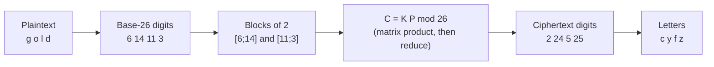
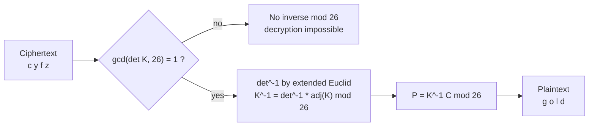

# Lecture 02 — Hill Cipher, Order of a Group and of an Element, Subgroups

> Prerequisite: [[../lecture-01/notes.md]] (group axioms, uniqueness/cancellation,
> $\mathbb{Z}_n$). Proof templates: [[../lecture-01/proofs-cheat-sheet.md]].
> Combined cheat-sheet for both lectures: [[../cheatsheet-lec01-02.md]].

## TL;DR
- **Hill cipher** turns the group/ring machinery into crypto: letters are base-26 digits,
  the plaintext is split into column blocks $P$, and $C = KP \bmod 26$ with an $n\times n$
  key $K$. Decryption is $P = K^{-1}C \bmod 26$.
- $K$ is usable **iff $\gcd(\det K, 26)=1$**, i.e. $\det K$ has a multiplicative inverse
  mod 26. "$\det K\neq0$ over $\mathbb{R}$" is **not** enough: $\det K = 13$ is nonzero but
  $13$ is not invertible mod 26 (because $26 = 2\cdot 13$).
- $K^{-1} = (\det K)^{-1}\cdot\operatorname{adj}(K) \bmod 26$, where
  $\operatorname{adj}\begin{bmatrix}a&b\\c&d\end{bmatrix}=\begin{bmatrix}d&-b\\-c&a\end{bmatrix}$
  — the *adjugate*, not $K$ itself.
- **Order of a group** $|G|$ = number of elements (finite vs infinite group).
  **Order of an element** $o(a)$ = least $n\ge1$ with $a^n=e$ ("$na=0$" additively);
  infinite order if no such $n$ exists. Two different numbers — never mix them up.
- In a **finite** group every element has finite order (pigeonhole on
  $a,a^2,a^3,\dots$), but the converse fails: $\begin{bmatrix}1&1\\0&1\end{bmatrix}$
  has infinite order inside the infinite group $GL(2,\mathbb{R})$.
- The two order theorems: $a^m=e \Rightarrow o(a)\mid m$, and
  $o(a^t)=\dfrac{n}{\gcd(t,n)}$ when $o(a)=n$.
- **Subgroup test (one-step):** $H\le G \iff$ $H\neq\varnothing$ and
  $\forall a,b\in H:\ ab^{-1}\in H$ (additively: $a-b\in H$). The proof manufactures
  $e=xx^{-1}$, then $x^{-1}=ex^{-1}$, then $xy=x(y^{-1})^{-1}$ — three uses of the same
  hypothesis, in that order.
- **Finite subgroup test:** if $H$ is a *finite* nonempty subset, closure ($ab\in H$) is
  enough to conclude $H\le G$ — but this shortcut is **only** valid for finite $H$
  (e.g. $\mathbb{N}\subseteq\mathbb{Z}$ is closed under $+$ and is not a subgroup).

## Where this fits
Lecture 1 defined $(G,*)$ and proved the basic manipulation theorems. This lecture does
three things with that definition: (1) *uses* it — Hill cipher is a matrix group acting on
digit vectors mod 26, so "is the key invertible?" becomes "is the key in a group of
invertible matrices?"; (2) *measures* elements — order of a group and order of an element,
the counting invariants that drive everything cyclic; (3) *looks inside* — subgroups, the
first structure-preserving notion. Lecture 3 (cyclic groups) is the direct continuation:
$\langle a\rangle$ is the subgroup generated by one element, and
$|\langle a\rangle| = o(a)$ is the bridge between the two orders defined here.

## Learning objectives
After this lecture you should be able to:
- Encrypt and decrypt a Hill-cipher message with a $2\times2$ key, showing the
  letter→digit table, the unreduced matrix product, the reduction mod 26, and the
  round-trip check.
- Compute a modular inverse by the extended Euclidean algorithm and check
  $\gcd(\det K,26)=1$ before inverting a key; explain why $\det K = 13$ fails.
- Distinguish $|G|$ from $o(a)$ and compute both for $\mathbb{Z}_n$ (additive) and
  $\mathbb{Z}_n^*$ (multiplicative) using Cayley tables.
- Prove: in a finite group every element has finite order; and
  $a^m=e\Rightarrow o(a)\mid m$.
- Prove $o(a^t)=n/\gcd(t,n)$ from scratch.
- State the subgroup definition and run the one-step test in both multiplicative and
  additive notation; prove the test in both directions.
- State and prove the finite subgroup test, and say why finiteness is essential.

---

## Full detailed explanation

### 1. Hill cipher — the setup

**Intuition.** A substitution cipher maps one letter to one letter, so letter frequencies
survive and it is easy to break. Hill's idea (Lester Hill, 1929) is to encrypt **blocks**
of $n$ letters at once: each block becomes a vector, and a fixed $n\times n$ matrix
scrambles it, so a single plaintext letter influences $n$ ciphertext letters. The
"scrambling" is linear algebra **mod 26**, which is exactly the arithmetic of
$\mathbb{Z}_{26}$ from Lecture 1.

**The data pipeline.**

1. **Letters → digits (base 26).** $A=0,B=1,C=2,\dots,Z=25$:

| A | B | C | D | E | F | G | H | I | J | K | L | M |
|---|---|---|---|---|---|---|---|---|---|---|---|---|
| 0 | 1 | 2 | 3 | 4 | 5 | 6 | 7 | 8 | 9 | 10 | 11 | 12 |

| N | O | P | Q | R | S | T | U | V | W | X | Y | Z |
|---|---|---|---|---|---|---|---|---|---|---|---|---|
| 13 | 14 | 15 | 16 | 17 | 18 | 19 | 20 | 21 | 22 | 23 | 24 | 25 |

2. **Split into blocks.** Plaintext of length $n$ letters per block → each block is a
   column vector $P=\begin{bmatrix}p_1\\ \vdots\\ p_n\end{bmatrix}$.
3. **Key.** An $n\times n$ matrix $K$ with entries in $\{0,\dots,25\}$, chosen so that
   $K$ is **invertible mod 26** (criterion in §3). Its entries must be random-looking —
   security lives in the key.
4. **Encrypt.** $C = KP \bmod 26$ — matrix multiply over $\mathbb{Z}$, then reduce every
   entry mod 26.
5. **Decrypt.** $P = K^{-1}C \bmod 26$.

For block size $2\times1$ the key is $2\times2$ and each block produces two ciphertext
digits:

$$
C = KP \bmod 26,\qquad
\begin{bmatrix}c_1\\c_2\end{bmatrix}
=\begin{bmatrix}k_{11}&k_{12}\\k_{21}&k_{22}\end{bmatrix}
\begin{bmatrix}p_1\\p_2\end{bmatrix}
=\begin{bmatrix}k_{11}p_1+k_{12}p_2\\ k_{21}p_1+k_{22}p_2\end{bmatrix}\bmod 26 .
$$

**Why the block size must match the key size.** If $P$ is $n\times1$ then $KP$ is defined
only when $K$ is $n\times n$. A $2\times2$ key cannot encrypt a 3-letter block.

*Encryption pipeline for the lecture's example: every arrow is a step you must show on
paper.*

**Common pitfalls.**
- Reducing **before** vs **after** the matrix product. You may reduce entries of $K$ and
  $P$ first (valid, because reduction is a ring homomorphism), but you must reduce the
  final product; the lecture reduces at the end, which is the safer habit.
- Forgetting that the **letter numbering starts at 0**, so $A=0$ and $Z=25$ — off-by-one
  here ruins every subsequent digit.
- Odd-length plaintexts need padding (e.g. append `X`); the slides do not discuss it,
  but the block structure forces it.

---

### 2. Worked encryption: "gold" with $K=\begin{bmatrix}2&3\\3&6\end{bmatrix}$ (slides 2–3)

**Step 1 — digits.** $g=6$, $o=14$, $l=11$, $d=3$.

**Step 2 — blocks.** $P_1=\begin{bmatrix}6\\14\end{bmatrix}$ (`go`),
$P_2=\begin{bmatrix}11\\3\end{bmatrix}$ (`ld`).

**Step 3 — first block, before reduction.**

$$
KP_1=\begin{bmatrix}2&3\\3&6\end{bmatrix}\begin{bmatrix}6\\14\end{bmatrix}
=\begin{bmatrix}2\cdot6+3\cdot14\\ 3\cdot6+6\cdot14\end{bmatrix}
=\begin{bmatrix}12+42\\ 18+84\end{bmatrix}
=\begin{bmatrix}54\\102\end{bmatrix}.
$$

**Step 4 — reduce mod 26.**

$$
\begin{bmatrix}54\\102\end{bmatrix}\equiv
\begin{bmatrix}54-52\\ 102-78\end{bmatrix}=
\begin{bmatrix}2\\24\end{bmatrix}\pmod{26},
\qquad 2\mapsto c,\ 24\mapsto y .
$$

**Step 5 — second block.**

$$
KP_2=\begin{bmatrix}2&3\\3&6\end{bmatrix}\begin{bmatrix}11\\3\end{bmatrix}
=\begin{bmatrix}22+9\\ 33+18\end{bmatrix}
=\begin{bmatrix}31\\51\end{bmatrix}
\equiv\begin{bmatrix}5\\25\end{bmatrix}\pmod{26},
\qquad 5\mapsto f,\ 25\mapsto z .
$$

**Result.** `gold` $\longmapsto$ `cyfz`. (Slide 3 writes only $(2,24)$ and $(5,25)$; the
unreduced products $54,102$ and $31,51$ are the intermediate step worth writing in an
exam.)

> **Check the key is legal before you encrypt.** $\det K = 2\cdot6-3\cdot3=12-9=3$ and
> $\gcd(3,26)=1$, so $K$ is invertible mod 26. If this check fails, the message is
> unrecoverable — see §3 and §5.

---

### 3. Invertibility mod 26 and the modular inverse

**Why the condition is $\gcd(\det K,26)=1$.** For $K^{-1}$ to exist with entries in
$\mathbb{Z}_{26}$ we need to divide by $\det K$, i.e. we need $(\det K)^{-1}$ **in
$\mathbb{Z}_{26}$**. An element $x\in\mathbb{Z}_{26}$ has a multiplicative inverse mod 26
iff $\gcd(x,26)=1$. Since $26=2\cdot13$, the invertible residues are exactly

$$
1,3,5,7,9,11,15,17,19,21,23,25
\qquad(\text{all odd and not }13),
$$

i.e. the 12 numbers coprime to 26. So $\det K$ must be congruent to one of these. In
particular $\det K \equiv 0 \pmod 2$ (even determinant) **or** $\det K\equiv 0\pmod{13}$
kills the key.

**Finding the inverse: extended Euclidean algorithm.** For $\det K = 3$:

$$
\begin{aligned}
26 &= 8\cdot 3 + 2\\
3 &= 1\cdot 2 + 1\\
1 &= 3-2 = 3-(26-8\cdot3) = 9\cdot 3-26 .
\end{aligned}
$$

Read off $9\cdot3\equiv1\pmod{26}$, so $3^{-1}\equiv 9$. (Check: $3\cdot9=27=26+1$ ✔)

**The matrix inverse formula mod 26.** For
$K=\begin{bmatrix}a&b\\c&d\end{bmatrix}$,

$$
K^{-1}=(\det K)^{-1}\cdot\operatorname{adj}(K)
=(\det K)^{-1}\begin{bmatrix}d&-b\\-c&a\end{bmatrix}\pmod{26},
$$

then reduce every entry into $\{0,\dots,25\}$ (write $-3$ as $23$, etc.).

**Common pitfalls.**
- Using $\frac{1}{\det K}$ as a rational number instead of the **modular** inverse. There
  is no "$1/3$" mod 26; there is $3^{-1}=9$.
- Forgetting to reduce the negative entries of the adjugate: $-3\equiv 23$, so the answer
  stays in $\{0,\dots,25\}$.
- Writing $\gcd(\det K,26)=1$ but computing with $\det K$ not reduced mod 26 — reduce
  first ($\det K=29$ behaves like $3$).

---

### 4. Worked decryption: "cyfz" → "gold" (slide 4)

**Step 1 — inverse key.** $\det K=3$, $\det^{-1}=9$, and
$\operatorname{adj}(K)=\begin{bmatrix}6&-3\\-3&2\end{bmatrix}$, so

$$
K^{-1}=9\begin{bmatrix}6&-3\\-3&2\end{bmatrix}
=\begin{bmatrix}54&-27\\-27&18\end{bmatrix}
\equiv\begin{bmatrix}2&25\\25&18\end{bmatrix}\pmod{26}
$$

using $54\equiv2$, $-27\equiv -27+52=25$, $18\equiv18$. (Check:)

$$
K K^{-1}=\begin{bmatrix}2&3\\3&6\end{bmatrix}\begin{bmatrix}2&25\\25&18\end{bmatrix}
=\begin{bmatrix}4+75&50+54\\6+150&75+108\end{bmatrix}
=\begin{bmatrix}79&104\\156&183\end{bmatrix}
\equiv\begin{bmatrix}1&0\\0&1\end{bmatrix}\pmod{26},
$$

since $79=3\cdot26+1$, $104=4\cdot26$, $156=6\cdot26$, $183=7\cdot26+1$. ✔

**Step 2 — ciphertext blocks.** `cy` $=\begin{bmatrix}2\\24\end{bmatrix}$,
`fz` $=\begin{bmatrix}5\\25\end{bmatrix}$.

**Step 3 — first block.**

$$
K^{-1}C_1=\begin{bmatrix}2&25\\25&18\end{bmatrix}\begin{bmatrix}2\\24\end{bmatrix}
=\begin{bmatrix}4+600\\ 50+432\end{bmatrix}
=\begin{bmatrix}604\\482\end{bmatrix}
\equiv\begin{bmatrix}6\\14\end{bmatrix}\pmod{26},
$$

since $604=23\cdot26+6$ and $482=18\cdot26+14$. Digits $6,14$ → `go`. ✔

**Step 4 — second block.**

$$
K^{-1}C_2=\begin{bmatrix}2&25\\25&18\end{bmatrix}\begin{bmatrix}5\\25\end{bmatrix}
=\begin{bmatrix}10+625\\ 125+450\end{bmatrix}
=\begin{bmatrix}635\\575\end{bmatrix}
\equiv\begin{bmatrix}11\\3\end{bmatrix}\pmod{26},
$$

since $635=24\cdot26+11$ and $575=22\cdot26+3$. Digits $11,3$ → `ld`. ✔

**Step 5 — round trip.** `cyfz` → `gold`, which matches the encryption in §2, so
$K^{-1}(KP)=P$ mod 26. This final check is part of the answer, not decoration.

*Decryption pipeline; the decision diamond is the only thing standing between you and an
unreadable message.*

**Where this sits in the theory.** The set of $2\times2$ matrices over $\mathbb{Z}_{26}$
with invertible determinant is a group under multiplication — the mod-26 analogue of
$GL(2,\mathbb{R})$ from Lecture 1 §4.4. Encryption is the map $P\mapsto KP$ and
decryption is $C\mapsto K^{-1}C$; that $K^{-1}$ exists is precisely (G3).

---

### 5. When the key fails: $\gcd(\det K,26)\neq1$

Take $K=\begin{bmatrix}1&0\\0&13\end{bmatrix}$. Then $\det K=13\neq0$, so $K$ is perfectly
invertible as a real matrix — yet it is **useless** for a Hill cipher:

- $K$ acts on a block by $(p_1,p_2)\mapsto(p_1,\,13p_2 \bmod 26)$.
- $13p_2 \bmod 26$ is $0$ if $p_2$ is even and $13$ if $p_2$ is odd — **all information in
  the second letter is destroyed**. There is no way to recover it.
- Algebraically: $13x\equiv1\pmod{26}$ has no solution, because $13x$ is always $0$ or
  $13$. So $\det K$ has no inverse and $K^{-1}$ does not exist over $\mathbb{Z}_{26}$.

**Moral, and the exam sentence:** invertibility over $\mathbb{R}$ ($\det K\neq0$) is
**necessary but not sufficient**; the correct criterion in $\mathbb{Z}_{26}$ is
$\gcd(\det K,26)=1$. This is the first appearance of the "zero divisors" phenomenon
(here $2\cdot13\equiv0\pmod{26}$), which becomes the definition of an integral domain in
part 2 of the course.

---

### 6. Order of a group

**Formal definition (slide 5).** A group $(G,*)$ is a **finite group** if $G$ has only
finitely many elements. The **order** of $(G,*)$, written $|G|$, is the number of elements
of $G$. A group with infinitely many elements is an **infinite group**.

**Examples (slide 5).** $(\mathbb{Z}_5,+)$ is a finite group of order $5$;
$(\mathbb{Z},+)$, $(\mathbb{Q},+)$, $(\mathbb{R},+)$ are infinite groups.

**Two clarifications the slide leaves implicit.**
- Only a group has an order. For a plain set one says "cardinality".
- $|G|$ counts **elements of the group**, so for $(\mathbb{Z}_n,+)$ it is $n$, but for
  $(\mathbb{Z}_n^*,\times)$ it is $\varphi(n)$ — e.g. $|\mathbb{Z}_5^*|=4$, not $5$,
  because $[0]$ is not in the multiplicative group.

---

### 7. Powers of an element, and why finite groups have finite orders

**Powers (slide 5).** For $a\in G$ and $n\in\mathbb{Z}$:

$$
a^0=e,\qquad a^n=\underbrace{a*a*\cdots*a}_{n\text{ times}}\ (n\ge1),
\qquad a^{-n}:=(a^{-1})^n\ (n\ge1).
$$

The slide's definition only displays $n\ge0$; the negative case is the line above, and it
is needed for the proofs (e.g. $a^{k-l}$ with $k>l$). The usual exponent laws hold:
$a^{m+n}=a^m a^n$ and $(a^m)^n=a^{mn}$ for all $m,n\in\mathbb{Z}$ — provable by induction,
used silently below.

> **Additive translation.** $na = a+a+\dots+a$ ($n$ times), $0a=0$, $(-n)a=n(-a)$.

**Lemma (the slide's argument, made precise).** If $G$ is finite and $a\in G$, then
$o(a)$ exists and $o(a)\le |G|$.

*Proof.* By closure, $a^1,a^2,a^3,\dots$ all lie in $G$. Consider the $|G|+1$ elements

$$
a^1,\ a^2,\ \dots,\ a^{|G|+1}\ \in G,
$$

but $G$ has only $|G|$ elements, so by the **pigeonhole principle** two of them coincide:
$a^k=a^l$ with $1\le l<k\le|G|+1$. Multiply on the right by $a^{-l}$:

$$
a^k a^{-l}=a^l a^{-l}\ \Longrightarrow\ a^{k-l}=e .
$$

Now $n=k-l$ is a positive integer with $a^n=e$, and $n\le|G|$. Hence the set of positive
$n$ with $a^n=e$ is nonempty, so it has a least element $o(a)\le n\le|G|$. $\blacksquare$

**Why the converse is false (slide 5 says so; here is the example).** In the *infinite*
group $GL(2,\mathbb{R})$ the matrix $\begin{bmatrix}0&-1\\-1&0\end{bmatrix}$ has order $2$:
finiteness of the group is sufficient for finite element order, not necessary.

**Common pitfalls.**
- Claiming "infinite group ⇒ every element has infinite order". False — the matrix above
  is the counterexample.
- Using $a^{k-l}=e$ without saying how you got it (multiply by $a^{-l}$); the slide jumps
  straight there.

---

### 8. Order of an element — definition and the three lecture examples

**Formal definition (slide 5).** Let $(G,*)$ be a group and $a\in G$. The smallest
positive integer $n$ such that $a^n=e$ is called the **order of $a$**, written $o(a)$. If
no such positive integer exists, $a$ is of **infinite order**.

Read it as a *minimum*, so two things must be checked in examples: (i) $a^n=e$ for your
candidate, and (ii) $a^t\neq e$ for **every** $0<t<n$. Just showing $a^n=e$ proves only
$o(a)\mid n$ (once the theorem of §10 is available), not $o(a)=n$.

**Example 1 (slide 6).** In $(\mathbb{Z}_6,+)$ find $o([3])$. Additive notation, so
"powers" are multiples:

$$
1\cdot[3]=[3]\neq[0],\qquad 2\cdot[3]=[6]=[0]=e \ \Longrightarrow\ o([3])=2 .
$$

**Example 2 (slide 6).** In $(\mathbb{Z}_5^*,\times)$ find $o([2])$, where
$\mathbb{Z}_5^*=\{[1],[2],[3],[4]\}$:

$$
[2]^1=[2],\quad [2]^2=[4],\quad [2]^3=[8]=[3],\quad [2]^4=[16]=[1]=e .
$$

Since no earlier power is $[1]$, $o([2])=4$. (The slide omits $[2]^3$; include it — it is
what rules out $o([2])=3$.)

**Example 3 (slide 6).** In $(GL(2,\mathbb{R}),\times)$:

(a) $A=\begin{bmatrix}0&-1\\-1&0\end{bmatrix}$. Compute:

$$
A^2=\begin{bmatrix}0&-1\\-1&0\end{bmatrix}\begin{bmatrix}0&-1\\-1&0\end{bmatrix}
=\begin{bmatrix}0\cdot0+(-1)(-1)&0\cdot(-1)+(-1)\cdot0\\ (-1)\cdot0+0\cdot(-1)&(-1)(-1)+0\cdot0\end{bmatrix}
=\begin{bmatrix}1&0\\0&1\end{bmatrix}=I_2 .
$$

And $A\neq I_2$, so $o(A)=2$. (Slide 6 prints $A^2$ as
$\begin{bmatrix}0&1\\1&0\end{bmatrix}$ — that is the swap matrix, not $A^2$; see
Corrections.)

(b) $B=\begin{bmatrix}1&1\\0&1\end{bmatrix}$. Successive powers:

$$
B^1=\begin{bmatrix}1&1\\0&1\end{bmatrix},\quad
B^2=\begin{bmatrix}1&2\\0&1\end{bmatrix},\quad
B^3=\begin{bmatrix}1&3\\0&1\end{bmatrix},\quad
B^4=\begin{bmatrix}1&4\\0&1\end{bmatrix}.
$$

By induction (multiply $\begin{bmatrix}1&n\\0&1\end{bmatrix}$ by $B$):

$$
B^n=\begin{bmatrix}1&n\\0&1\end{bmatrix}\qquad\text{for all }n\ge1 .
$$

Since $n\ge1$ gives $B^n\neq I_2$ (top-right entry $n\not\equiv0$), **no** positive power
equals the identity, so $o(B)$ is infinite. Note $B\in GL(2,\mathbb{R})$ because
$\det B=1$.

**Common pitfalls.**
- Reporting the first exponent that "looks like" $e$: e.g. $[2]^2=[4]$ in $\mathbb{Z}_5^*$
  is *not* $e$, and $[4]^2=[16]=[1]$ **is**, so $o([4])=2$ — different from $o([2])$.
- Mixing additive and multiplicative language: in $(\mathbb{Z}_6,+)$ you write
  $2\cdot[3]=[0]$, not $[3]^2=[0]$ (though it is harmless shorthand, the examiner wants
  $n a$).
- For matrices, "infinite order" needs the induction proof, not "it keeps growing".

---

### 9. Cayley tables for the two finite groups in this lecture

The workflow for any finite group: build the table, read off identity, inverses,
commutativity, then list the order of **every** element.

#### 9.1 $(\mathbb{Z}_6,+)$

| $+$ | $[0]$ | $[1]$ | $[2]$ | $[3]$ | $[4]$ | $[5]$ |
|---|---|---|---|---|---|---|
| $[0]$ | $[0]$ | $[1]$ | $[2]$ | $[3]$ | $[4]$ | $[5]$ |
| $[1]$ | $[1]$ | $[2]$ | $[3]$ | $[4]$ | $[5]$ | $[0]$ |
| $[2]$ | $[2]$ | $[3]$ | $[4]$ | $[5]$ | $[0]$ | $[1]$ |
| $[3]$ | $[3]$ | $[4]$ | $[5]$ | $[0]$ | $[1]$ | $[2]$ |
| $[4]$ | $[4]$ | $[5]$ | $[0]$ | $[1]$ | $[2]$ | $[3]$ |
| $[5]$ | $[5]$ | $[0]$ | $[1]$ | $[2]$ | $[3]$ | $[4]$ |

- Identity: row/column $[0]$. $|G|=6$.
- Inverses: $[0]\to[0]$, $[1]\to[5]$, $[2]\to[4]$, $[3]\to[3]$, $[4]\to[2]$, $[5]\to[1]$.
- Commutative: the table is symmetric about the main diagonal.
- Orders (multiples until $[0]$):

| Element | chain | $o$ |
|---|---|---|
| $[0]$ | $[0]$ | $1$ |
| $[1]$ | $1,2,3,4,5,0$ | $6$ |
| $[2]$ | $2,4,0$ | $3$ |
| $[3]$ | $3,0$ | $2$ |
| $[4]$ | $4,2,0$ | $3$ |
| $[5]$ | $5,4,3,2,1,0$ | $6$ |

Cross-check with §10's formula (here $n=o([1])=6$):
$o(t[1])=\dfrac{6}{\gcd(t,6)}$ gives $6,3,2,3,6$ for $t=1,\dots,5$ ✔.

#### 9.2 $(\mathbb{Z}_5^*,\times)$

| $\times$ | $[1]$ | $[2]$ | $[3]$ | $[4]$ |
|---|---|---|---|---|
| $[1]$ | $[1]$ | $[2]$ | $[3]$ | $[4]$ |
| $[2]$ | $[2]$ | $[4]$ | $[1]$ | $[3]$ |
| $[3]$ | $[3]$ | $[1]$ | $[4]$ | $[2]$ |
| $[4]$ | $[4]$ | $[3]$ | $[2]$ | $[1]$ |

- Identity: $[1]$ (row/column that copies the header). $|G|=4$.
- Inverses: $[1]\to[1]$, $[2]\to[3]$, $[3]\to[2]$, $[4]\to[4]$.
- Commutative: symmetric about the diagonal.
- Orders:

| Element | chain | $o$ |
|---|---|---|
| $[1]$ | $[1]$ | $1$ |
| $[2]$ | $2,4,3,1$ | $4$ |
| $[3]$ | $3,4,2,1$ | $4$ |
| $[4]$ | $4,1$ | $2$ |

Cross-check with §10 for $a=[2]$, $n=4$: $o([2]^t)=\dfrac{4}{\gcd(t,4)}$ gives
$t=1\mapsto4$, $t=2\mapsto2$, $t=3\mapsto4$, $t=4\mapsto1$, i.e. $[2],[4],[3],[1]$ have
orders $4,2,4,1$ ✔.

**Reading the two tables together.** The additive table has $6$ cells per row and no
repeats beyond the identity row; the multiplicative table has $4$. Both are "the same
idea" — a Latin square — but the *sets* and *operations* differ, so the orders differ.
This is the cleanest illustration of the lecture-1 rule: always name $(G,*)$.

---

### 10. Theorem: $a^m=e \Rightarrow o(a)\mid m$ (slide 7)

> **Theorem.** Let $(G,*)$ be a group and $a\in G$ with $o(a)=n$. If $a^m=e$ for some
> positive integer $m$, then $n\mid m$.

**Proof.** Apply the division algorithm to $m$ and $n$: there exist $q,r\in\mathbb{Z}$
with

$$
m=nq+r,\qquad 0\le r<n .
$$

Then, using the exponent laws and $a^n=e$,

$$
a^r=a^{m-nq}=a^m\,a^{-nq}=a^m\,(a^n)^{-q}=e\cdot e^{-q}=e\cdot e=e .
$$

So $a^r=e$ with $0\le r<n$. If $r>0$, then $r$ is a **positive** integer smaller than $n$
with $a^r=e$, contradicting the minimality of $n=o(a)$. Hence $r=0$, so $m=nq$ and
therefore $n\mid m$. $\blacksquare$

**Reading the proof.** It is the standard "division algorithm + minimality" pattern: any
exponent giving $e$ can be *reduced* below $n$, and only $0$ survives. The same skeleton
proves the order divides $|G|$ (Lagrange, later) and that $\mathbb{Z}_n$'s additive orders
divide $n$.

**Corollary (very useful).** $o(a)$ is the **least** positive $n$ with $a^n=e$, so once
you know $a^m=e$, you get $o(a)\mid m$ — and conversely, if $o(a)=n$ then $a^m=e\iff n\mid m$.

**Common pitfall.** Writing $a^{m-nq}=a^m/a^{nq}$ — there is no division. Use
$a^{-nq}=(a^n)^{-q}$; negative exponents are defined via inverses.

---

### 11. Theorem: $o(a^t)=\dfrac{n}{\gcd(t,n)}$ (slide 8)

> **Theorem.** Let $(G,*)$ be a group, $a\in G$ with $o(a)=n$, and $t$ a positive integer.
> Then
> $$o(a^t)=\frac{n}{\gcd(t,n)} .$$

**Set-up.** Write $d=\gcd(t,n)$, so $t=du$, $n=dv$ with $\gcd(u,v)=1$. We must show
$o(a^t)=v$. Let $k=o(a^t)$; we prove $v\mid k$ and $k\mid v$, hence $k=v$.

**(a) $v\mid k$.** By definition of $k$,

$$
(a^t)^k=e\ \Longrightarrow\ a^{tk}=e .
$$

By the theorem of §10 applied to the element $a$ (whose order is $n$), $n\mid tk$, i.e.
$dv\mid duk$, so $v\mid uk$. Since $\gcd(u,v)=1$, Euclid's lemma gives $v\mid k$.

**(b) $k\mid v$.** Compute

$$
(a^t)^{v}=a^{tv}=a^{du\cdot v}=a^{dvu}=a^{nu}=(a^n)^u=e^u=e .
$$

By §10 applied to the element $a^t$ (whose order is $k$), any exponent giving $e$ is a
multiple of $k$; hence $k\mid v$.

**(c) Conclusion.** $k$ and $v$ are positive integers each dividing the other, so
$k=v=\dfrac{n}{d}=\dfrac{n}{\gcd(t,n)}$. $\blacksquare$

**Sanity checks.**
- $t=1$: $o(a)=n/\gcd(1,n)=n$ ✔.
- $t=n$: $o(a^n)=n/n=1$, and indeed $a^n=e$ has order $1$ ✔.
- $\mathbb{Z}_5^*$, $a=[2]$, $n=4$: $t=2\Rightarrow o([4])=4/2=2$ ✔ (matches the table);
  $t=3\Rightarrow o([3])=4/1=4$ ✔.
- $\mathbb{Z}_6$, $a=[1]$, $n=6$: $t=3\Rightarrow o([3])=6/3=2$ ✔ (matches Example 1).

**Common pitfalls.**
- Forgetting $\gcd(t,n)$ must be computed with **$n=o(a)$**, not with $|G|$. (They often
  coincide, but not always — e.g. in $\mathbb{Z}_6$ the element $[2]$ has $n=3$ while
  $|G|=6$.)
- Assuming $o(a^t)$ divides $t$ rather than $n/\gcd$.
- Applying the formula when $o(a)$ is infinite — it does not apply.

---

### 12. Subgroups — definition

**Formal definition (slide 9).** Let $(G,*)$ be a group and $H$ a nonempty subset of $G$.
Then $(H,*)$ is a **subgroup** of $(G,*)$ if $(H,*)$ is itself a group (with the *same*
operation), written $(H,*)\le(G,*)$ or simply $H\le G$.

**Read the definition carefully.**
- Same operation — you never redefine $*$ on $H$.
- $H$ must be nonempty. This is not decoration: the empty set satisfies the condition
  "for all $a,b\in H$, $ab^{-1}\in H$" vacuously, yet has no identity, so it is not a
  group.
- Every group has at least the **trivial subgroups** $\{e\}$ and $G$ itself (slide 10).
  A subgroup strictly between them is called *proper* and *nontrivial*.
- To prove $H\le G$ you must check: $H\neq\varnothing$; closure of $*$ on $H$; identity;
  inverses. Associativity is **free**, because it holds in $G$ and $H\subseteq G$.

---

### 13. The one-step subgroup test (slide 9)

> **Theorem.** Let $G$ be a group and $H$ a nonempty subset of $G$. Then
> $$H\le G \iff \forall a,b\in H:\ ab^{-1}\in H .$$

**Proof (⇒).** Suppose $H\le G$ and let $a,b\in H$. Since $H$ is a group, $b\in H$ has an
inverse **in $H$**: $b^{-1}\in H$. Since $H$ is closed under $*$, $a,b^{-1}\in H$ gives
$a b^{-1}\in H$. $\checkmark$

**Proof (⇐).** Suppose $H\neq\varnothing$ and $a,b\in H\Rightarrow ab^{-1}\in H$. We
manufacture the three group properties from that single hypothesis:

1. **Identity.** Since $H\neq\varnothing$, pick $x\in H$. Apply the hypothesis with
   $a=b=x$:
   $$e=x\,x^{-1}\in H .$$
2. **Inverses.** Let $x\in H$. Apply the hypothesis with $a=e$ (now known to be in $H$)
   and $b=x$:
   $$x^{-1}=e\,x^{-1}\in H .$$
3. **Closure.** Let $x,y\in H$. By step 2, $y^{-1}\in H$; apply the hypothesis with
   $a=x$, $b=y^{-1}$, noting $(y^{-1})^{-1}=y$ (Lecture 1 §6):
   $$xy=x\,(y^{-1})^{-1}\in H .$$
4. **Associativity.** Inherited: for $x,y,z\in H\subseteq G$,
   $x(yz)=(xy)z$ because it holds in $G$.

Hence $(H,*)$ satisfies (G1)–(G3) and is a group, so $H\le G$. $\blacksquare$

**Additive form.** In an additive group, $ab^{-1}$ becomes $a+(-b)=a-b$:

$$
H\le(G,+) \iff H\neq\varnothing \text{ and } \forall a,b\in H:\ a-b\in H .
$$

**Why the test is worth memorising.** It replaces four checks (nonempty, identity,
inverse, closure) with one equation, and it is the standard answer format for "show $H$ is
a subgroup". The order of the three constructions is forced: you cannot write
$x^{-1}=ex^{-1}$ before knowing $e\in H$, and you cannot write $xy=x(y^{-1})^{-1}$ before
knowing inverses live in $H$.

**Common pitfalls.**
- Checking $ab\in H$ and calling it the one-step test. Products alone do **not** give
  inverses for infinite $H$ (see §15).
- Forgetting nonemptiness — the hypothesis is vacuous on $\varnothing$.
- Using $H\le G$ and $H\subseteq G$ interchangeably. $\subseteq$ is set inclusion;
  $\le$ is "subgroup". Every subgroup is a subset, not conversely.

---

### 14. Subgroup examples, with the test applied

**Example 1 (slide 10).** Trivial subgroups $\{e\}$ and $G$. For $\{e\}$ the test element
is $e\,e^{-1}=e\in\{e\}$, so the test passes (nonempty: it contains $e$).

**Example 2 (slide 10).** $(2\mathbb{Z},+)\le(\mathbb{Z},+)$. Let $a,b\in 2\mathbb{Z}$,
so $a=2s$, $b=2t$ with $s,t\in\mathbb{Z}$. In additive notation the test element is
$a-b$:

$$
a+(-b)=2s+(-2t)=2(s-t)\in 2\mathbb{Z}\quad(\text{since } s-t\in\mathbb{Z}).
$$

Also $2\mathbb{Z}\neq\varnothing$ (it contains $0$). Hence $2\mathbb{Z}\le\mathbb{Z}$.
$\checkmark$ (Slide 10 writes $a+b^{-1}$; in an additive group that must be read as
$a+(-b)=a-b$ — see Corrections.)

The same computation with $2$ replaced by any $n\ge1$ shows $n\mathbb{Z}\le\mathbb{Z}$.

**Example 3 (not in the slides; the most instructive one).**
$SL(2,\mathbb{R})\le GL(2,\mathbb{R})$. Both are groups (Lecture 1 §4.4–4.5); for
$A,B\in SL(2,\mathbb{R})$,

$$
\det(AB^{-1})=\det A\cdot\det(B^{-1})=1\cdot\frac{1}{\det B}=1,
$$

so $AB^{-1}\in SL(2,\mathbb{R})$ and the one-step test gives $SL\le GL$. Note how the test
turns a subgroup claim into a **one-line determinant computation**.

**Example 4 (non-example, for contrast).** $(\mathbb{N},+)\not\le(\mathbb{Z},+)$: it is
closed and associative, but $3\in\mathbb{N}$ has no inverse in $\mathbb{N}$, so it is not a
group. Nonempty + closed is not enough when $H$ is infinite.

---

### 15. The finite subgroup test (slide 10 corollary) — and its proof

> **Corollary.** Let $G$ be a group and $H$ a **finite** nonempty subset of $G$. Then
> $$H\le G \iff \forall a,b\in H:\ ab\in H .$$

The slide states this without proof. Here is the standard argument.

**Proof.** (⇒) If $H\le G$ then $H$ is closed, so $ab\in H$.

(⇐) Suppose $H$ is finite, nonempty, and closed under multiplication. By the one-step
test it suffices to show $ab^{-1}\in H$ for all $a,b\in H$, and by closure it suffices to
show $b^{-1}\in H$ for every $b\in H$.

*Step 1: every element of $H$ has finite order.* Let $b\in H$. By closure,
$b,b^2,b^3,\dots\in H$. Since $H$ is finite, two powers coincide: $b^i=b^j$ with
$1\le i<j$ (pigeonhole). Multiplying by $b^{-i}$ (legitimate in $G$) gives
$b^{j-i}=e$, so $b$ has finite order $m=j-i$ and $e=b^m\in H$.

*Step 2: the inverse is a power.* With $m=o(b)$,
$$b^{-1}=b^{m-1}\in H,$$
because $m-1\ge0$ and $b^{m-1}$ is a power of $b$, hence in $H$ by closure (if $m=1$ then
$b=e$ and $b^{-1}=e\in H$).

Now for $a,b\in H$: $b^{-1}\in H$, so $ab^{-1}\in H$ by closure, and the one-step test
gives $H\le G$. $\blacksquare$

**Why finiteness is essential.** In $(\mathbb{Z},+)$, the subset $\mathbb{N}$ is nonempty
and closed under $+$, yet is not a subgroup (no inverses). Finiteness is what converts
"closed" into "closed under inverses", via pigeonhole.

**Common pitfalls.**
- Using the finite test on an infinite subset — the most common mistake in this section.
- Forgetting to check $H$ is nonempty, so that $e=b^m$ makes sense (you need some $b$).
- Believing the converse: "closed under $ab^{-1}$" is the *general* test; "$ab\in H$" is
  only the specialization to finite $H$.

---

## Corrections / things to watch (in the slides)

1. **Slide 6, Example 3(a): $\begin{bmatrix}0&-1\\-1&0\end{bmatrix}^2$ is printed as
   $\begin{bmatrix}0&1\\1&0\end{bmatrix}$.** Correct value:
   $\begin{bmatrix}0&-1\\-1&0\end{bmatrix}^2=\begin{bmatrix}1&0\\0&1\end{bmatrix}=I_2$.
   (The printed matrix is the swap $\begin{bmatrix}0&1\\1&0\end{bmatrix}$, which is
   a different element of order 2.) The conclusion $o=2$ is unaffected.
2. **Slide 7, proof of Theorem 1: the quotient is named $q$ ($m=nq+r$) but the next line
   writes $a^{m-nt}$.** It must be $a^{m-nq}$ (equivalently $a^{r}$); the symbol $t$ belongs
   to Theorem 2.
3. **Slide 4, decryption formula: a line reads $C=K^{-1}P\bmod 26$.** It must be
   $P=K^{-1}C\bmod 26$ throughout (the plaintext is the unknown).
4. **Slide 4, "$K^{-1}=\frac{1}{|K|}K$"** — the second factor must be the **adjugate**
   $\operatorname{adj}(K)=\begin{bmatrix}d&-b\\-c&a\end{bmatrix}$, not $K$.
   Written literally, $\frac{1}{|K|}K$ is wrong.
5. **Slide 3, encryption of "gold":** only the reduced results $(2,24)$, $(5,25)$ appear.
   Write the unreduced products $(54,102)$, $(31,51)$ first — that is where marks are lost.
6. **Slide 5, powers:** the definition says $n\in\mathbb{Z}$ but only defines $n\ge0$.
   Add $a^{-n}:=(a^{-1})^n$.
7. **Slide 5, "$a^k=a^l\Rightarrow a^{k-l}=e$"** skips the step "multiply by $a^{-l}$".
8. **Slide 6, Example 2:** the chain skips $[2]^3=[3]$; without it you have not excluded
   $o([2])=3$.
9. **Slide 8, proof of Theorem 2:** the line $(a^t)^{n/d}=a^{ndu/d}$ is confusing notation.
   With $t=du$, $n=dv$ the correct chain is
   $(a^t)^{v}=a^{duv}=a^{nv}=(a^n)^u=e$.
10. **Slide 10, the corollary (finite subgroup test) is asserted without proof.** Proof
    supplied in §15.
11. **Slide 10, subgroup example:** "$a+b^{-1}=2s+(-2t)$" mixes multiplicative and additive
    notation. In $(2\mathbb{Z},+)$ write $a+(-b)=a-b=2(s-t)$.
12. **Slide 2, "the matrix ... is invertible"** should say *invertible modulo 26*, and the
    precise criterion ($\gcd(\det K,26)=1$) appears only on slide 3; state it up front.
13. **Slide 3, "decrypt iff $K^{-1}$ exists"** is right, but note $\det K$ must be taken
    **mod 26** before testing $\gcd$ (e.g. $\det K=29$ behaves like $3$).

---

## Key definitions & theorems

| Term | Precise statement | Plain-English meaning |
|---|---|---|
| Hill cipher | $C=KP \bmod 26$, $P=K^{-1}C \bmod 26$ | block cipher encrypting $n$ letters at a time by an $n\times n$ key matrix |
| Key criterion | $K^{-1}$ exists mod 26 $\iff \gcd(\det K,26)=1$ | divide by $\det K$ only if $\det K$ is coprime to 26 |
| $\operatorname{adj}(K)$ | $\begin{bmatrix}d&-b\\-c&a\end{bmatrix}$ for $K=\begin{bmatrix}a&b\\c&d\end{bmatrix}$ | transposed cofactor matrix, used to build $K^{-1}$ |
| $|G|$ | number of elements of $G$ | order **of the group** |
| Finite / infinite group | $|G|<\infty$ / $|G|=\infty$ | size of the underlying set |
| $a^n$ | $a^0=e$; $a^n=a*\cdots*a$ ($n$ times); $a^{-n}=(a^{-1})^n$ | repeated multiplication, negatives via inverse |
| $o(a)$ | least $n\ge1$ with $a^n=e$; $\infty$ if none | order **of the element**: when it cycles back to $e$ |
| Finite-order lemma | $G$ finite $\Rightarrow o(a)$ exists and $o(a)\le|G|$ | pigeonhole on the powers |
| Division-by-order | $o(a)=n$, $a^m=e\Rightarrow n\mid m$ | any exponent hitting $e$ is a multiple of the order |
| Power order | $o(a^t)=n/\gcd(t,n)$ | taking the $t$-th power shrinks the order by $\gcd(t,n)$ |
| Subgroup | $H\neq\varnothing\subseteq G$ with $(H,*)$ a group | a group sitting inside $G$ with the same operation |
| Trivial subgroups | $\{e\}$ and $G$ | the two subgroups every group has |
| One-step test | $H\le G\iff\forall a,b\in H: ab^{-1}\in H$ | single equation replaces four checks |
| Finite subgroup test | $H$ finite nonempty, closed under $ab$ $\Rightarrow H\le G$ | closure is enough **only** when $H$ is finite |

---

## Connections
- **Back to** [[../lecture-01/notes.md]]: group axioms, $(ab)^{-1}=b^{-1}a^{-1}$ (used in
  the Hill round trip and in the one-step test), $\mathbb{Z}_n$ (the arithmetic mod 26).
- **Forward to Lecture 3 (cyclic groups):** $\langle a\rangle=\{a^k:k\in\mathbb{Z}\}$ is a
  subgroup by the one-step test, and $|\langle a\rangle|=o(a)$ — the two orders finally
  meet.
- **Forward to Lagrange (later):** $o(a)\mid|G|$ and $|H|\mid|G|$; the proof reuses the
  division-algorithm/minimality skeleton of §10.
- **Forward to rings/fields:** $\mathbb{Z}_{26}$ is *not* a field, and that is exactly why
  $\det K=13$ fails — zero divisors. $(\mathbb{Z}_p,\cdot)$ for prime $p$ has no zero
  divisors, which is why Hill keys work mod a prime.
- **CS elsewhere:** the same "$C=KP$" structure is the affine/Hill family of ciphers; the
  matrix group condition reappears in error-correcting codes (linear codes are images of
  matrix maps over $\mathbb{F}_q$).

---

## Quick self-check

**1.** Encrypt `hi` with $K=\begin{bmatrix}2&3\\3&6\end{bmatrix}$. ($h=7$, $i=8$.)

Answer

$$
KP=\begin{bmatrix}2&3\\3&6\end{bmatrix}\begin{bmatrix}7\\8\end{bmatrix}
=\begin{bmatrix}14+24\\21+48\end{bmatrix}=\begin{bmatrix}38\\69\end{bmatrix}
\equiv\begin{bmatrix}12\\17\end{bmatrix}\pmod{26},
$$

i.e. `mr` ($m=12$, $r=17$).

**2.** Why is $K=\begin{bmatrix}1&0\\0&13\end{bmatrix}$ unusable as a Hill key, even though
$\det K=13\neq0$?

Answer

$\gcd(13,26)=13\neq1$, so $13$ has no inverse mod 26 ($13x$ is always $0$ or $13$).
Equivalently $K$ multiplies the second digit by 13, which annihilates all its information.
Invertible over $\mathbb{R}$ but not over $\mathbb{Z}_{26}$.

**3.** Find $o([4])$ in $(\mathbb{Z}_6,+)$ and in $(\mathbb{Z}_5^*,\times)$.

Answer

Additive $\mathbb{Z}_6$: $[4],[8]=[2],[12]=[0]$, so $o=3$ (cross-check
$6/\gcd(4,6)=3$).
Multiplicative $\mathbb{Z}_5^*$: $[4]^1=[4]$, $[4]^2=[16]=[1]$, so $o=2$. Cross-check:
$[4]=[2]^2$ with $o([2])=4$, so $o([4])=4/\gcd(2,4)=2$ ✔. (Do **not** plug $t=4$ into
$4/\gcd(4,4)$: that formula needs $a$ to be a known power of a fixed element, and
$[4]=[2]^2$, not $[2]^4$.)

**4.** Prove: if $o(a)=6$ and $a^{m}=e$, what are the possibilities for $m$?

Answer

By §10, $6\mid m$, so $m\in\{6,12,18,\dots\}$ — and $m=0$ if you allow it. In particular
$m$ cannot be $2,3,4,5$.

**5.** Show $H=\{[0],[2],[4]\}\le(\mathbb{Z}_6,+)$.

Answer

Nonempty ($[0]\in H$). For $a,b\in H$, each is an even residue, so $a-b$ is an even residue,
i.e. $a-b\in\{[0],[2],[4]\}=H$. By the one-step test (additive form), $H\le\mathbb{Z}_6$.
Equivalently: it is the image of $2\mathbb{Z}$ mod 6.

**6.** Is $\mathbb{N}\le(\mathbb{Z},+)$? Is $\{[0],[1],[2]\}\le(\mathbb{Z}_5,+)$?

Answer

$\mathbb{N}$ is not a subgroup: $0\in\mathbb{N}$ is the identity and it is closed, but
$3$ has no inverse in $\mathbb{N}$ (and if $\mathbb{N}=\{1,2,\dots\}$ even the identity is
missing). $\{[0],[1],[2]\}$ is not a subgroup: it is not closed, e.g. $[2]+[2]=[4]\notin H$.

**7.** State the one-step test for a subgroup of $(\mathbb{Q}\setminus\{0\},\cdot)$ and use
it to show $H=\{\pm1\}$ is a subgroup.

Answer

Multiplicative form: $H\le G$ iff $H\neq\varnothing$ and $ab^{-1}\in H$. For
$H=\{1,-1\}$: nonempty; $1\cdot1^{-1}=1$, $1\cdot(-1)^{-1}=-1$, $(-1)\cdot1^{-1}=-1$,
$(-1)\cdot(-1)^{-1}=(-1)(-1)=1$, all in $H$. Hence $H\le\mathbb{Q}\setminus\{0\}$.

**8.** Why does the finite subgroup test not apply to $\mathbb{N}\subseteq\mathbb{Z}$?

Answer

$\mathbb{N}$ is infinite, so pigeonhole ("$b^i=b^j$ for some $i<j$") gives nothing. And
indeed the conclusion is false: $\mathbb{N}$ is closed under $+$ but is not a subgroup of
$(\mathbb{Z},+)$.

---

## One-page cheat-sheet

**Hill cipher**
$$
C=KP\bmod 26,\qquad P=K^{-1}C\bmod 26,\qquad
K^{-1}=(\det K)^{-1}\operatorname{adj}(K)\bmod 26 .
$$
Usable key $\iff \gcd(\det K,26)=1$. $A=0,\dots,Z=25$; block size = size of $K$.
$2\times2$ case: $\operatorname{adj}\begin{bmatrix}a&b\\c&d\end{bmatrix}=\begin{bmatrix}d&-b\\-c&a\end{bmatrix}$,
$\det=ad-bc$.
Lecture key: $K=\begin{bmatrix}2&3\\3&6\end{bmatrix}$, $\det=3$, $3^{-1}=9$,
$K^{-1}=\begin{bmatrix}2&25\\25&18\end{bmatrix}$; `gold`→`cyfz`→`gold`.

**Orders**
- $|G|$ = number of elements. $o(a)$ = least $n\ge1$ with $a^n=e$ (additively: $na=0$).
- $G$ finite ⇒ $o(a)$ exists, $o(a)\le|G|$ (pigeonhole).
- $o(a)=n,\ a^m=e\Rightarrow n\mid m$ (division algorithm + minimality).
- $o(a^t)=\dfrac{n}{\gcd(t,n)}$.
- Quick values: $\mathbb{Z}_6$: $1,6,3,2,3,6$ for $[0],\dots,[5]$;
  $\mathbb{Z}_5^*$: $1,4,4,2$ for $[1],[2],[3],[4]$.

**Subgroups**
- $H\le G$: $H\neq\varnothing\subseteq G$ and $(H,*)$ a group (same operation).
- One-step: $H\le G\iff\forall a,b\in H:\ ab^{-1}\in H$; additively $a-b\in H$.
- Proof recipe (⇐): $e=xx^{-1}$ → $x^{-1}=ex^{-1}$ → $xy=x(y^{-1})^{-1}$; associativity free.
- Finite test: $H$ finite nonempty closed under $ab$ ⇒ $H\le G$ (fails for infinite $H$).
- Trivial subgroups: $\{e\}$, $G$. Examples: $2\mathbb{Z}\le\mathbb{Z}$, $SL\le GL$,
  $\{\pm1\}\le\mathbb{Q}\setminus\{0\}$.

---

## Source reference

| Subsection | Slides (PDF pages) |
|---|---|
| Hill cipher intro, letter table, $C=KP$, block/key size | 2 |
| Encryption of "gold", decryption formula | 3 |
| Decryption of "cyfz", modular inverse, matrix inverse | 4 |
| Order of a group, powers, finite-order argument, definition of $o(a)$ | 5 |
| Order examples: $\mathbb{Z}_6$, $\mathbb{Z}_5^*$, $GL(2,\mathbb{R})$ | 6 |
| Theorem 1 ($n\mid m$) and its proof | 7 |
| Theorem 2 ($o(a^t)=n/\gcd(t,n)$) proof | 8 |
| Subgroup definition, one-step test + proof | 9 |
| Subgroup examples ($2\mathbb{Z}$), finite subgroup corollary | 10 |
