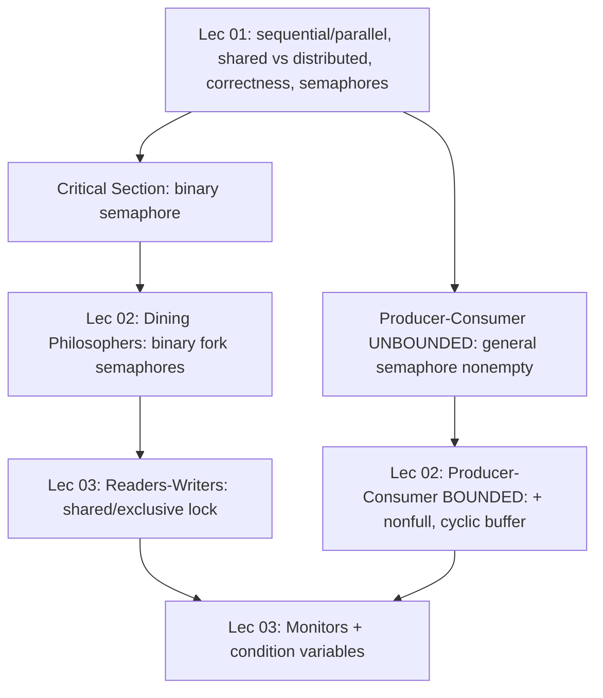
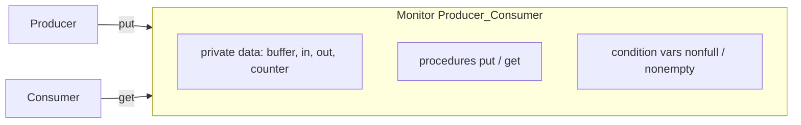

# Exam Cheat-Sheet — Lectures 01–03 (Synchronisation)

> **Scope:** definitions + all problem code + a **read Q/A** section that answers the
> exam questions verbatim. Everything here is **shared-memory parallelism** (one machine,
> one address space) — there is **no message complexity**; the relevant costs are
> **blocking, deadlock, starvation, and fairness**.
> Standard failure assumption throughout: **fail-stop** (a process that dies while holding
> a lock blocks the resource forever — the bridge to the distributed side later).

---

## 0. How topics connect



- **L01** gives the vocabulary + 2 resources axes (shared vs distributed) and the first two problems.
- **L02** applies semaphores to a *bounded* buffer (2 semaphores) and to Dining Philosophers (deadlock).
- **L03** pushes to Readers–Writers (failure mode = **starvation**, not deadlock) and hides the bookkeeping behind **monitors**.

---

## 1. All Definitions (one line each)

### Programs & processes
| Term | Definition |
|---|---|
| **Sequential program** $S$ | Single instruction stream on one processor; correctness = Hoare triple $\{p\}\;S\;\{q\}$. |
| **Partial correctness** | *If* $S$ terminates on valid input, output satisfies $q$. (Ignores termination.) |
| **Total correctness** | Partial correctness **+** $S$ always terminates. |
| **Sequential process** | Dynamic execution: ordered operations $o_1,o_2,\dots$; next op starts only after previous completes. |
| **Parallel/concurrent program** | Decomposition into tasks (each internally sequential) run simultaneously. |
| **Synchronous execution** | Caller waits for each op → forces sequential order. |
| **Asynchronous execution** | Ops overlap/interleave; no waiting between processes. |

### Architectures (the course's central axis)
| | **Shared memory** | **Distributed memory** |
|---|---|---|
| Address space | one **global** | **private** per processor |
| Communication | read/write shared RAM | **message passing** over network |
| Sync burden | programmer's (critical sections) | explicit messages |
| Failure | single machine | **separate failure domains** |
| Maps to | pthreads / OpenMP | MPI |

### Correctness of concurrent programs
| Term | Definition |
|---|---|
| **Correctness of a concurrent program** | Each task is correct **and** the global properties hold: **mutual exclusion**, **deadlock freedom** (safety) and **liveness/no starvation**. |
| **Safety property** | "**Nothing bad happens**": mutual exclusion + freedom from deadlock. |
| **Liveness property** | "**Something good eventually happens**": every requesting process eventually gets the resource. |
| **Mutual exclusion** | At any time, no resource is used by more than one process. |
| **Deadlock** | Two+ processes permanently blocked, **each waiting on the other**. |
| **Starvation** | A process waits forever because the resource is *never allocated to it* (no circular wait required). |
| **Race condition** | Outcome depends on unpredictable interleaving of non-atomic shared access. |

### Critical section & semaphores
| Term | Definition |
|---|---|
| **Critical section (CS)** | The fragment of a process that **uses a shared resource**; requirement: ≤1 task in its CS at a time. |
| **Critical section problem** | A group of processes compete for a resource where only one may have access at a time (shared vars, DB records, files, printers). |
| **Semaphore** $s=(w,q)$ | $w\in\mathbb{N}_0$ = counter; $q$ = set/**FIFO queue** of tasks blocked on $s$. |
| **Binary semaphore** | $w\in\{0,1\}$ (1 = free, 0 = used) → **mutual exclusion** (lock). |
| **General semaphore** | $w\in\mathbb{N}_0$ → **counting / condition synchronisation**. |
| **`wait(s)`** (atomic) | if $w>0$ then $w{:=}w-1$; else **block** task, add to $q$. |
| **`signal(s)`** (atomic) | if $q\neq\emptyset$ then unblock one task; else $w{:=}w+1$. |
| **Condition synchronisation** | Waiting for an **event/state** (data available) rather than for a lock. |
| **Producer–consumer problem** | Producer generates data → buffer → consumer retrieves & processes. |

### Higher-level patterns
| Term | Definition |
|---|---|
| **Bounded buffer** | Fixed cyclic array of size $n$; index wraps as `(idx+1) mod n`. |
| **Circular wait** | Each holder waits on a resource held by the next, forming a cycle (1 of 4 deadlock conditions). |
| **Fork (pattern)** | One task splits into $k\ge2$ concurrent subtasks (fan-out). |
| **Join (pattern)** | Subtasks sync back to one continuation = a **barrier** (fan-in). |
| **Reader access condition** | A reader may access iff **no writer is currently inside**. |
| **Writer access condition** | A writer may access iff **no reader and no writer is inside** (fully exclusive). |
| **Monitor** | Construct encapsulating **private shared data + procedures + condition variables**; **≤1 process active inside at a time** (auto mutual exclusion). |
| **Condition variable** | FIFO queue of blocked processes with **no stored value**; `signal` with no waiter is **lost**. |
| **Lost wakeup** | A `signal` with no waiter has no effect → must re-check a state variable. |

---

## 2. Quick-reference Tables

### 2.1 Bounded vs Unbounded buffer — advantages / disadvantages (high-yield!)
| | **Unbounded buffer** | **Bounded buffer** |
|---|---|---|
| Structure | `array(0..∞)`, `in,out:=0`, never wraps | `array(0..n-1)`, `in:=(in+1) mod n` |
| Semaphores | **1** (`nonempty := (0,∅)`) | **2** (`nonempty := (0,∅)`, `nonfull := (n,∅)`) |
| Producer ever blocks? | **No** (buffer never full) | **Yes** — on `wait(nonfull)` when full |
| **Advantages** | Simple; producer never delayed | Fixed memory; **backpressure/flow control**; realistic; predictable resource use |
| **Disadvantages** | Memory grows → **overflow/exhaustion** if producer faster; theoretical only | More state; producer latency under load; needs cyclic indices |
| Invariant | `nonempty.w = #items` | `nonempty.w + nonfull.w = n` |

### 2.2 Semaphore `wait` / `signal` (must be ATOMIC)
```text
wait(s):   if s.w > 0 then s.w := s.w - 1        else suspend task; add to s.q
signal(s): if s.q ≠ ∅  then remove one task, resume it   else s.w := s.w + 1
```
> **Without atomicity:** two tasks both read $s.w=1$, both decrement, both enter the CS → **mutual exclusion violated** (race).

### 2.3 Condition variables vs Semaphores (L03 punchline)
| Aspect | Condition variable | Semaphore |
|---|---|---|
| Value | **none** | integer counter |
| Counting | cannot count ops | counts `wait`/`signal` |
| Wait | block + insert in FIFO queue (+ **release monitor lock**) | decrement; block if <0 |
| Signal | wake one waiter, **else lost** | increment; wake if waiting |

### 2.4 Two semaphore roles (do not confuse)
| | Mutual exclusion | Condition sync |
|---|---|---|
| Semaphore | **binary**, $w\in\{0,1\}$ | **general**, $w\in\mathbb{N}_0$ |
| Blocks when | resource busy ($w=0$) | event not ready (e.g. buffer empty) |
| Resumes when | holder `signal`s | producer/other task `signal`s |

### 2.5 Decision rules ("use X when Y")
- One-at-a-time resource → **binary semaphore** around the CS.
- Wait for an event/state → **general semaphore** (condition sync).
- Producer *must* be throttled / finite memory → **bounded buffer** (+`nonfull`).
- Many readers, few writers, must not starve writers → **no-starvation Readers–Writers**.
- Want mutual exclusion with **no** manual `wait`/`signal` bookkeeping → **monitor**.
- 5 philosophers deadlock → break circular wait with a **seat semaphore (`up_to_4`)**.

---

## 3. All Problem Code

### 3.1 Critical Section — mutual exclusion for $n$ tasks
```text
s: semaphore := (1, ∅);         -- binary = free

task Ti (i = 1..n):
    wait(s);                    -- acquire
        critical section        -- use shared resource
    signal(s);                  -- release
```
- **Mutual-exclusion proof:** `wait` is atomic ⇒ only one task can see $w=1$ and decrement it to 0; all others block on $q$.
- **Deadlock-freedom proof (contradiction):** if two tasks were both blocked, then $w=0$ and both in $q$; but $w=0$ means one already decremented from 1 ⇒ only one was inside ⇒ contradiction. ∎
- **Liveness:** FIFO $q$ ⇒ no starvation.

### 3.2 Producer–Consumer — **UNBOUNDED** buffer (L01)
```text
buffer: array(0..∞) of data_type;
in, out: natural := 0;
nonempty: semaphore := (0, ∅);          -- general: # items in buffer

task Producer:                          task Consumer:
  loop                                    loop
    Produce data;                           wait(nonempty);      -- block if empty
    buffer(in) := data;                     data := buffer(out);
    in := in + 1;                           out := out + 1;
    signal(nonempty);                       Consume data;
  end loop                                end loop
```
- Consumer with $w=0$ → **blocks** on `nonempty.q` until producer signals (condition sync).
- **Failure without `nonempty`:** consumer reads `buffer(out)` — **stale/uninitialised garbage**.
- **Disadvantage:** unbounded → **memory exhaustion** if producer faster.

### 3.3 Producer–Consumer — **BOUNDED** buffer (L02) ★
```text
buffer: array(0..n-1) of data_type;         -- cyclic
in, out: natural := 0;
nonempty: semaphore := (0, ∅);              -- # items
nonfull : semaphore := (n, ∅);              -- # free slots

task Producer:                              task Consumer:
  loop                                        loop
    Produce data;                               wait(nonempty);       -- block if empty
    wait(nonfull);         -- block if full     data := buffer(out);
    buffer(in) := data;                         out := (out + 1) mod n;
    in := (in + 1) mod n;                       signal(nonfull);      -- 1 more free slot
    signal(nonempty);      -- 1 more item       Consume data;
  end loop                                    end loop
```
- **Invariant:** `nonempty.w + nonfull.w = n` (items + free slots = capacity).
- `wait(nonfull)` ⇒ never insert into a full buffer (count ≤ n).
- `wait(nonempty)` ⇒ never retrieve from an empty buffer (count ≥ 0).
- Producer and consumer wait on **different** semaphores ⇒ **no circular wait, no deadlock**.

```mermaid
sequenceDiagram
    participant P as Producer
    participant B as Cyclic Buffer (size n)
    participant C as Consumer
    Note over B: in=0,out=0,nonempty=0,nonfull=n
    P->>B: wait(nonfull); buffer(in):=data; in=(in+1)mod n; signal(nonempty)
    C->>B: wait(nonempty); data:=buffer(out); out=(out+1)mod n; signal(nonfull)
    Note over B: n inserts with no consume ⇒ nonfull=0 ⇒ producer blocks
```

### 3.4 Dining Philosophers (L02)
5 philosophers, 5 forks; philosopher $i$ needs left fork $i$ and right fork $(i+1)\bmod 5$; each fork a **binary semaphore**.

**Naive (deadlock-prone) — left then right:**
```text
fork: array(0..4) of semaphore := (1, ∅);
task Philosopher_i:
  loop
    Think;
    wait(fork(i));              -- LEFT
    wait(fork((i+1) mod 5));    -- RIGHT
    Eat;
    signal(fork(i));
    signal(fork((i+1) mod 5));
  end loop
```
**Bug — circular wait:** all 5 grab their left fork, each waits for a right fork held by a neighbour ⇒ waits-for cycle $P_0\to P_1\to P_2\to P_3\to P_4\to P_0$ ⇒ **deadlock** (and possible starvation).


**Fixed — seat semaphore `up_to_4` (breaks circular wait):**
```text
up_to_4: semaphore := (4, ∅);       -- at most 4 seated
task Philosopher_i:
  loop
    Think;
    wait(up_to_4);              -- take a seat (blocks if 4 already seated)
    wait(fork(i));
    wait(fork((i+1) mod 5));
    Eat;
    signal(fork(i));
    signal(fork((i+1) mod 5));
    signal(up_to_4);            -- release seat LAST
  end loop
```
- **Deadlock-free:** a 5-cycle needs all 5 seated; with ≤4 seated, one philosopher always gets both forks.
- **Starvation-free:** if $i$ blocked forever on `up_to_4`, then 4 are seated; one of them eats and leaves → `up_to_4.w>0` → $i$ admitted. Contradiction. ∎
- **Max eating concurrency:** $\lfloor 5/2\rfloor = 2$ philosophers.

C/pthreads equivalence (scaffolding):
```c
sem_t fork_[5], up_to_4;                       // init 1 each, up_to_4 init 4
int left = i, right = (i+1) % 5;
sem_wait(&up_to_4);
sem_wait(&fork_[left]);  sem_wait(&fork_[right]);
eat(i);
sem_post(&fork_[left]);  sem_post(&fork_[right]);  sem_post(&up_to_4);
```

### 3.5 Readers–Writers (L03)
**Access rules:** reader iff no writer *inside*; writer iff no reader and no writer *inside*.

**First solution — reader-priority (STARVES WRITERS):**
```text
s: semaphore := (1, ∅);             -- guards no_of_readers
access: semaphore := (1, ∅);        -- guards the database
no_of_readers: natural := 0;

reader:                             writer:
  loop                                loop
    wait(s);                            wait(access);
    no_of_readers := no_of_readers+1;   Write data;
    if no_of_readers = 1 then           signal(access);
       wait(access);                end loop
    end if;
    signal(s);
    Read data;
    wait(s);
    no_of_readers := no_of_readers-1;
    if no_of_readers = 0 then
       signal(access);
    end if;
    signal(s);
  end loop
```
- **Reader-priority:** first reader takes `access`; last reader releases it; middle readers only touch `s` → many readers concurrently.
- **Writer starvation:** if readers keep arriving, `no_of_readers` never hits 0 ⇒ `signal(access)` never runs ⇒ `access` never released ⇒ writers block **forever** (liveness failure, *not* deadlock).

**Correct solution — no starvation (writer-priority on arrival):**
```text
s := (1,∅);  reading_allowed := (0,∅);  writing_allowed := (0,∅);
nr, nw  := 0;   -- USING readers / writers
nwr,nww := 0;   -- WAITING readers / writers

reader:                                  writer:
  wait(s);                                 wait(s);
  if nw > 0 then                           if nr>0 or nw>0 then
     nwr := nwr+1;  signal(s);                nww := nww+1;  signal(s);
     wait(reading_allowed);                   wait(writing_allowed);
  end if;                                  end if;
  nr := nr+1;                              nw := nw+1;  signal(s);
  if nwr>0 then nwr:=nwr-1; signal(reading_allowed);
  else signal(s); end if;                  Write data;
  Read data;                               wait(s);  nw := nw-1;
  wait(s); nr := nr-1;                     if nwr>0 then nwr:=nwr-1; signal(reading_allowed);
  if nr=0 and nww>0 then                       else if nww>0 then nww:=nww-1; signal(writing_allowed);
     nww:=nww-1; signal(writing_allowed);      else signal(s); end if;
  else signal(s); end if;
```
- **Rule 1:** new reader blocked if a writer *waits* → `wait(reading_allowed)` (removes writer starvation).
- **Rule 2:** last reader (`nr=0`, `nww>0`) → `signal(writing_allowed)`.
- **Rule 3:** writer finishes → wake waiting readers first, else a writer.
- **Baton passing:** the waker does **not** `signal(s)`; the woken process releases `s`.
- Variants: **reader-priority** (writers starve) · **writer-priority** · **no-starvation/fair** (this).

### 3.6 Producer–Consumer with a **Monitor** (L03)
```text
monitor Producer_Consumer is
  buffer: array(0..n-1) of data_type;
  in, out, counter: natural := 0;          -- counter = # items
  nonempty, nonfull: condition;

  procedure put(d) is
    if counter = n then wait(nonfull); end if;   -- full ⇒ wait space
    buffer(in) := d;  in := (in+1) mod n;
    counter := counter + 1;
    signal(nonempty);                            -- data available
  end put;

  procedure get(d) is
    if counter = 0 then wait(nonempty); end if;  -- empty ⇒ wait data
    d := buffer(out);  out := (out+1) mod n;
    counter := counter - 1;
    signal(nonfull);                             -- space available
  end get;
end Producer_Consumer;
```
- Callers just: `Producer_Consumer.put(data)` / `Producer_Consumer.get(data)` — **no full/empty checks**.
- Monitor gives mutual exclusion automatically; condition variables handle full/empty.
- POSIX: monitor ≈ `pthread_mutex_t` + `pthread_cond_t`; `pthread_cond_wait(&cv,&m)` **atomically releases** the mutex; use `while`, not `if`.



### 3.7 Fork–Join (L02)
- **Fork** = one task splits into $k\ge2$ concurrent subtasks; **Join** = barrier, all subtasks must finish before the continuation runs.
- Segment time = $\max(t_B,t_C)$, **not** $t_B+t_C$; imbalance makes the shorter branch idle (load-imbalance / Amdahl).
- Dependency $A\to\{B,C\}\to D$ via `S_B,S_C` (init 0) and `done_B,done_C` (init 0):

```text
A: Operations A; signal(S_B); signal(S_C);
B: wait(S_B); Operations B; signal(done_B);
C: wait(S_C); Operations C; signal(done_C);
D: wait(done_B); wait(done_C); Operations D;
```

---

## 4. Exam Read Q/A  (questions exactly as they appear + model answers)

### Q. What is the correctness of concurrent programs? *(4 Marks)*
Correctness has **two layers**:
1. **Local:** each individual task (a sequential program) is correct — satisfies its Hoare triple $\{p\}\,S\,\{q\}$ (partial + termination = total correctness).
2. **Global:** the **synchronisation properties** hold:
   - **Safety** ("nothing bad happens") — **mutual exclusion** (≤1 process in its critical section) and **freedom from deadlock**.
   - **Liveness** ("something good eventually happens") — every requesting process **eventually gets the resource** (no starvation).
> A concurrent program is correct **iff** every task is correct **and** all global safety + liveness properties hold.

### Q. Define the safety property of concurrent programs. *(3 Marks)*
A **safety property** states that **"nothing bad ever happens"** during execution. For concurrent programs it comprises:
- **Mutual exclusion** — at any time, no resource is used by more than one process.
- **Freedom from deadlock** — no situation where two or more processes can never terminate because each is permanently waiting on the other.
> Intuition: it is a *lower bound* on correctness (a bad state is never reached); it says nothing about progress — that is the job of the **liveness** property.

### Q. What is a critical section, and how can it be solved? *(4 Marks)* *(also asked as 2 Marks)*
- **Critical section (CS):** the fragment of a process (task) that **uses a shared resource** (shared variable, file, DB record, printer) which may be used by **only one process at a time**. Requirement: **at most one task executes its CS at any moment**.
- **The problem:** a group of processes compete for that resource → need mutual exclusion + no deadlock + no starvation.
- **Solution** — three-phase protocol **acquire → use → release**, implemented with a **binary semaphore** $s := (1,\emptyset)$:
```text
wait(s);      -- acquire permission
  critical section
signal(s);    -- release
```
  - `wait` and `signal` are **atomic**, so only one task can decrement $s.w$ from 1 to 0; all others block on the queue (mutual exclusion).
  - Other solutions: **Peterson's algorithm**, **test-and-set** instruction, **semaphores**, **monitors** (all later lectures).

### Q. What are semaphores? *(1 Mark)*
A **semaphore** is a synchronisation primitive $s=(w,q)$: $w$ is a **nonnegative integer counter** and $q$ is a **FIFO set/queue of blocked tasks**. Operations `wait(s)` (decrement, or block) and `signal(s)` (wake a waiter, or increment) are **atomic**. **Binary** semaphores ($w\in\{0,1\}$) give mutual exclusion; **general** semaphores ($w\in\mathbb{N}_0$) give counting/condition synchronisation.

### Q. Give a solution to the producer–consumer problem using an **unbounded** buffer. *(5 or 7 Marks)*
**Data:**
```text
buffer: array(0..∞) of data_type;   in, out := 0;
nonempty: semaphore := (0, ∅);      -- general; counts items present
```
**Producer:** `Produce data; buffer(in):=data; in:=in+1; signal(nonempty);`
**Consumer:** `wait(nonempty); data:=buffer(out); out:=out+1; Consume data;`
**Explanation:** with an unbounded buffer the producer **never blocks**; only the consumer can block. `nonempty` is a **general semaphore** performing **condition synchronisation** — if the buffer is empty ($w=0$) the consumer blocks on `nonempty.q` until the producer's `signal` makes data available. Without `nonempty` the consumer would read uninitialised/stale data.
> **Drawback:** memory grows without bound → **exhaustion** if the producer is faster.

### Q. Give a solution to the producer–consumer problem using a **bounded** buffer and explain why the bounded buffer is better than the unbounded buffer. *(7 Marks)* ★
**Data (cyclic array of size $n$):**
```text
buffer: array(0..n-1) of data_type;   in, out := 0;
nonempty: semaphore := (0, ∅);        -- items present
nonfull : semaphore := (n, ∅);        -- free slots
```
**Producer:** `Produce; wait(nonfull); buffer(in):=data; in:=(in+1) mod n; signal(nonempty);`
**Consumer:** `wait(nonempty); data:=buffer(out); out:=(out+1) mod n; signal(nonfull); Consume;`
**Invariant:** `nonempty.w + nonfull.w = n`.
- `wait(nonfull)` stops insertion into a **full** buffer; `wait(nonempty)` stops retrieval from an **empty** buffer.
- Producer and consumer wait on **different** semaphores ⇒ no circular wait ⇒ no deadlock.

**Why bounded is better than unbounded:**
1. **Finite memory** — bounded uses a fixed $n$ slots; unbounded can grow until it **overflows/exhausts** memory when the producer outpaces the consumer.
2. **Flow control / backpressure** — bounded blocks the producer (`wait(nonfull)`) when full, keeping producer and consumer balanced; unbounded hides overload until it is too late.
3. **Realistic & predictable** — real systems have finite buffers; bounded gives bounded latency and deterministic resource usage.
4. **Reusability** — the cyclic `mod n` index recycles slots forever; unbounded keeps allocating.

### Q. (variant) Distinguish shared-memory and distributed-memory, with adv/disadv.
- **Shared memory:** one global address space; communication = read/write; **adv** fast, simple; **disadv** programmer must synchronise (critical sections), single point of failure.
- **Distributed memory:** private memory per processor; communication = **message passing** over a network; **adv** scalable, fault-isolated, geographically spread; **disadv** slower communication, complex, partial failure (need fault tolerance). Standard failure model: **fail-stop**.

### Q. (likely) Give the Dining Philosophers problem and a deadlock-free solution. *(see §3.4)*
State the naive left-then-right solution deadlocks (circular wait), then add `up_to_4 := (4,∅)`; prove deadlock-freedom and starvation-freedom; note max eating concurrency $=\lfloor 5/2\rfloor=2$.

### Q. (likely) Give the Readers–Writers problem: first solution and why it may starve writers. *(see §3.5)*
State the two access conditions; give the reader-priority solution; explain that if `no_of_readers` never returns to 0, `signal(access)` never executes ⇒ writers starve. Then give the no-starvation solution.

### Q. (likely) What is a monitor and how does it differ from semaphores? *(see §1, §2.3, §3.6)*
Monitor = encapsulated private data + procedures + condition variables with **automatic mutual exclusion** (≤1 active process). Condition variables carry **no value** (signal with no waiter is lost), unlike semaphores which are stateful counters.

---

## 5. Traps & examiner's gotchas
- **Safety vs liveness:** deadlock = safety failure; starvation = **liveness** failure. Proving one does **not** prove the other.
- **Mutual exclusion vs condition sync:** a semaphore guards a CS (binary) **or** waits for an event (general) — say which.
- **Atomicity of `wait`/`signal`** is *the* reason semaphores work; state it in every proof.
- **Bounded buffer** needs **two** semaphores; **unbounded** needs **one** — a classic exam discriminator.
- **Readers–Writers first solution is "not entirely correct"** despite giving mutual exclusion — it starves writers.
- **Condition variable ≠ semaphore:** `signal` with no waiter is **lost**; state must live in a monitor variable (`counter`).
- **`signal` should be the last statement** in a monitor procedure (condition must still hold at hand-off).
- **Fork–join time = max, not sum** of branch times; imbalance wastes the shorter branch.
- **Dining Philosophers:** releasing the seat (`signal(up_to_4)`) must come **after** releasing both forks.
- **Shared vs distributed:** everything in L01–L03 is shared memory — never talk about "message complexity" here.
