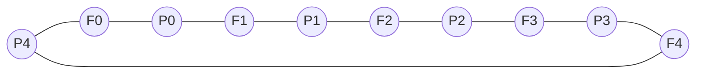
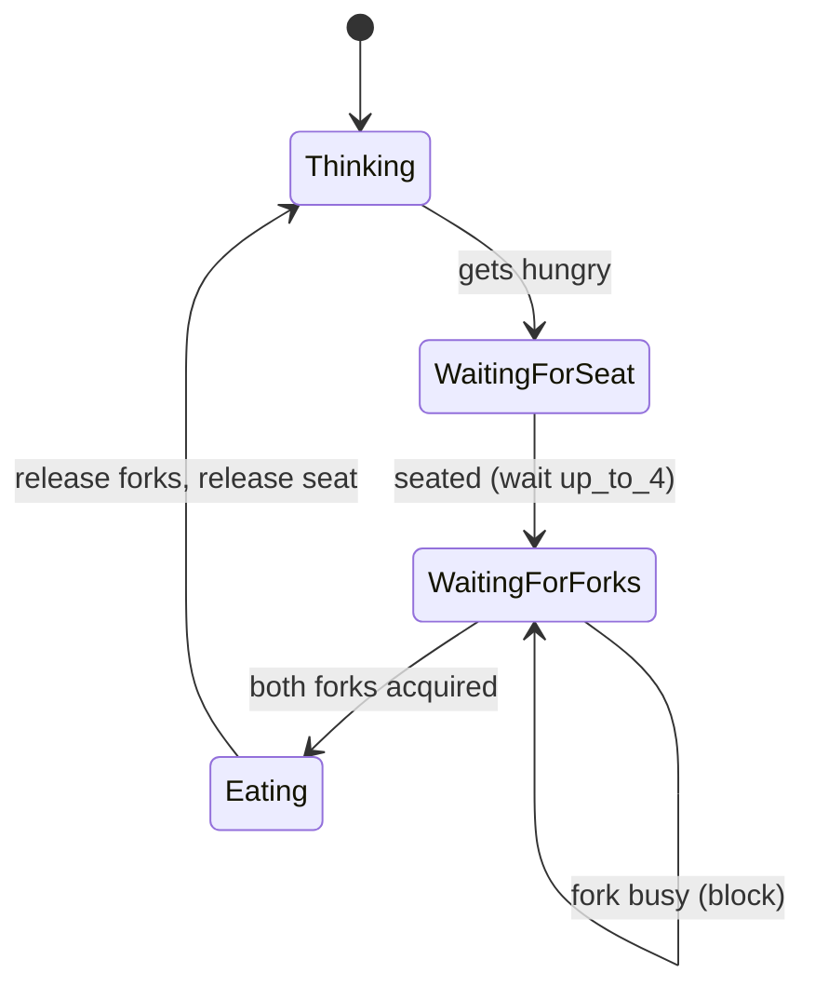
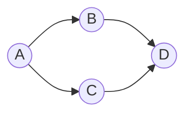

# Lecture 02 — Synchronization Patterns: Bounded Buffer, Dining Philosophers, and Fork–Join

## TL;DR

- This lecture opens with a **revision** of the correctness properties (mutual exclusion, deadlock freedom, liveness), the critical-section problem, and semaphores from Lecture 01 — then applies them to three concrete patterns.
- **Bounded producer–consumer** needs *two* semaphores: `nonfull` (init `n`, blocks the producer when the buffer is full) and `nonempty` (init `0`, blocks the consumer when the buffer is empty). The buffer becomes a **cyclic array** with `in := (in+1) mod n`.
- **Dining Philosophers** is the canonical *deadlock* example: the naive "pick up left, then right" solution deadlocks when all five grab their left fork at once. Adding one seat-limiting semaphore `up_to_4 := (4, ∅)` makes it deadlock- **and** starvation-free, while still allowing at most 2 philosophers to eat simultaneously ($\lfloor 5/2 \rfloor = 2$).
- **Semaphore ordering matters.** Reaching for the left fork first and then the right *in the same global order for everyone* is what creates the circular wait; the seat semaphore breaks the cycle.
- **Fork–join** is the general synchronization pattern behind all of this: one task **forks** into $k$ parallel subtasks, which **join** (barrier) back into a single continuation.
- This is all **shared-memory parallelism** (same machine, shared address space) — *not* distributed computing. No message complexity applies here; the metrics are concurrency level and starvation/deadlock freedom.

## Where this fits

Direct continuation of **Lecture 01**, which introduced sequential/parallel programs, the shared-vs-distributed-memory axis, the three correctness properties, semaphores, and the unbounded producer–consumer problem. This lecture re-uses all of that vocabulary, adds the **bounded** variant, and introduces the first full *mutual-exclusion-plus-ordering* case study (Dining Philosophers). It sets up the later lectures on mutual-exclusion algorithms (Peterson, test-and-set), monitors, and deadlock theory (the four necessary conditions generalise the deadlock you meet here).

Prerequisite: Lecture 01 (semaphore `wait`/`signal`, critical section, safety/liveness).

## Learning objectives

After this lecture you should be able to:

1. Write the producer–consumer solution for a **bounded** buffer from scratch, and explain the role and initial value of each of `nonempty` and `nonfull`.
2. Explain why a bounded buffer must be implemented as a **cyclic** array (`mod n`) and what goes wrong with a linear index.
3. Model the Dining Philosophers problem with fork semaphores, and *demonstrate* the deadlock scenario concretely (which fork each philosopher holds).
4. Prove that the seat-limiting (`up_to_4`) solution is deadlock-free and starvation-free, and state the maximum number of philosophers that can eat at once.
5. Decode a semaphore program and enumerate its **possible output sequences** (Question 1), and reason about which interleavings are legal.
6. Build a fork–join dependency structure from a dependency graph and encode it with semaphores (Question 2).

---

## Full Detailed Explanation

### 0. Revision from Lecture 01 (the vocabulary this lecture builds on)

**Safety properties** ("nothing bad ever happens"):
- **Mutual exclusion** — at any time, no resource is used by more than one process.
- **No deadlock** — no situation where two or more processes can never terminate because they are each waiting on the other.

**Liveness property** ("something good eventually happens"):
- During each concurrent execution, a required condition is eventually satisfied.
- Concretely: **no individual starvation** — a process is not left waiting forever because the resource is never allocated to it.

**Critical-section problem** — a group of processes compete for a resource that only one may use at a time. Resources of this kind: shared-memory variables, database records, files, physical devices (printers, …). The **critical section** is the fragment of the process that uses the resource. Requirement: at any time only one task executes its critical section.

**Semaphore** $s = (w, q)$:
- $s.w$ — a nonnegative integer (the value/counter).
- $s.q$ — a set (queue) of tasks blocked on this semaphore.

```text
type semaphore is
  record
    w: natural;
    q: queue;
  end record;
```

Two types: **general** ($w$ any nonnegative integer) and **binary** ($w \in \{0,1\}$; 1 = free, 0 = used).

**Operations** (both **atomic**):

- `wait(s)` — if `s.w > 0` then `s.w := s.w − 1`; else suspend the calling task and add it to `s.q` (it is then said to be *blocked on* `s`).
- `signal(s)` — if `s.q` is nonempty then delete and unblock one task from `s.q` and resume it; else `s.w := s.w + 1`.

> **What goes wrong without atomicity** (the "why" behind atomicity): two tasks both execute `wait(s)` on a binary semaphore `s = (1, ∅)`. If the compiler/interleaving splits `wait` into "read `s.w`" and "write `s.w−1`", both tasks can read `s.w = 1`, both decide "free", both decrement, and both enter their critical sections — mutual exclusion is violated. Atomicity means the check and the decrement happen as one indivisible step, so only one task can observe `s.w = 1`.

> **Scope reminder (the course's central axis):** everything in this lecture is **shared-memory parallelism** — one machine, one global address space, semaphores stored in shared RAM. There is no network, no message passing, no partial failure. Contrast with the **distributed** side of the course (MPI, logical clocks), where communication is explicit messages between separate, independently-failing machines. Do not confuse "the buffer is a shared array" (shared memory) with "the buffer is a mailbox passed between machines" (distributed).

---

### 1. Producer–Consumer with an **Unbounded** Buffer (revision)

**Intuition.** A producer generates data chunks; a consumer removes and processes them. A shared buffer decouples their speeds. In the unbounded version the buffer is conceptually infinite, so the producer *never* needs to wait — the only synchronization needed is to stop the consumer from reading when there is nothing to read.

**Data structures:**

```text
buffer: array(0 .. ∞) of data_type;   -- unbounded buffer
in, out: natural := 0;                -- buffer indices
nonempty: semaphore := (0, ∅);        -- general semaphore: how many chunks are in the buffer
```

**Tasks:**

```text
task body Producer is              task body Consumer is
  data: data_type;                   data: data_type;
begin                              begin
  loop                               loop
    Produce data;                      wait(nonempty);      -- block if buffer empty
    buffer(in) := data;                data := buffer(out);
    in := in + 1;                      out := out + 1;
    signal(nonempty);                  Consume data;
  end loop;                          end loop;
end Producer;                      end Consumer;
```

**Condition (event) synchronization.** `nonempty` is not a lock — it is a *counter of available data*:
- `nonempty.w > 0` → data is available; the consumer's `wait` decrements and proceeds.
- `nonempty.w = 0` → the buffer is empty; the consumer blocks on `nonempty.q` until the producer's `signal(nonempty)`.

Condition synchronization is required whenever a task may correctly perform an operation **only if** another task has already performed its operation or a specific event has occurred.

> **What goes wrong without `nonempty`:** the consumer executes `data := buffer(out)` on an empty buffer. `out` points past the last written slot, so the consumer reads *stale or uninitialised* memory and "consumes" garbage. `nonempty` forces the consumer to block until a real chunk exists.

**Problem with the unbounded buffer — memory exhaustion.** Real buffers are finite. If the producer is much faster than the consumer, an unbounded buffer grows without limit and overflows memory. Hence the bounded version below.

---

### 2. Producer–Consumer with a **Bounded** Buffer (new)

**Intuition.** Keep the buffer finite (size $n$) and as a **cyclic array**. Now there are *two* conditions to protect: the consumer must not read an empty buffer, and the producer must not write a full buffer. Two general semaphores handle the two conditions.

**Data structures:**

```text
buffer: array(0 .. n-1) of data_type;  -- bounded buffer of n elements
in, out: natural := 0;                 -- buffer indices
nonempty: semaphore := (0, ∅);         -- how many chunks are currently in the buffer
nonfull : semaphore := (n, ∅);         -- how many FREE entries are in the buffer
```

**Cyclic organisation.** When data is inserted at position $n-1$, the `in` index wraps to $0$; likewise for `out`:

$$\texttt{in} := (\texttt{in}+1) \bmod n, \qquad \texttt{out} := (\texttt{out}+1) \bmod n$$

**Tasks:**

```text
task body Producer is                 task body Consumer is
  data: data_type;                      data: data_type;
begin                                 begin
  loop                                  loop
    Produce data;                         wait(nonempty);        -- block if buffer empty
    wait(nonfull);      -- block if full  data := buffer(out);
    buffer(in) := data;                   out := (out + 1) mod n;
    in := (in + 1) mod n;                 signal(nonfull);       -- one more free slot
    signal(nonempty);   -- one more item  Consume data;
  end loop;                             end loop;
end Producer;                         end Consumer;
```

**Why this is correct (the invariant).** Maintain the invariant

$$\texttt{nonempty.w} + \texttt{nonfull.w} = n \quad\text{(at all times, at the semaphore level)}.$$

- The producer's `signal(nonempty)` transfers one slot from "free" to "full"; the consumer's `signal(nonfull)` transfers one back.
- `wait(nonfull)` in the producer only succeeds if there is a free slot, so the producer can never insert into a full buffer → the **number of items never exceeds $n$**.
- `wait(nonempty)` in the consumer only succeeds if there is an item, so the consumer can never retrieve from an empty buffer → the **number of items never drops below $0$**.

The slide annotates the two `wait`s as: `wait(nonempty)` *"protects against retrieving data from the empty buffer"*, `wait(nonfull)` *"protects against insertions into full buffer".*

```mermaid
sequenceDiagram
    participant P as Producer
    participant B as Cyclic Buffer (size n)
    participant C as Consumer
    Note over B: in=0, out=0, nonempty=0, nonfull=n
    P->>B: wait(nonfull); buffer(in):=data; in=(in+1)mod n
    P->>B: signal(nonempty)  (items: 0→1)
    C->>B: wait(nonempty)    (items: 1→0)
    B->>C: data := buffer(out); out=(out+1)mod n
    C->>B: signal(nonfull)
    Note over B: after n inserts with no consume, nonfull=0 ⇒ producer blocks on wait(nonfull)
```

*Caption: one produce/consume round-trip on the bounded buffer; the two semaphores shuffle slots between "full" and "free".*

> **Why the order of the two `wait`s is safe here but must be chosen carefully:** In this design the producer waits on `nonfull` and the consumer waits on `nonempty` — they wait on *different* semaphores, so there is no circular wait between producer and consumer, and no deadlock. (Compare Dining Philosophers below, where everyone reaching for the *same fork order* creates a cycle.)

> **What goes wrong with a linear (non-cyclic) index:** after $n$ insertions `in` would exceed the array bounds (buffer overflow / out-of-range write), and once `out` catches `in` the producer would report "full" forever even though the buffer was emptied — the indices never wrap, so the buffer can't be reused. `mod n` recycles the slots.

---

### 3. The Dining Philosophers Problem (new — the core case study)

**Intuition.** Five philosophers sit around a round table. Between each pair of neighbours lies a single fork — five forks total. To eat, a philosopher needs **both** the fork on their left and the fork on their right. A fork can be held by only one philosopher at a time. Philosophers alternate between **thinking** and **eating**. The problem: synchronize access to the forks so that each philosopher can alternate thinking/eating, without deadlock or starvation.



*Caption: five philosophers $P_0\ldots P_4$ around the table; fork $F_i$ sits between $P_{i-1}$ and $P_i$ (redrawn from slide 14). With the numbering used in the slides, philosopher $i$ has fork $i$ on the **left** and fork $(i+1)\bmod 5$ on the **right**.*

**Setup and modelling.**
- Philosophers are numbered $0$ to $4$. Philosopher $i$'s left fork is $i$, right fork is $(i+1)\bmod 5$.
- Each fork is a **binary semaphore** (a lock), initialised to free:

```text
fork: array(0 .. 4) of semaphore := (0 .. 4 => (1, ∅));
```

- At most **two** philosophers *not sitting next to each other* can eat simultaneously — because with 5 forks you can pair up at most $\lfloor 5/2 \rfloor = 2$ disjoint neighbours.
- Each philosopher is one **task** requiring two resources (forks).

#### 3.1 First attempt — the deadlock-prone solution

```text
task body Philosopher_i is           -- i = 0,1,...,4
begin
  loop
    Think;
    wait(fork(i));                 -- pick up the LEFT fork
    wait(fork((i+1) mod 5));       -- pick up the RIGHT fork
    Eat;
    signal(fork(i));               -- put down the LEFT fork
    signal(fork((i+1) mod 5));     -- put down the RIGHT fork
  end loop;
end Philosopher_i;
```

**Behaviour:** acquire left, then right; if a fork is unavailable, block on its `wait`. Once both forks are held → eat → release both. Each philosopher does this concurrently.

**The bug — circular wait / deadlock.** Consider the schedule where **all five** philosophers are hungry at once and each executes line `wait(fork(i))` successfully before any executes its second `wait`:


*Caption: deadlock — every philosopher holds their left fork and waits forever for a right fork held by their neighbour. The wait-for graph is a cycle.*

Formally: each philosopher $i$ holds fork $i$ and requests fork $(i+1)\bmod 5$. The "waits-for" relation cycles $P_0 \to P_1 \to P_2 \to P_3 \to P_4 \to P_0$. No fork is ever released, so no `signal` is ever reached — permanent blocking. This is the textbook instance of the **circular-wait** deadlock condition (one of the four necessary conditions you meet in the deadlock lecture). The slide notes this attempt can also lead to **starvation**.

#### 3.2 Deadlock-free solution — limit the table to four philosophers

**Key idea.** Break the cycle by ensuring **at least one philosopher can always get both forks**. If at most **four** philosophers are seated at any moment, then a "holds-left-wants-right" deadlock cycle cannot exist: such a cycle must run through *all five* philosophers (each link is a philosopher holding a fork their neighbour waits for, and the cycle must cover all five forks), so it needs all five seated. With only four seated, the fifth fork is never held, the cycle is broken, and at least one seated philosopher can obtain both of their forks, eat, then leave and free their forks.

Add one **general semaphore** acting as seats at the table:

```text
up_to_4: semaphore := (4, ∅);   -- limits philosophers at the table to 4

task body Philosopher_i is       -- i = 0,1,...,4
begin
  loop
    Think;
    wait(up_to_4);               -- get permission to sit (blocks if 4 already seated)
    wait(fork(i));               -- pick up the LEFT fork
    wait(fork((i+1) mod 5));     -- pick up the RIGHT fork
    Eat;
    signal(fork(i));             -- put down the LEFT fork
    signal(fork((i+1) mod 5));   -- put down the RIGHT fork
    signal(up_to_4);             -- release the seat
  end loop;
end Philosopher_i;
```

**Why it works — at most 4 seated ⇒ no circular wait.** With at most 4 philosophers seated and 5 forks, the "holds-left-wants-right" cycle over all 5 philosophers cannot form: a cycle in the wait-for graph would require *all five* to be seated mid-meal, which the seat semaphore forbids. Hence at least one seated philosopher can obtain both forks, eat, and free their forks, letting others make progress.

> **Correctness proof 1 — Mutual exclusion on forks (from slides 21).** Each fork is a binary semaphore, so at most one philosopher can hold any given fork at a time — no fork is used by more than one philosopher.

> **Correctness proof 2 — Starvation-freedom (from slides 22), proof by contradiction.**
> 1. Suppose philosopher $i$ is blocked **forever** on `wait(up_to_4)`.
> 2. Then 4 philosophers are already at the table (otherwise $i$ would have been admitted — `up_to_4.w` would be $>0$).
> 3. Among those 4, at least one can pick up **both** forks and eat (the cycle argument above); after eating, that philosopher leaves by executing `signal(up_to_4)`.
> 4. Then `up_to_4.w` becomes $>0$, so $i$ gains access — contradicting the assumption that $i$ is blocked forever.
> 5. Therefore starvation cannot occur. $\blacksquare$

> Note the two distinct guarantees: the seat semaphore kills **deadlock** (a *safety* property — nothing bad happens); the contradiction argument establishes **starvation-freedom** (a *liveness* property — everyone eventually eats). A common exam trap is to prove only one and assume the other follows — they are independent properties.

**Performance / concurrency analysis (shared-memory, so no message cost):**
- **Maximum concurrency:** 2 philosophers eating simultaneously ($\lfloor 5/2 \rfloor$). The seat semaphore limits *seated* philosophers to 4, but only 2 can hold disjoint fork pairs at once.
- **No message complexity** — this is shared memory, not a message-passing algorithm; the relevant costs are the number of `wait`/`signal` operations (5 per full think–eat cycle per philosopher) and the blocking behaviour.
- **Fairness:** correctness does not depend on the semaphore queue being FIFO, but a FIFO `q` (Lecture 01 convention) is what turns "starvation-free" from a probabilistic into a deterministic guarantee.



*Caption: philosopher lifecycle; the two `wait(fork…)` calls are where deadlock would arise without the seat semaphore.*

> **Beyond the slides (scaffolding):** the slides use Ada-style tasks + semaphores. In POSIX the same structure is a `sem_t` per fork plus one seat semaphore. A faithful C/pthreads translation — **this is my addition, not slide content** — is:

```c
#include <pthread.h>
#include <semaphore.h>

sem_t fork_[5];      // fork_[i] = fork i, initialised to 1
sem_t up_to_4;       // initialised to 4

void *philosopher(void *arg) {
    int i = *(int *)arg;
    int left  = i;                 // fork i          (left)
    int right = (i + 1) % 5;       // fork (i+1) mod 5 (right)
    for (;;) {
        think(i);
        sem_wait(&up_to_4);        // take a seat (blocks if 4 seated)
        sem_wait(&fork_[left]);    // pick up LEFT fork
        sem_wait(&fork_[right]);   // pick up RIGHT fork
        eat(i);
        sem_post(&fork_[left]);    // put down LEFT fork
        sem_post(&fork_[right]);   // put down RIGHT fork
        sem_post(&up_to_4);        // release seat
    }
}
```

Each `sem_wait` is the atomic `wait(s)`; each `sem_post` is `signal(s)`. Note the seat is released **last**, after both forks, so a philosopher never sits while still holding forks.

---

### 4. Worked Semaphore Problems

#### 4.1 Question 1 — enumerate the legal outputs

Two binary semaphores and three tasks:

```text
a: semaphore := (1, ∅);
b: semaphore := (0, ∅);

task body A is        task body B is        task body C is
  wait(a);              wait(a);              wait(b); wait(a);
  write('A');           write('B');           write('C');
  signal(a);            signal(b);            signal(a);
end A;                end B;                end C;
```

We must find every string that can be printed by some legal interleaving.

**Step 1 — what synchronizes what.**
- `a` starts at $1$: like a lock. Tasks **A** and **B** both begin with `wait(a)`, so **A and B cannot be inside simultaneously**; C's second operation `wait(a)` also competes for `a`.
- `b` starts at $0$: **C cannot pass `wait(b)` until B executes `signal(b)`.** B does `signal(b)` *after* it writes `'B'` (and after acquiring `a`). So **`'B'` must be printed before `'C'`**.

**Step 2 — case analysis on who gets `a` first.**

*Case: A runs first.*
1. A: `wait(a)` ($a\!:1\to0$), `write('A')`, `signal(a)` ($a\!:0\to1$).
2. B: `wait(a)` ($1\to0$), `write('B')`, `signal(b)` (unblocks C if waiting), `signal(a)`.
3. C: `wait(b)` succeeds, `wait(a)` succeeds, `write('C')`.
- Output: **`ABC`**.

(Cannot be `ACB`: C cannot print before B prints, since only B signals `b`.)

*Case: B runs first.*
1. B: `wait(a)` ($1\to0$), `write('B')`, `signal(b)` ($b\!:0\to1$), `signal(a)` ($a\!:0\to1$).
2. Now A and C both compete for `a`.
   - If **C** gets `a`: `write('C')`, `signal(a)`; then A prints → **`BCA`**.
   - If **A** gets `a`: `write('A')`, `signal(a)`; then C prints → **`BAC`**.

**Answer:** the possible outputs are **`ABC`, `BAC`, `BCA`** — matching the slide. Note `CAB`, `CBA`, `ACB` are all impossible (C before B is impossible; and A/B ordering that would require A inside while B holds `a` is impossible).

> This is a *pure* "decode the semaphores" exercise: no forks, no buffers — just atomic `wait`/`signal` and which ordering constraints they impose.

#### 4.2 Question 2 — build a fork–join structure from a dependency graph

Dependency graph (slide 25): $A \to B \to D$ and $A \to C \to D$, i.e. **A first; B and C in parallel; then D**.



*Caption: fork–join shape — A forks to B and C; B and C join into D.*

Semaphores (all general, init 0):

```text
S_B    : semaphore := (0, ∅);   -- "A done" signal for B
S_C    : semaphore := (0, ∅);   -- "A done" signal for C
done_B : semaphore := (0, ∅);   -- "B done" signal for D
done_C : semaphore := (0, ∅);   -- "C done" signal for D
```

```text
task body A is           task body B is          task body C is          task body D is
  Operations A;            wait(S_B);              wait(S_C);              wait(done_B);
  signal(S_B);             Operations B;           Operations C;           wait(done_C);
  signal(S_C);             signal(done_B);         signal(done_C);         Operations D;
end A;                   end B;                  end C;                  end D;
```

**Why it enforces the graph.** A's two `signal`s release B and C, which were both blocked — they now run concurrently (parallel). D blocks on `done_B` then `done_C`, so it proceeds only after **both** B and C have finished → the "join" barrier. Note D's order of `wait`s doesn't matter here (it isn't holding any other resource while waiting), unlike the philosopher case.

#### 4.3 Fork–Join Parallelism Pattern (slide 28)

**Definition.** A fundamental synchronization model:
- **Fork** — a single task splits into $k \ge 2$ parallel subtasks that execute concurrently.
- **Join** — the parallel subtasks synchronize back to a single point of execution.

Properties (from the slide's summary box):
- **Single entry point** — one task (A) starts the process.
- **Parallel execution** — the $k$ tasks (B, C) run simultaneously after the fork.
- **Synchronization point** — the continuation (D) waits for *all* parallel tasks to complete.
- **Barrier-like behaviour** — the "join" acts as a barrier all parallel tasks must reach before D proceeds.

**Connection to performance.** If the two subtasks take times $t_B$ and $t_C$, the fork–join segment takes $\max(t_B, t_C)$, not $t_B + t_C$ — the source of parallelism. If $t_B \ne t_C$, the shorter branch idles at the barrier (a **load-imbalance** cost, the same phenomenon Amdahl's law quantifies). Question 2 is exactly a fork–join where $k=2$.

> **Shared vs. distributed, once more:** fork–join here is realized with **shared-memory semaphores on one machine**. The same *pattern* reappears on the distributed side (e.g., a coordinator scattering work and gathering results with `MPI_Bcast`/`MPI_Reduce`), but there communication is explicit messages across failure domains — the pattern is the same; the mechanism is not.

---

## Key Definitions & Theorems

| Term | Precise statement | Plain-English meaning |
|---|---|---|
| **Bounded buffer** | A cyclic array of size $n$; indices advance as `(idx+1) mod n`. | A fixed-size ring buffer reused forever. |
| **`nonempty`** | General semaphore, init $0$; counts data chunks currently in the buffer. | "How many items are ready to consume." |
| **`nonfull`** | General semaphore, init $n$; counts free slots. | "How much room is left to produce into." |
| **Buffer invariant** | `nonempty.w + nonfull.w = n`. | Items + free slots always equal capacity. |
| **Dining Philosophers** | 5 philosophers, 5 forks, each needs both adjacent forks to eat. | Classic shared-resource/ordering deadlock example. |
| **Circular wait** | Each of the 5 holds its left fork and waits for its right. | The deadlock cycle of the naive solution. |
| **`up_to_4`** | Seat-limiting general semaphore, init $4$; at most 4 seated. | Removes circular wait by capping the table. |
| **Max eating concurrency** | $\lfloor 5/2 \rfloor = 2$. | Only 2 disjoint fork pairs exist. |
| **Fork** | One task splits into $k \ge 2$ concurrent subtasks. | "Fan out." |
| **Join** | Subtasks synchronize back to a single continuation. | "Fan in / barrier." |
| **Condition synchronisation** | Waiting for an event/state rather than for a lock. | "Wait until there's data." |
| **Starvation** | A process waits forever because the resource is never allocated to it. | Being permanently unlucky, not blocked by a cycle. |

---

## Connections

- Builds directly on **[[level-04/semester-01/parallel/lectures/lecture-01/notes.md]]** — the semaphore `wait`/`signal` definitions, the correctness properties, and the unbounded producer–consumer are all revisions of that lecture.
- The **circular wait** deadlock here is the concrete instance of the four necessary conditions formalised in the later **deadlock** lecture; `up_to_4` is a *prevention* technique (break the circular-wait condition).
- Dining Philosophers is the archetypal **mutual-exclusion + ordering** problem — expect Peterson's algorithm, test-and-set, and monitors (later lectures) to be motivated through it.
- The **fork–join** pattern is the shared-memory ancestor of the divide-and-conquer models in OpenMP (parallel regions + implicit barrier at `#pragma omp parallel for`).
- Fork–join's distributed analogue (scatter/gather) is the MPI collective-operations topic on the distributed side of the course.

---

## Quick Self-Check

1. Why does the bounded producer–consumer need **two** semaphores while the unbounded one needs only one?
<details>
The unbounded buffer can never be full, so the producer never has to wait — only the consumer can be blocked (empty buffer). With a finite buffer of size $n$, the producer must also be blocked when all $n$ slots are occupied, so we add `nonfull` (init $n$) to block the producer and count free slots.
</details>

2. State the invariant relating `nonempty.w`, `nonfull.w`, and $n$, and explain the two failure modes it prevents.
<details>
`nonempty.w + nonfull.w = n`. If the producer could insert without `wait(nonfull)`, the count would exceed $n$ (insert into a full buffer → overwrite unread data). If the consumer could retrieve without `wait(nonempty)`, the count would go below 0 (read from an empty buffer → garbage).
</details>

3. In the naive Dining Philosophers solution, exactly which schedule produces deadlock, and what is the resulting wait-for cycle?
<details>
All five philosophers grab their left fork first. Then each holds fork $i$ and waits for fork $(i+1)\bmod 5$, giving the cycle $P_0 \to P_1 \to P_2 \to P_3 \to P_4 \to P_0$. No fork is ever released, so no philosopher can proceed — permanent blocking.
</details>

4. Why does limiting the table to 4 philosophers eliminate deadlock? What is the maximum number that can eat simultaneously?
<details>
A circular wait requires all five philosophers to be seated mid-meal. With at most 4 seated and 5 forks, one seated philosopher always has both forks free, so the cycle cannot form. But only $\lfloor 5/2 \rfloor = 2$ can actually eat at once (disjoint fork pairs).
</details>

5. For Question 1, why is `ACB` impossible?
<details>
C executes `wait(b)` before printing, and `b` is initialised to $0$, so C can only pass after B executes `signal(b)`. B performs `signal(b)` only after printing `'B'`, so `'B'` must always precede `'C'`. Therefore any string with C before B is impossible.
</details>

6. What distinguishes the fork from the join in the fork–join pattern?
<details>
Fork = one task splits into $k$ concurrent subtasks (fan-out). Join = the subtasks synchronize back into one continuation, acting as a barrier that all subtasks must reach before the continuation runs (fan-in). In Question 2, A is the fork and D is the join.
</details>

---

## One-Page Cheat-Sheet

| Concept | Formula / Rule |
|---|---|
| **Semaphore** | $s=(w,q)$; general $w\in\mathbb N_0$, binary $w\in\{0,1\}$ |
| `wait(s)` | $w>0 \Rightarrow w:=w-1$; else block on $q$ |
| `signal(s)` | $q\ne\emptyset \Rightarrow$ unblock one task; else $w:=w+1$ |
| **Unbounded P–C** | `nonempty:=(0,∅)`; producer: insert, `signal(nonempty)`; consumer: `wait(nonempty)`, retrieve |
| **Bounded P–C** | add `nonfull:=(n,∅)`; producer: `wait(nonfull)` … `signal(nonempty)`; consumer: `wait(nonempty)` … `signal(nonfull)` |
| **Buffer invariant** | `nonempty.w + nonfull.w = n` |
| **Cyclic index** | `in:=(in+1) mod n`, `out:=(out+1) mod n` |
| **Fork semaphores** | `fork: array(0..4) of semaphore := (1,∅)`; phil $i$: left $=i$, right $=(i+1)\bmod5$ |
| **Naive DP** | left then right ⇒ circular wait ⇒ deadlock (all 5 grab left) |
| **Fixed DP** | add `up_to_4 := (4, ∅)`; ensures ≥1 phil can get both forks |
| **Max eating** | $\lfloor 5/2\rfloor = 2$ |
| **Q1 outputs** | `ABC`, `BAC`, `BCA` (B always before C) |
| **Q2 structure** | A → {B, C} → D via `S_B,S_C,done_B,done_C` |
| **Fork–join** | fork = fan-out to $k$ tasks; join = barrier (max of branch times, not sum) |

---

## Source Reference

| Subsection | Slide/page |
|---|---|
| Outline | p.2 |
| Safety & liveness properties | p.3 |
| Critical section problem | p.4 |
| Semaphores (definition, types) | p.5 |
| Semaphore operations (`wait`/`signal`) | p.6 |
| Producer–consumer, unbounded (data) | p.7 |
| Unbounded buffer tasks | p.8 |
| Condition synchronisation with `nonempty` | p.9 |
| Problem with unbounded buffer (memory exhaustion) | p.10 |
| Bounded buffer (data, cyclic index) | p.11 |
| Bounded buffer tasks | p.12 |
| Bounded buffer annotations ("protects against…") | p.13 |
| Dining Philosophers problem + figure | p.14 |
| Dining Philosophers constraints (≤2 eating) | p.15 |
| Forks as binary semaphores | p.16 |
| First attempt (code) | p.17 |
| First attempt behaviour + deadlock | p.18 |
| Deadlock-free solution (idea: 4 philosophers) | p.19 |
| Deadlock-free solution (code, `up_to_4`) | p.20 |
| Correctness 1 — mutual exclusion on forks | p.21 |
| Correctness 2 — starvation-freedom proof | p.22 |
| Question 1 | p.23 |
| Question 1 (possible sequences) | p.24 |
| Question 2 (dependency graph) | p.25 |
| Question 2 (semaphore declarations) | p.26 |
| Question 2 (tasks A–D) | p.27 |
| Fork–join parallelism pattern | p.28 |
