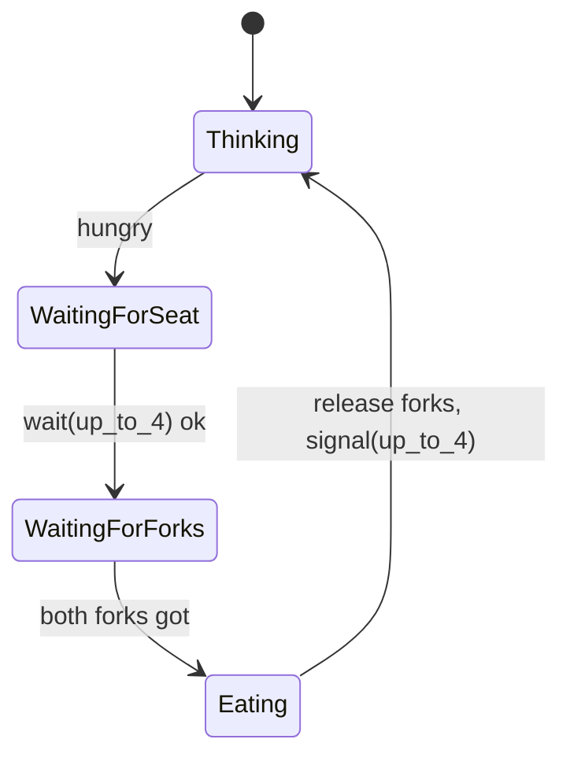

# Lecture 02 — Summary (Bounded Buffer · Dining Philosophers · Fork–Join)

> Scope: everything here is **shared-memory parallelism** (one machine, shared address space). No message complexity — metrics are concurrency level, deadlock/starvation freedom.

## Revision (Lecture 01)
- **Safety** ("nothing bad"): mutual exclusion, no deadlock.
- **Liveness** ("something good"): no starvation — a requester is eventually served.
- **Semaphore** $s=(w,q)$: general $w\in\mathbb N_0$; binary $w\in\{0,1\}$ (1 free, 0 used).
- `wait(s)`: $w>0 \Rightarrow w{:=}w-1$; else block on $q$. `signal(s)`: $q\neq\emptyset\Rightarrow$ unblock one; else $w{:=}w+1$. **Both atomic.**

## Bounded Producer–Consumer
- **Sems:** `nonempty := (0,∅)` (items in buffer), `nonfull := (n,∅)` (free slots).
- **Cyclic buffer:** `in := (in+1) mod n`, `out := (out+1) mod n`.
- **Producer:** `Produce; wait(nonfull); buffer(in):=data; in:=(in+1) mod n; signal(nonempty);`
- **Consumer:** `wait(nonempty); data:=buffer(out); out:=(out+1) mod n; signal(nonfull); Consume;`
- **Invariant:** `nonempty.w + nonfull.w = n`.
- `wait(nonempty)` guards against reading empty; `wait(nonfull)` guards against writing full.
- Unbounded = one semaphore (`nonempty` only); unbounded buffer ⇒ **memory exhaustion** if producer faster.
- **Without `nonempty`:** consumer reads garbage from empty buffer. **Without cyclic index:** out-of-range writes + buffer can never be reused.

## Dining Philosophers
- 5 philosophers, 5 forks; $P_i$ left $=F_i$, right $=F_{(i+1)\bmod5}$; needs **both** to eat.
- `fork: array(0..4) of semaphore := (0..4 => (1,∅));` (binary = lock).
- **Naive (left then right):** all 5 grab left ⇒ each waits for right ⇒ **circular wait** $P_0\to P_1\to\dots\to P_4\to P_0$ ⇒ **deadlock** (and possible starvation).
- **Fix:** add `up_to_4 := (4,∅)`; `wait(up_to_4)` on sit, `signal(up_to_4)` on leave (released **last**).
- **Deadlock-free:** ≤4 seated + 5 forks ⇒ ≥1 can get both forks ⇒ cycle can't form.
- **Starvation-free (contradiction):** if $P_i$ blocked forever on `up_to_4` ⇒ 4 seated ⇒ one of them eats & leaves ⇒ signals ⇒ $P_i$ admitted. ⊥
- **Max eating concurrency:** $\lfloor 5/2\rfloor = 2$. 5 `wait/signal` ops per cycle.
- Fork-semaphore fixes are **prevention** by breaking the circular-wait condition.

## Semaphore Problems
### Q1 — `a:=(1,∅)`, `b:=(0,∅)`; A:`wait(a);'A';signal(a)`, B:`wait(a);'B';signal(b);signal(a)`, C:`wait(b);wait(a);'C';signal(a)`
- `a` = lock shared by A,B (and C's 2nd op). `b` forces **B before C** (C blocks on `wait(b)` until B's `signal(b)`).
- **Possible outputs: `ABC`, `BAC`, `BCA`.** (`ACB`, `CAB`, `CBA` impossible.)

### Q2 — dependency A → {B, C} → D
- Sems: `S_B,S_C,done_B,done_C := (0,∅)`.
- A: `OpsA; signal(S_B); signal(S_C);` B: `wait(S_B); OpsB; signal(done_B);` C: `wait(S_C); OpsC; signal(done_C);` D: `wait(done_B); wait(done_C); OpsD;`

## Fork–Join Pattern
- **Fork:** one task splits into $k\ge2$ concurrent subtasks. **Join:** all subtasks barrier back to one continuation.
- Properties: single entry; parallel execution after fork; D waits for **all**; join = barrier.
- Segment time $=\max(t_B,t_C)$, not sum ⇒ speedup; unequal branches ⇒ load imbalance (Amdahl).

## Decision Rules
- Buffer finite? → need **both** `nonempty` and `nonfull` + cyclic index.
- Everyone reaching resources in the **same order** creating a cycle? → add a seat/permission semaphore to break circular wait.
- Dependency graph A→{B,C}→D? → fork semaphores on A, join semaphores held by D.
