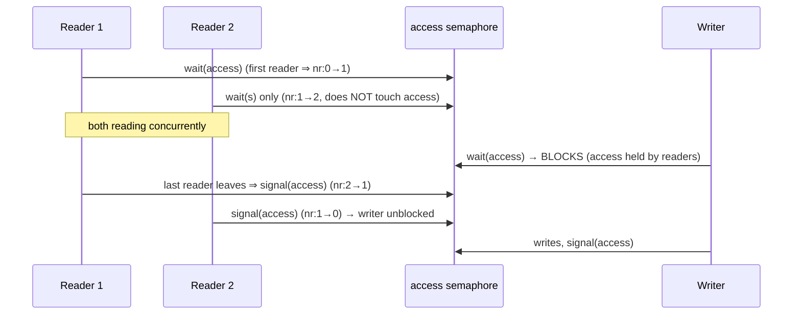
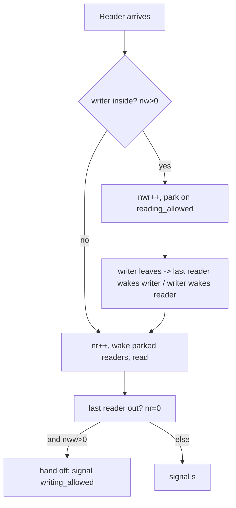
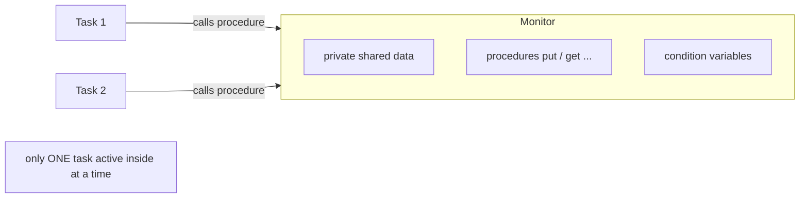

# Lecture 03 — Readers–Writers and Monitors

## TL;DR

- **Readers–Writers**: readers may share access (multiple readers at once), but a writer needs **exclusive** access. The synchronization job is entirely in the **access conditions**, not in the data operations themselves.
- The **first (reader-priority) solution** uses one semaphore `access` plus a counter `no_of_readers` protected by `s`. It is correct for mutual exclusion but **starves writers**: if readers keep arriving, `no_of_readers` never hits 0, `access` is never released, and writers wait forever.
- The **correct (starvation-free) solution** adds `reading_allowed`, `writing_allowed`, and counters `nr, nw, nwr, nww`; it **blocks new readers when a writer is waiting** and hands off the lock so both classes eventually proceed.
- A **monitor** is a high-level construct bundling *private shared data + procedures + condition variables*; **only one process may be active inside it at a time**, giving mutual exclusion automatically — no explicit `wait`/`signal` on the data.
- **Condition variables** (`wait(c)` / `signal(c)`) are *queues of blocked processes* with **no stored value**: a `signal` with no waiter is **lost** (unlike a semaphore `signal`, which increments a counter).
- The **monitor producer–consumer** is trivial for callers: `put`/`get` handle full/empty internally via `nonfull`/`nonempty` condition variables and the `counter` variable.
- Everything here is again **shared-memory parallelism** (one machine, one address space). No message complexity; the costs are blocking, fairness, and starvation.

## Where this fits

Follows **Lecture 02** (bounded buffer, Dining Philosophers, fork–join), which used raw semaphores for mutual exclusion and condition synchronization. This lecture pushes semaphore programming to a trickier problem (Readers–Writers, where the *failure mode is starvation, not deadlock*) and then introduces the **higher-level abstraction — the monitor — that hides the semaphore bookkeeping** behind condition variables. Monitors are the conceptual model behind POSIX mutexes + condition variables (later lectures) and behind every "synchronized"/"lock-guarded object" in Java/C#. Prereqs: Lecture 01 (semaphores, safety/liveness) and Lecture 02 (condition synchronization, cyclic buffer).

## Learning objectives

After this lecture you should be able to:

1. State the two Readers–Writers access conditions precisely and distinguish *reader-priority*, *writer-priority*, and *no-starvation* variants.
2. Reproduce the reader-priority solution and explain the exact mechanism by which it starves writers.
3. Read the no-starvation solution and explain the roles of `nr`, `nw`, `nwr`, `nww`, and the two extra semaphores.
4. Define a monitor, its three encapsulated parts, and its single-active-process invariant.
5. Contrast condition variables with semaphores on value, counting, and signal-with-no-waiter behaviour.
6. Write the monitor-based producer–consumer and explain why `put`/`get` need no full/empty checks at the call site.
7. Explain the "signal must be near the end of the monitor procedure" recommendation.

---

## Full Detailed Explanation

### 0. Framing: which side of the course axis is this?

> **Shared-memory, again.** Readers, writers, and monitors all live on **one machine** with a **shared address space**. Communication is by reading/writing shared variables protected by semaphores — there is no network, no messages, and no partial failure in the model. The implicit failure assumption is "no failures during a critical section"; a process that crashed while holding `access`/the monitor lock would block the database forever. (That worry — *what if the lock holder dies?* — is exactly what becomes central on the **distributed** side later, where locks and leases must survive node crashes.) Do not confuse a shared database object here with a replicated/distributed database elsewhere in the course.

This lecture reuses two ideas from Lecture 02: **mutual exclusion** (a binary semaphore around a critical section) and **condition synchronization** (a semaphore/counter waiting for a state like "data available"). Readers–Writers stresses the second, then Monitors package both behind a nicer interface.

---

### 1. The Readers–Writers Problem — statement & access conditions

**Intuition.** A shared database is read by many *readers* and updated by *writers*. Reading doesn't change the data, so several readers can read at the same time. Writing changes the data, so a writer must be the *only* one acting on the database. The whole problem is deciding, at each moment, who is allowed in.

**Setting.** Readers and writers are tasks competing for access to a shared database:
- **Readers** perform transactions that **read** data.
- **Writers** perform transactions that **update** records.

**Synchronization requirements** (from slides 3):
- To maintain **data consistency**, a writer requires **exclusive access** to the database (or the specific record) during its transaction.
- When **no writers** are accessing the database, **multiple readers** can read records simultaneously.

**Access conditions / mutual-exclusion rules** (slides 4):
- A **reader** may access the database only if **no writer** is currently using it.
- A **writer** may access the database only if **no other task (reader *or* writer)** is currently using it.

> **Key point:** the problem reduces to properly synchronizing the **access conditions** for readers and writers. Note this is a form of the **readers–writers lock**: `readLock()` may be held simultaneously by many tasks; `writeLock()` is exclusive. It is a *shared/exclusive* lock, not a plain mutex.

**Common pitfall.** Assuming "multiple readers OK" trivially extends to "multiple readers and a writer OK". It does not — writer exclusivity dominates. The two rules above are not symmetric and the asymmetry is the source of every subtlety in this lecture.

---

### 2. First solution — reader-priority (and why writers starve)

**Intuition.** Track how many readers are inside with a counter `no_of_readers`. The *first* reader to enter "locks the database for readers" (blocks writers); the *last* reader to leave "unlocks it". Writers just take the lock for themselves. The counter needs its own mutex `s` because several readers modify it concurrently.

**Shared declarations** (slides 5):

```text
s: semaphore := (1, ∅);              -- binary: protects the no_of_readers variable
access: semaphore := (1, ∅);         -- binary: synchronizes access to the database
no_of_readers: natural := 0;         -- readers currently inside the database

Readers: array(1 .. 100) of reader;
Writers: array(1 .. 100) of writer;
```

**Tasks** (slides 6):

```text
task type reader;                    task body writer is
task body reader is                  begin
begin                                  loop
  loop                                   wait(access);            -- 20: take DB
    wait(s);                             Writing data to the database;   -- 21
    no_of_readers := no_of_readers + 1;  signal(access);          -- 22: release DB
    if no_of_readers = 1 then wait(access); end if;   -- first reader blocks writers
    signal(s);
    Reading data from the database;
    wait(s);
    no_of_readers := no_of_readers - 1;
    if no_of_readers = 0 then signal(access); end if; -- last reader releases writers
    signal(s);
  end loop;
end reader;
```

**How the reader works, line by line.**
- `wait(s)` … `signal(s)` bracket every update of `no_of_readers` so two readers can't corrupt the counter (a race would let a reader see a stale count and skip the lock).
- `if no_of_readers = 1 then wait(access)`: the **first** reader grabs `access` — this is what excludes writers.
- `if no_of_readers = 0 then signal(access)`: the **last** reader releases `access` — writers may now enter.
- Middle readers (neither first nor last) touch only `s`, so they pass through without serializing on `access` → **many readers read concurrently**.

The writer is simply: `wait(access)` … write … `signal(access)`.



*Caption: reader-priority flow — writers wait while *any* reader is inside, and the lock is held for the whole time at least one reader is present.*

**Solution analysis (slides 7).**
- **Advantage:** simple — only one semaphore `access` controls writer exclusion; easy to implement.
- **Limitation:** **not entirely correct — writer starvation may occur.**
- **Cause:** if a large number of readers continuously issue requests, they dominate access.
- **Effect:** readers repeatedly update `no_of_readers` (the two counter updates), preventing writers from ever using the database.

> **Starvation scenario (the "what goes wrong"):** Suppose readers keep arriving such that at least one reader is always inside the database. `no_of_readers` is never 0, so `signal(access)` (the last-reader release) is **never executed**, so `access` stays permanently locked and every `wait(access)` by a writer blocks forever. The writer is not deadlocked in the circular-wait sense — it *could* proceed if readers paused — it is **starved**: it makes no progress while readers monopolize. This is a **liveness** failure, distinct from the **safety** failure (deadlock) seen in Dining Philosophers.

> **Why "reader-priority":** new readers are never blocked by *waiting* writers — a reader only checks whether a writer is currently *inside* (`no_of_readers = 1` path), never whether a writer is *waiting*. So arriving readers keep jumping the queue ahead of waiting writers. Fixing starvation means *giving waiting writers priority over new readers* — which is exactly what the correct solution does.

**Common pitfall.** Believing `access` alone gives mutual exclusion but forgetting the counter race. If you drop `s`, two readers can both observe `no_of_readers = 0` and both skip `wait(access)` correctly, but two readers can also *both* increment from 0 to 1 inconsistently, or the "first" test can misfire — the standard non-atomic `read-modify-write` race from Lecture 01.

---

### 3. The correct solution — no starvation (writer-priority on arrival)

**Intuition.** Add two "door" semaphores and four counters. A new reader that finds a **writer active** doesn't barge in; it becomes a *waiting reader* (`nwr`) and parks. A new writer that finds readers or a writer active becomes a *waiting writer* (`nww`) and parks. When readers finish, the **last** reader wakes a waiting writer (writers not starved). When a writer finishes, it wakes waiting readers first, then a waiting writer. The `s` semaphore protects all four counters; the `reading_allowed`/`writing_allowed` semaphores are the parking spots.

**Declarations** (slides 8):

```text
s: semaphore := (1, ∅);                -- mutual exclusion for the shared counters
reading_allowed: semaphore := (0, ∅);  -- readers park here when a writer is active
writing_allowed: semaphore := (0, ∅);  -- writers park here when someone is active
nr:  natural := 0;   -- number of readers USING the database
nw:  natural := 0;   -- number of writers USING the database
nwr: natural := 0;   -- number of WAITING readers
nww: natural := 0;   -- number of WAITING writers
```

**Reader task** (slides 9):

```text
task body reader is
begin
  loop
1.    wait(s);                          -- pre-protocol of reader
2.    if nw > 0 then                    -- a writer is inside
3.       nwr := nwr + 1;
4.       signal(s);
5.       wait(reading_allowed);         -- park until a writer frees the database
6.    end if;
7.    nr := nr + 1;
8.    if nwr > 0 then                   -- other readers are still parked
9.       nwr := nwr - 1;
10.      signal(reading_allowed);        -- wake the next parked reader
11.   else signal(s); end if;
12.   Reading data from the database;
13.   wait(s); nr := nr - 1;            -- post-protocol of reader
14.   if nr = 0 and nww > 0 then        -- last reader out, writers waiting?
15.      nww := nww - 1;
16.      signal(writing_allowed);        -- hand off to a waiting writer
      else signal(s); end if;
  end loop;
end reader;
```

**Writer task** (slides 10):

```text
task body writer is
begin
  loop
    wait(s);                            -- pre-protocol of writer
    if nr > 0 or nw > 0 then            -- readers or a writer are inside
       nww := nww + 1;
       signal(s);
       wait(writing_allowed);           -- park until the database frees
    end if;
    nw := nw + 1;
    signal(s);
    Writing data to the database;
    wait(s);
    nw := nw - 1;                       -- post-protocol of writer
    if nwr > 0 then                     -- readers waiting? wake one
       nwr := nwr - 1;
       signal(reading_allowed);
    else if nww > 0 then                -- else writers waiting? wake one
       nww := nww - 1;
       signal(writing_allowed);
    else
       signal(s); end if;
  end loop;
end writer;
```

**How it works — the baton-passing (`signal` transfers `s`).** The subtle idiom throughout: **a process that wakes another process does *not* release `s`**; instead the woken process releases `s` when it is done with the counters. `signal` here is a *hand-off* of the `s` lock, not a plain wake-up. Concretely:

- **Reader waking another reader (lines 8–10):** reader R₁ exits its `if nw>0` block holding `s`, increments `nr`, sees a parked reader, decrements `nwr`, and `signal(reading_allowed)` — but does **not** `signal(s)`. The woken reader resumes at line 7, increments `nr`, and cascades to the next parked reader, until the last one finds `nwr = 0` and does `signal(s)`. So **one** wake-up cascades into unblocking **all** parked readers, exactly as the correctness note requires.
- **Last reader → writer (lines 14–16):** the last reader, still holding `s`, decrements `nww` and `signal(writing_allowed)` without releasing `s`; the woken writer does `nw := nw + 1; signal(s)`, effectively taking over the lock. This is how "wake a writer when readers finish" is realized.
- **Writer → readers/writer:** on finishing, a writer wakes a parked reader (giving waiting readers priority over waiting writers, avoiding reader starvation in this branch), else a parked writer, else simply releases `s`.



*Caption: reader decision path in the no-starvation solution — the `nw>0` test is what blocks new readers behind waiting writers.*

**Correctness conditions the protocol must ensure** (slides 11):
1. **Reader blocking:** a new reader is **blocked if a writer is waiting** for access — implemented by `wait(reading_allowed)` (reader line 5). *(This is the writer-priority rule that removes writer starvation.)*
2. **Writer unblocking:** after readers finish using the database, a waiting writer should be unblocked if one is present — implemented by `signal(writing_allowed)` (reader line 16).
3. **Reader/writer unblocking (after a writer finishes):** all waiting readers should be unblocked (if any) → `signal(reading_allowed)`; if no readers are waiting, a waiting writer should be unblocked (if any) → `signal(writing_allowed)`.

> **Analysis.** This is a **no-starvation** solution: waiting writers are preferred over newly-arriving readers (condition 1), waiting readers are preferred over waiting writers when a writer exits (condition 3) — so neither class waits forever. It costs more shared state (`2` semaphores and `4` counters vs. `1` + `1`). As always here: **no message complexity** (shared memory); the relevant measures are **structural fairness** and the blocking/unblocking discipline. The classic three readers–writers variants are: *reader-priority* (first solution — writers starve), *writer-priority*, and *no-starvation/fair* (this solution).

**Common pitfalls.**
- Treating `reading_allowed`/`writing_allowed` as ordinary counting semaphores and calling `signal` on them twice "for two readers" — the protocol wakes **one** and relies on the **cascade**; a spurious extra `signal` corrupts the count.
- Forgetting that the waker must **not** `signal(s)` (it must hand the lock over) — adding a stray `signal(s)` breaks mutual exclusion on the counters.
- Mixing up `nr`/`nw` (currently **using**) with `nwr`/`nww` (currently **waiting**). Conditions are written on the correct pair.

**Optional POSIX sketch (my scaffolding, not slide content).** The reader-priority solution maps to a mutex + counting discipline; `nr`/`nw` guarded by a mutex, `access` as a `sem_t`:

```c
pthread_mutex_t s = PTHREAD_MUTEX_INITIALIZER;
sem_t access;               /* init 1 */
int no_of_readers = 0;

void *reader(void *) {
    for (;;) {
        pthread_mutex_lock(&s);
        if (++no_of_readers == 1) sem_wait(&access);   /* first reader blocks writers */
        pthread_mutex_unlock(&s);
        /* read the database */
        pthread_mutex_lock(&s);
        if (--no_of_readers == 0) sem_post(&access);   /* last reader frees writers */
        pthread_mutex_unlock(&s);
    }
}
void *writer(void *) {
    for (;;) { sem_wait(&access); /* write */ sem_post(&access); }
}
```

---

### 4. Monitors

**Intuition.** Writing semaphore protocols like the one above is error-prone (baton passing, counter races). A **monitor** is a language-level construct that does the mutual-exclusion bookkeeping for you: you put shared data and the procedures that touch it into one box, and the runtime guarantees only one process is ever inside the box. For *waiting for a condition* (not just exclusion) the monitor provides **condition variables**.

**Definition** (slides 12). A monitor is a high-level synchronization construct that **encapsulates**:
- **Shared data** — *private*; it cannot be accessed from outside the monitor.
- **Procedures** that operate on the data.
- **Synchronization mechanisms** — condition variables.

**Vital feature:** at any given time, **only one process can execute a procedure contained in the monitor**.

**Purpose:** enforces **mutual exclusion automatically** — no explicit semaphore operations needed to protect the shared data.



*Caption: a monitor is a box — private data, procedures, condition variables — with a single-entry guarantee.*

> **Why this is a genuine abstraction, not just sugar:** mutual exclusion is *provided by the runtime*, so a programmer cannot forget it, and cannot accidentally publish the shared data (it's private). You only handle the *application-level* conditions (full/empty).

**Common pitfall.** Thinking a monitor alone solves producer–consumer. Exclusive procedure execution stops data races, but you also need to *block* a producer when the buffer is full and a consumer when empty — that requires **condition variables** (next section). Monitor = mutual exclusion; condition variables = condition synchronization. Both needed.

---

### 5. Condition variables and their operations

**Intuition.** Inside a monitor, a process sometimes can't proceed ("buffer full"). It must *release the monitor* (so someone else can make the condition true) and *wait* until signaled. A **condition variable** is the queue it waits in.

**Operations** (slides 13, 15):
- `wait(a)` — blocks the calling process.
- `signal(a)` — unblocks a waiting process.

**How `wait(a)` works** (slides 13):
- If a monitor procedure invoked by process **P** cannot continue because a condition is not satisfied:
  - P executes `wait(a)` on the corresponding condition variable `a`.
  - P is **blocked** and **inserted into the FIFO queue** associated with `a`.
  - P is **no longer active** → it does **not impede access to the monitor** (crucial: it releases the monitor lock so others can enter).
- This allows another process **Q** to enter the monitor and perform the actions that may satisfy the condition.

**Signaling and unblocking** (slides 14):
- Process Q may satisfy the condition and execute `signal(a)`.
- `signal(a)` unblocks process P waiting in the queue associated with `a`.
- **The difficulty:** only one process can be active inside a monitor at a time. The signaling process is active → the unblocked process **cannot become active immediately** — it can only run when the signaling process **leaves** the monitor.
- **Problem:** between `signal` and leaving the monitor, the signaling process may perform further operations; one must be sure the signaled condition **is still satisfied** when it leaves.
- **Recommendation:** the `signal` operation should be the **last operation performed** in the monitor procedure.

> **What goes wrong if signal *isn't* the last operation (the "what goes wrong" example):** In `put`, suppose you wrote `signal(nonempty)` and then continued modifying `counter`/`buffer`. A waiting consumer can only wake once the producer *exits* the monitor, and by then the buffer state may have changed again — the condition the consumer assumed (space/data present) may no longer hold, so it re-reads inconsistent state. Keeping `signal` last (or, in Hoare-style monitors, having `signal` immediately transfer control) ensures the condition is intact at hand-off.

**Condition variable operations table** (slides 15):

| Operation | Meaning |
|---|---|
| `wait(c)` | Suspend the calling process and place it in the queue of condition `c`; **release the monitor lock** |
| `signal(c)` | Wake up one process waiting on condition `c` (if any); the woken process **re-enters the monitor** |

**Declarations** (slides 15):
```text
nonempty: condition;   -- signals data is available
nonfull : condition;   -- signals space is available
```

> **Condition variables have no value — they are just queues of waiting processes.** This is the single most important contrast with a semaphore.

**Common pitfall.** Using a condition variable like a semaphore counter, e.g. signalling to "remember" an event for a future waiter. A condition variable **stores nothing**; a `signal` with no waiter is lost. If you need to remember "data was produced", that state must live in a **monitor variable** (here, `counter`), and the code must *test the condition in a loop or guarded by the state* — you don't get it back from the condition variable.

---

### 6. Condition variables vs. semaphores

**Comparison table** (slides 16):

| Aspect | Condition Variables | Semaphores |
|---|---|---|
| **Value** | Not assigned a value | Have an integer component |
| **Counting** | Cannot count operations | Can count `wait`/`signal` operations |
| **Nature** | Distinct — no stored state | Integer counter + queue |
| **Wait operation** | Blocks the process and inserts it into a FIFO queue | Decrements counter; blocks if counter < 0 |
| **Signal operation** | Unblocks a waiting process (if any); **otherwise lost** | Increments counter; unblocks if processes waiting |

> **Read this table as the lecture's punchline:** a semaphore *is* a stateful counter with a queue; a condition variable is *only* a queue. That is why a monitor must pair each condition variable with an explicit state variable (e.g. `counter`, or `full`/`empty` booleans) that the procedures test — the condition variable itself cannot tell you whether the condition holds.

> **What goes wrong without this distinction:** if you port a semaphore solution directly, you may rely on `signal` "remembering" a permit. With condition variables that permit is silently lost when no one is waiting → a future waiter blocks forever (a **lost-wakeup** liveness bug). Monitors fix it by re-checking the state variable that the `signal` is about.

---

### 7. Producer–Consumer using a Monitor

**Intuition.** The buffer, its indices, its fill counter, and both condition variables are *private to the monitor*. The producer just calls `put(data)`; the consumer just calls `get(data)`. All full/empty handling is inside.

**Caller tasks** (slides 17):

```text
task body Producer is              task body Consumer is
  data: data_type;                   data: data_type;
begin                              begin
  loop                               loop
    Produce data;                      Producer_Consumer.get(data);
    Producer_Consumer.put(data);       Consume data;
  end loop;                          end loop;
end Producer;                      end Consumer;
```

**Behaviour table** (slides 18):

| Task | Action |
|---|---|
| Producer | Calls monitor procedure `put` to insert data |
| Consumer | Calls monitor procedure `get` to retrieve data |

Mutual exclusion of `put`/`get` is **guaranteed by the monitor**. **Advantage:** the producer and consumer need not handle buffer details or full/empty checks — the monitor does it.

**The monitor** (slides 19):

```text
monitor Producer_Consumer is
  buffer: array(0 .. n − 1) of data_type;
  in, out : natural := 0;            -- buffer indices
  counter : natural := 0;            -- how many chunks of data are in the buffer
  nonempty, nonfull : condition;     -- condition variables

  procedure put(d: in data) is
  begin
    if counter = n then wait(nonfull); end if;   -- buffer full ⇒ wait for space
    buffer(in) := d;                             -- insert data
    in := (in + 1) mod n;                        -- cyclic index (cf. Lecture 02)
    counter := counter + 1;
    signal(nonempty);                            -- data available
  end put;

  procedure get(d: out data) is
  begin
    if counter = 0 then wait(nonempty); end if;  -- buffer empty ⇒ wait for data
    d := buffer(out);                            -- retrieve data
    out := (out + 1) mod n;                      -- cyclic index
    counter := counter − 1;
    signal(nonfull);                             -- space available
  end get;
end Producer_Consumer;
```

**Synchronization using condition variables** (slides 20):
- Inserting and retrieving data are protected by the condition variables `nonfull` and `nonempty`.
- **Producer (buffer full):** if `put` finds the buffer full, the producer task is blocked and placed in the queue associated with `nonfull`. It is unblocked after the consumer executes `get`, which performs `signal(nonfull)`.
- **Consumer (buffer empty):** if the buffer has no data, the consumer task is blocked and placed in the queue associated with `nonempty`. It resumes when the producer signals `nonempty`.
- **Buffer state:** the degree of filling is controlled by `counter`.

```mermaid
sequenceDiagram
    participant P as Producer
    participant M as Monitor (counter, buffer)
    participant C as Consumer
    P->>M: put(data): counter==n? wait(nonfull)
    Note over M: mutual exclusion automatic
    M->>C: insert; counter++; signal(nonempty)
    C->>M: get(data): counter==0? wait(nonempty)
    M->>P: retrieve; counter--; signal(nonfull)
```

*Caption: monitor producer–consumer — the condition variables park the blocked side; `counter` is the state they check.*

> **Why this needs no `s` semaphore:** the monitor's single-active-process rule is the mutual exclusion. The condition variables are only for *blocking on full/empty*. Compare the raw-semaphore version from Lecture 02 (which needed `nonempty`, `nonfull` **and** careful ordering) — the monitor removes the ordering hazard because you can't be inside `put` while inside `get`.

> **Analysis.** Mutual exclusion is automatic; condition synchronization costs one `wait`/`signal` pair per block. The cyclic buffer and the invariant `0 ≤ counter ≤ n` mirror Lecture 02. Again: **shared memory, no message complexity.**

**Optional POSIX mapping (my scaffolding, not slide content).** Monitors correspond to **mutex + condition variables**:

```c
pthread_mutex_t m = PTHREAD_MUTEX_INITIALIZER;
pthread_cond_t nonempty = PTHREAD_COND_INITIALIZER;
pthread_cond_t nonfull  = PTHREAD_COND_INITIALIZER;
int counter = 0, in = 0, out = 0, buffer[N];

void put(int d) {                    /* monitor procedure */
    pthread_mutex_lock(&m);
    while (counter == N) pthread_cond_wait(&nonfull, &m);   /* releases m while waiting */
    buffer[in] = d; in = (in + 1) % N; counter++;
    pthread_cond_signal(&nonempty);
    pthread_mutex_unlock(&m);
}
```

Two things to notice: (1) `pthread_cond_wait(&nonfull, &m)` **atomically releases the monitor lock** while blocking — the "P is no longer active / does not impede the monitor" rule from slide 13; (2) real code uses `while (condition)` not `if (condition)` to re-check after wake-up (spurious wakeups) — the slide's `if` is the simplified teaching form.

**Common pitfalls.**
- Forgetting that `wait` releases the monitor lock — without that, a `wait`ing producer would block the consumer from ever entering to free space → **deadlock**.
- Using `if` instead of `while` around the condition test in a real implementation (spurious wakeups / changed conditions).
- Signalling the wrong condition variable (`signal(nonempty)` in `get` instead of `signal(nonfull)`), which wakes the wrong side and stalls the other.

---

## Key Definitions & Theorems

| Term | Precise statement | Plain-English meaning |
|---|---|---|
| **Access condition (reader)** | A reader may access the DB only if no writer is currently using it. | Readers are blocked by an active writer. |
| **Access condition (writer)** | A writer may access the DB only if no reader or writer is using it. | Writers are fully exclusive. |
| **Reader-priority solution** | First reader takes `access`, last reader releases it. | Simple but starves writers. |
| **Writer starvation** | Writers never get `access` because `no_of_readers` never returns to 0. | Readers keep the door locked. |
| **No-starvation solution** | Blocks new readers when a writer waits; hands off the lock on release. | Nobody waits forever. |
| **`nr` / `nw`** | Count of readers/writers currently *using* the database. | "Who's inside." |
| **`nwr` / `nww`** | Count of *waiting* readers/writers. | "Who's parked." |
| **Baton passing** | The waker does not release `s`; the woken process releases it. | Hand over the lock, don't drop it. |
| **Monitor** | Construct encapsulating private data + procedures + condition variables. | A locked box with methods. |
| **Monitor invariant** | At most one process executes a monitor procedure at a time. | Automatic mutual exclusion. |
| **Condition variable** | A FIFO queue of blocked processes; carries **no value**. | A waiting room, not a counter. |
| **`wait(c)` (monitor)** | Block caller on `c` and release the monitor lock. | "Wait here, someone else gets in." |
| **`signal(c)` (monitor)** | Wake one waiter on `c`; if none, the signal is **lost**. | "Knock on the waiting room door." |
| **Lost-wakeup** | A `signal` with no waiter has no effect; the state must be re-checked. | Signal doesn't remember events. |

---

## Connections

- Builds on **[[level-04/semester-01/parallel/lectures/lecture-02/notes.md]]** — condition synchronization, cyclic buffer (`mod n`), mutual exclusion via binary semaphores.
- Also built on **[[level-04/semester-01/parallel/lectures/lecture-01/notes.md]]** — the definition of `wait`/`signal`, safety vs. liveness.
- Readers–Writers is the third classic concurrency problem, alongside Dining Philosophers (Lecture 02) and producer–consumer; together they cover **starvation**, **deadlock**, and **condition sync** respectively.
- **Monitors + condition variables** are the direct ancestors of POSIX `pthread_mutex_t` + `pthread_cond_t` (the shared-memory API used in later lectures) and of Java's `synchronized`/`wait()`/`notify()`.
- The unlock-the-lock-holder question ("what if the holder crashes?") is the bridge to the **distributed** side's fault-tolerance material.

---

## Quick Self-Check

1. Why is the first Readers–Writers solution "not entirely correct" if it does provide mutual exclusion?
<details>
Because it can **starve writers**. Mutual exclusion (safety) holds, but liveness fails: if readers keep arriving so `no_of_readers` never returns to 0, `access` is never released and writers block forever.
</details>

2. What exactly does `signal(access)` in the reader's post-protocol represent?
<details>
It is the **last reader leaving** (`no_of_readers = 0`). It releases `access`, allowing a blocked writer (or reader) to use the database. If there is no last reader (readers keep arriving), this never executes — the root of writer starvation.
</details>

3. In the correct solution, what distinguishes `nr`/`nw` from `nwr`/`nww`?
<details>
`nr`/`nw` count readers/writers *currently using* the database; `nwr`/`nww` count readers/writers *waiting* for access (parked on `reading_allowed`/`writing_allowed`). The protocol blocks new readers when `nw > 0` and prefers parked writers when the last reader exits.
</details>

4. What two things does a monitor encapsulate, and what property does it guarantee automatically?
<details>
It encapsulates (private) shared data, procedures over that data, and synchronization mechanisms (condition variables). It automatically guarantees **mutual exclusion** — only one process executes a monitor procedure at a time.
</details>

5. What happens if you `signal` a condition variable that has no waiting process?
<details>
The `signal` is **lost** (no effect), because condition variables carry no stored value/state. This is unlike a semaphore `signal`, which increments the counter. Correct code must re-check a state variable rather than assume the signal was remembered.
</details>

6. Why must the signalling operation typically be the last statement in a monitor procedure?
<details>
Because the woken process can only become active after the signaller leaves the monitor, and between the signal and the exit the signaller may change state. Making `signal` last ensures the condition the woken process relies on is still true at hand-off.
</details>

7. In the monitor producer–consumer, what role does `counter` play that `nonempty`/`nonfull` cannot?
<details>
`counter` is the **explicit state** (how many chunks are in the buffer) that the procedures test (`counter = n`, `counter = 0`). Condition variables have no value, so they cannot tell you whether the buffer is full/empty — the state must live in a monitor variable.
</details>

---

## One-Page Cheat-Sheet

| Concept | Rule / Formula |
|---|---|
| **Reader access** | allowed iff no writer *inside* |
| **Writer access** | allowed iff no reader and no writer *inside* (fully exclusive) |
| **Reader-priority sems** | `s := (1,∅)` (counter lock), `access := (1,∅)` (DB lock), `no_of_readers := 0` |
| **Reader pattern** | `wait(s); nr++; if nr=1 wait(access); signal(s);` … `wait(s); nr--; if nr=0 signal(access); signal(s);` |
| **Writer pattern** | `wait(access); write; signal(access);` |
| **Writer starvation cause** | `nr` never returns to 0 ⇒ `signal(access)` never runs |
| **No-starvation sems** | `s:=(1,∅)`, `reading_allowed:=(0,∅)`, `writing_allowed:=(0,∅)` |
| **No-starvation counters** | `nr,nw` (using), `nwr,nww` (waiting), all init 0 |
| **Rule 1 (reader block)** | new reader blocked if a writer is waiting → `wait(reading_allowed)` |
| **Rule 2 (writer unblock)** | last reader (`nr=0`, `nww>0`) → `signal(writing_allowed)` |
| **Rule 3 (writer finishes)** | wake readers first (`signal(reading_allowed)`), else a writer |
| **Baton passing** | waker does **not** `signal(s)`; woken process releases `s` |
| **Monitor** | private data + procedures + condition variables; ≤1 process active |
| **`wait(c)`** | block on `c`, **release monitor lock** |
| **`signal(c)`** | wake one waiter on `c`; **lost if none** |
| **CV vs semaphore** | CV: no value, no counting, signal lost · Sem: counter + queue, counts, signal stored |
| **Signal placement** | make `signal` the **last** operation in the monitor procedure |
| **Monitor P–C** | `put`: `if counter=n wait(nonfull); insert; counter++; signal(nonempty)` · `get`: `if counter=0 wait(nonempty); retrieve; counter--; signal(nonfull)` |
| **POSIX mapping** | monitor ≈ `pthread_mutex_t` + `pthread_cond_t`; `cond_wait` releases the mutex |

---

## Source Reference

| Subsection | Slide/page |
|---|---|
| Outline | p.2 |
| Readers–Writers problem statement & requirements | p.3 |
| Access conditions / mutual-exclusion rules | p.4 |
| First solution — shared declarations | p.5 |
| First solution — reader & writer tasks | p.6 |
| Solution analysis (advantage, limitation, starvation) | p.7 |
| Correct solution — declarations | p.8 |
| Correct solution — reader task | p.9 |
| Correct solution — writer task | p.10 |
| Correctness conditions of the solution | p.11 |
| Monitors — definition, features, purpose | p.12 |
| Condition variables & synchronization (`wait`) | p.13 |
| Signaling and unblocking (the difficulty) | p.14 |
| Condition variables (declarations, operations, "no value") | p.15 |
| Condition variables vs. semaphores (table) | p.16 |
| Producer–consumer with a monitor (caller tasks) | p.17 |
| Producer–consumer using a monitor (behaviour table) | p.18 |
| The monitor `Producer_Consumer` (code) | p.19 |
| Synchronization using condition variables | p.20 |
